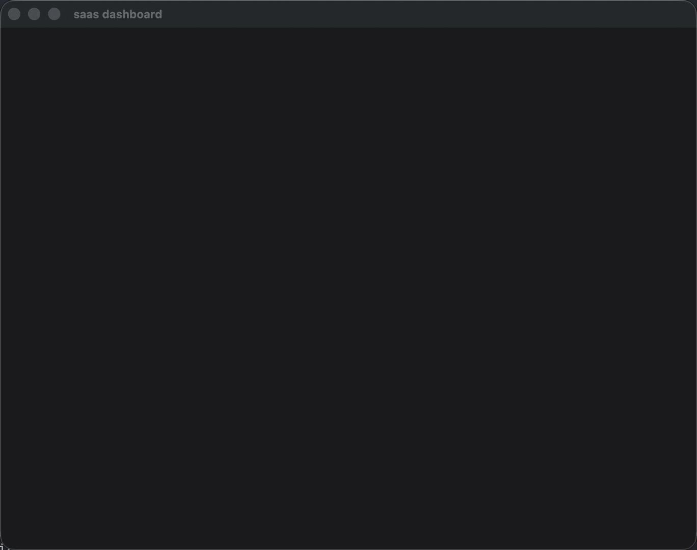
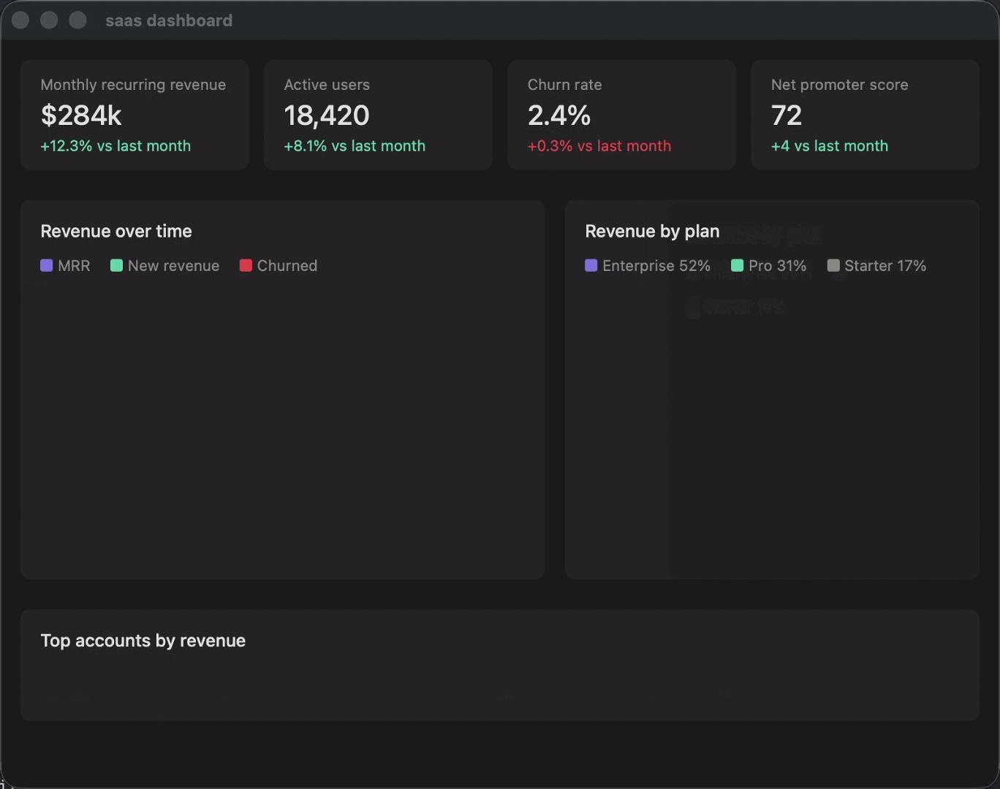
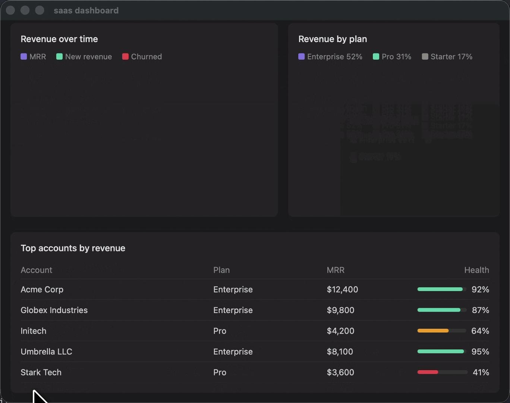

## 問題

Agent 生成互動元件時，如何讓等待過程可見，又避免每次更新都重建整個畫面？

## 做法

- X 原帖只有兩個連結；已閱讀連出的 Michael Livshits 原文，並下載原文 dashboard.gif 抽取三張影格。
- 動圖先顯示空視窗，再出現四個 KPI 卡與圖表框架，後續補入表格列；截取時點不是完整載入完成證明。
- 作者描述用模組化指引產生 HTML，再以 DOM diff 更新視窗，避免逐次整頁替換；這是作者對自建 pi 擴充的說明，對 Claude 內部的推測不可當成官方架構證據。

*原文動圖起始只有空的原生視窗。*

*KPI 卡與圖表容器先出現，部分內容仍空白。*

*後續影格補入表格資料，但不能據此認定所有圖表已完成。*

## 為什麼有效（推論）

固定卡片位置、逐步填充內容，可能讓使用者辨識已到達的資訊並減少閃動；未量測更新頻率與穩定度。

## 借鑑要點

- **適合**：Agent 生成儀表板、可視化解說與逐步到達的工具結果。
- **不適合**：需要一次原子提交、不能出現中間態的交易確認。
- **移植時注意**：明確區分載入中、部分資料和完成；未知值不能先顯示為零。保留捲動、焦點與互動狀態，並限制生成 HTML 權限。

## 來源與核對範圍

- [原帖 2060179936699384319](https://x.com/LinearUncle/status/2060179936699384319)：已核對 X 官方公開 HTML 內嵌的同 ID Tweet／NoteTweet 正文；發佈時間為 2026-05-29T02:02:27+00:00。
- 已下載並檢視原始媒體；影片僅保留關鍵影格，沒有保存原始影片。媒體出處與擷取時間見本目錄 `evidence.json`。
- 本卡只把貼文文字、附圖與錄影可確認的內容列為觀察；未執行產品驗收，效果解讀列為推論。

補充一手來源：[作者原文](https://michaellivs.com/blog/reverse-engineering-claude-generative-ui/)。文章日期為 2026-03-13，與 X 貼文日期分開記錄。
