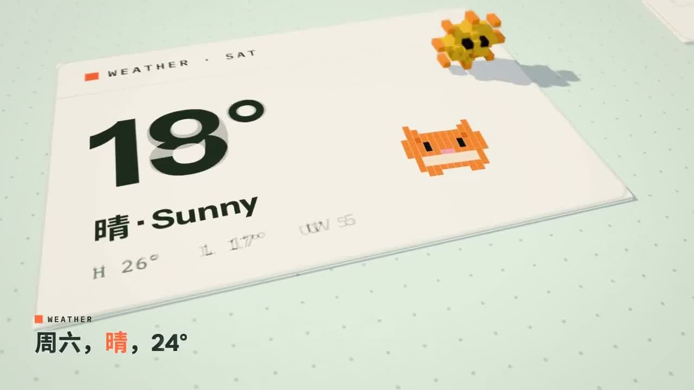
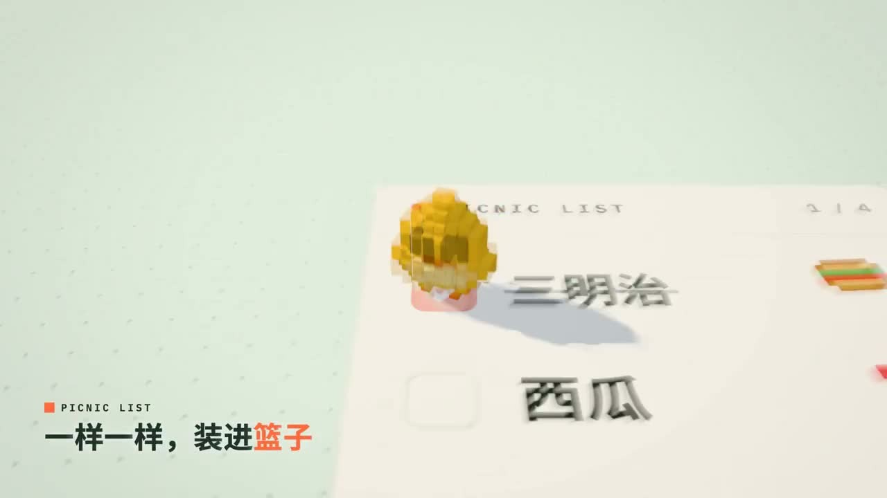
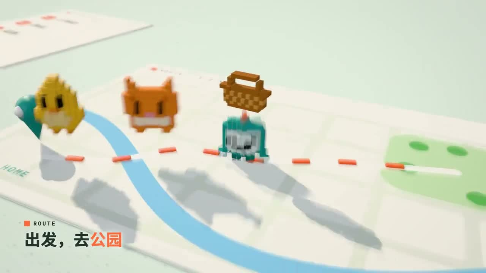
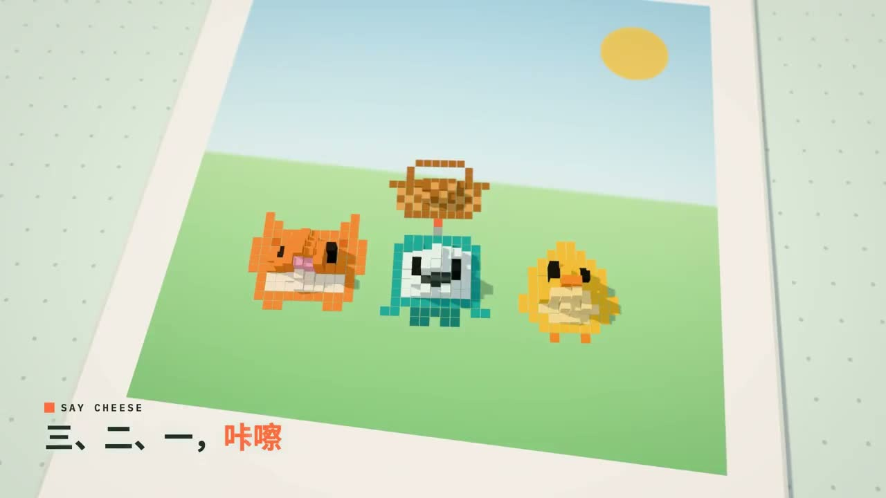
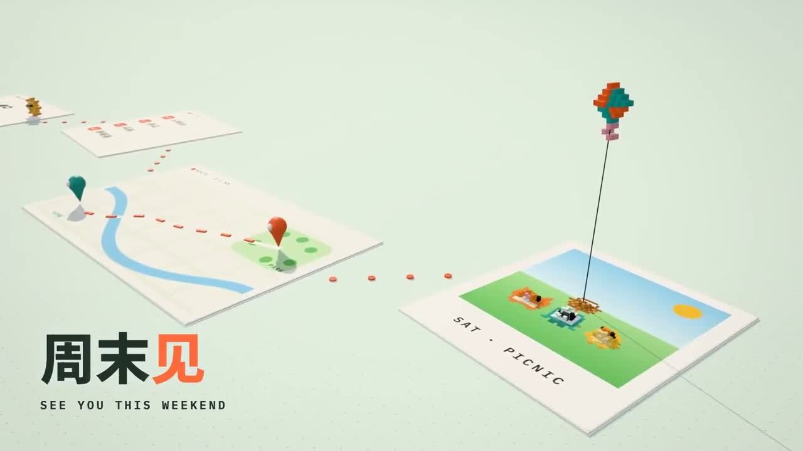

## 問題

宣傳短片要在有限時間內串起天氣、準備清單、路線與合照，避免只輪流切換互不相連的截圖。

## 做法

*角色站在天氣卡上，平面資訊與立體陰影共存。*

*鏡頭進入野餐清單，角色與清單物件同場。*

*角色沿藍色地圖路線前進。*

*合照卡接續路線場景。*

*結尾拉遠，四類卡片仍位於同一場景。*

- 起始畫面是 18°、晴天的平面天氣卡，像素角色站在介面卡面上並投下陰影。
- 鏡頭移向 PICNIC LIST，清單上的物件被帶入角色活動；接著沿地圖上的藍色路線移動到合照卡。
- 結尾拉遠，天氣、清單、地圖與合照散布於同一桌面場景。作者稱使用 Three.js、微距景深與一鏡到底；本次核實的是影片畫面，而非其技術實作。

## 為什麼有效（推論）

- 角色與鏡頭提供連續的視線導引，可能讓不同介面被理解成同一次出行的階段。

## 借鑑要點

- **適合**：產品功能宣傳與短篇敘事。
- **不適合**：正式操作頁中持續阻擋閱讀與點擊的裝飾動畫。
- **移植時注意**：先確定卡片內容和場景順序；移植到產品內時讓動效可略過，避免把宣傳鏡頭當成日常導航。

## 來源與核實範圍

- [@lemomo_ai 原帖](https://x.com/lemomo_ai/status/2114330367599714810)；發表時間：2026-10-25T12:16:56+00:00。
- 依原帖文字與本次實際檢視的素材整理；未操作產品驗證功能。`date` 為收錄日期；原帖發表日期另記於 `published_at`。
