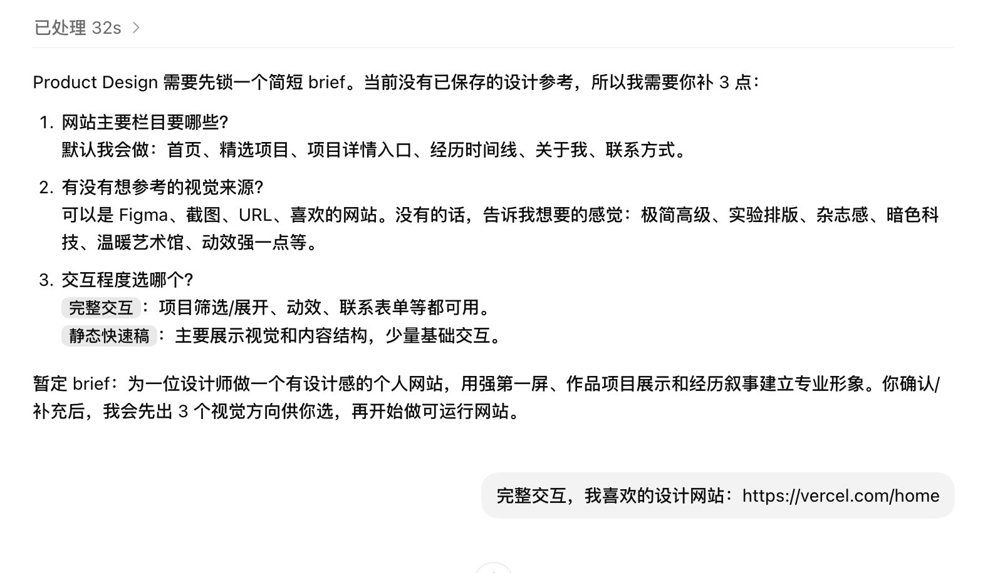
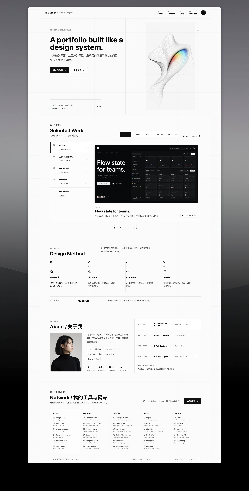

## 問題

作品集需要讓訪客先理解作者做什麼，再透過具體作品判斷能力；過多裝飾容易搶走作品本身。

## 做法

*先詢問產品目標、視覺參考和交付形式。*

*長頁以黑白層次、留白及產品截圖呈現作品。*

- 原貼文展示 Product Design 插件、需求對話與生成長頁；作者將其描述為參考 Vercel 風格的作品集案例，並歸因於 @NiallxYoung。
- 需求截圖先詢問網站目標、視覺參考與交付形式，之後才給出生成結果；第三張長頁以白底、黑色標題、細分隔及大面積留白組織作品與資訊區。
- 首屏短標題旁配置輕量圖像，往下以真實介面式截圖、清單及卡片排列專案內容。本次只查看生成展示，未核對作品真實性或可互動性。

## 為什麼有效（推論）

克制的背景和明確段落層次，可能使作品而非裝飾成為主要證據；先問用途與交付也能避免只模仿視覺表面。

## 借鑑要點

- **適合**：個人作品集、開發者履歷與產品顧問介紹頁。
- **不適合**：需要高辨識品牌識別的官網直接複製另一品牌版式。
- **移植時注意**：保留自身作品脈絡、角色與結果；圖片需能放大並有文字替代。參考間距、層次與內容節奏即可，不能連標誌和文案一起搬用。

## 來源與核對範圍

- [xin_pai88825 原文](https://x.com/xin_pai88825/status/2062018158433849708)（發布：2026-06-03T03:46:54+00:00）。

已核對 X 公開原文的嵌入式 Tweet／NoteTweet 資料及本卡所列原始素材。`kind: concept` 表示本次僅確認公開展示／設計方法，沒有把示範等同正式上線或端到端驗證。
