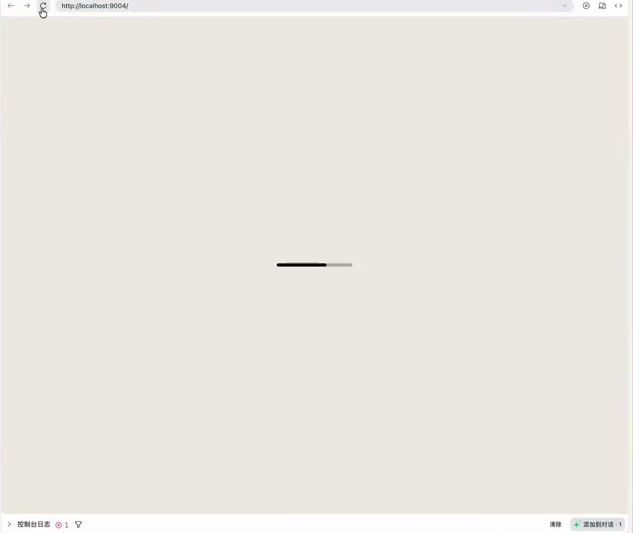
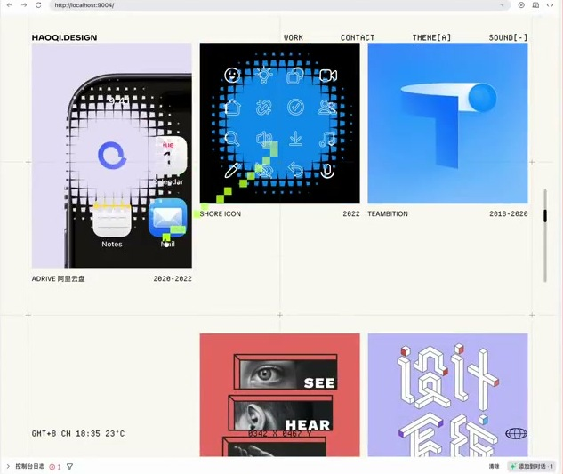
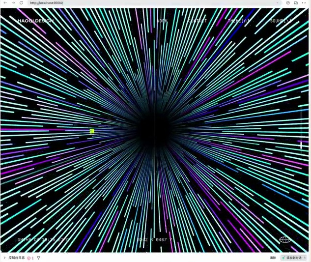

## 問題

個人作品集如何從自我介紹過渡到多個專案，而不讓首屏變成無差別卡片堆？

## 做法

- 錄影右側是瀏覽器預覽，先出現短線載入畫面，再出現大字自我介紹，接著捲動到作品縮圖網格。
- 作品區保留頂部 WORKS、CONTACT、THEMES 等導覽，縮圖下有簡短標籤；後段切到高對比放射線畫面。
- 左側是 Agent 工作記錄；作者稱是還原網站，本次沒有原站並排比較，因此不判定還原精度。保存素材只保留預覽，排除工作記錄與個人肖像。

*預覽先呈現短線載入狀態。*

*作品區用大幅縮圖與短標籤構成網格。*

*後段出現放射線視覺，與前面的安靜底色形成差異。*

## 為什麼有效（推論）

大字介紹先交代定位、縮圖網格再提供探索入口，可能讓訪客先建立框架再挑作品。放射線裝飾的價值取決於是否打斷閱讀。

## 借鑑要點

- **適合**：以少量視覺作品展示能力的個人網站。
- **不適合**：高頻查找、資料量大的工具頁面。
- **移植時注意**：明確保留作品名稱、連結與載入失敗狀態；動態裝飾要能降低或停止，不能用單段錄影證明整站完成。

## 來源與核對範圍

- [原帖 2070305673121042481](https://x.com/dingyi/status/2070305673121042481)：已核對 X 官方公開 HTML 內嵌的同 ID Tweet／NoteTweet 正文；發佈時間為 2026-06-26T00:38:31+00:00。
- 已下載並檢視原始媒體；影片僅保留關鍵影格，沒有保存原始影片。媒體出處與擷取時間見本目錄 `evidence.json`。
- 本卡只把貼文文字、附圖與錄影可確認的內容列為觀察；未執行產品驗收，效果解讀列為推論。
