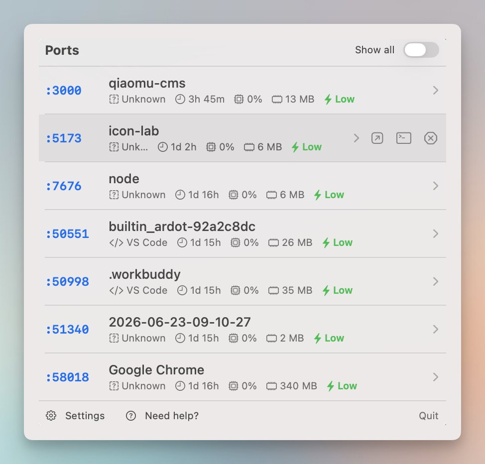

## 問題

本機同時跑多個開發服務時，只知道連接埠號還不夠判斷誰在使用、是否仍要保留。

## 做法

*每列左側以藍色端口號起頭，右側顯示程序名、來源、運行時間、CPU、記憶體與 Low 狀態；選中列露出操作圖示。*

**附圖觀察**：列表將埠號放在最固定、最醒目的欄位；程序名稱在第一行，資源資訊縮在第二行。Show all 切換位於標題右側，Settings、Need help?、Quit 放在底欄。高亮列有外開、終端與關閉形狀圖示；沒有操作影片，不能斷言每個圖示的實際效果。

## 為什麼有效（推論）

用埠號作穩定索引，再補程序身分與耗用，可能降低只看一串數字的判斷成本。來源為使用者公開截圖，不代表程序偵測準確率。

## 借鑑要點

- **適合**：開發者本機程序、背景工作與資源監控。
- **不適合**：沒有權限與確認流程卻允許直接結束關鍵服務的工具。
- **移植時注意**：程序名稱可能包含專案資料，需有隱私模式；危險圖示補標籤或提示，狀態不可只靠顏色。

## 來源與核對範圍

- [原帖 2069829482404622725](https://x.com/vista8/status/2069829482404622725)：已核對 X 官方公開頁面內嵌 Tweet／NoteTweet 快取。

- 本卡根據來源文字與已檢視媒體記錄，沒有執行產品功能驗收；作者成效宣稱不視為獨立測試。
