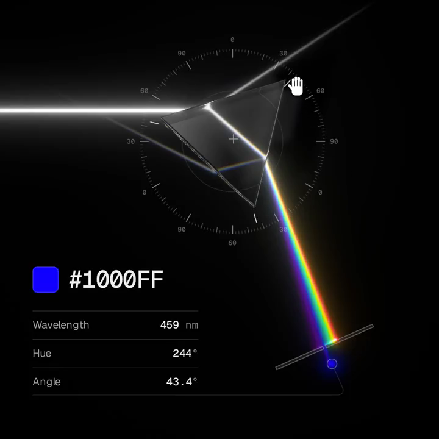
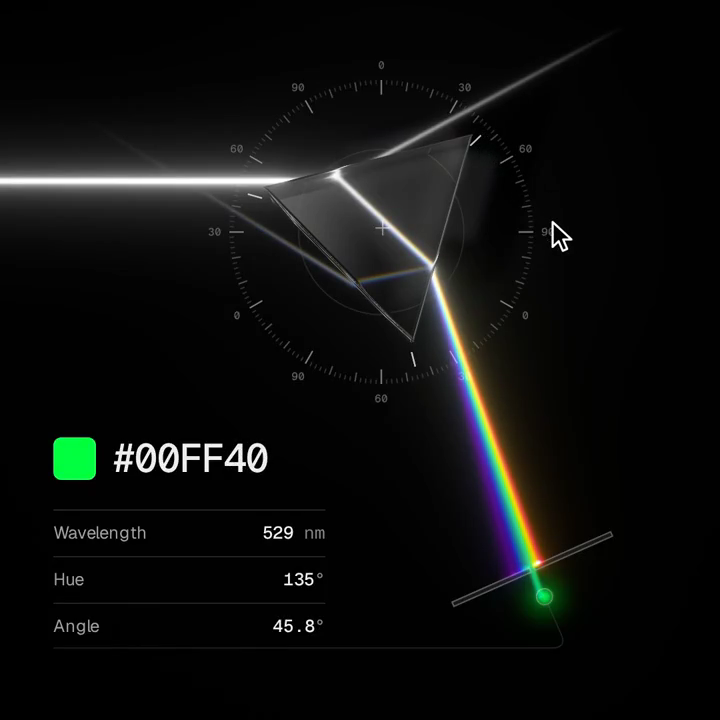
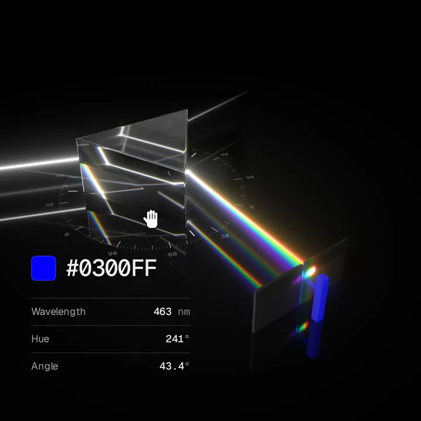
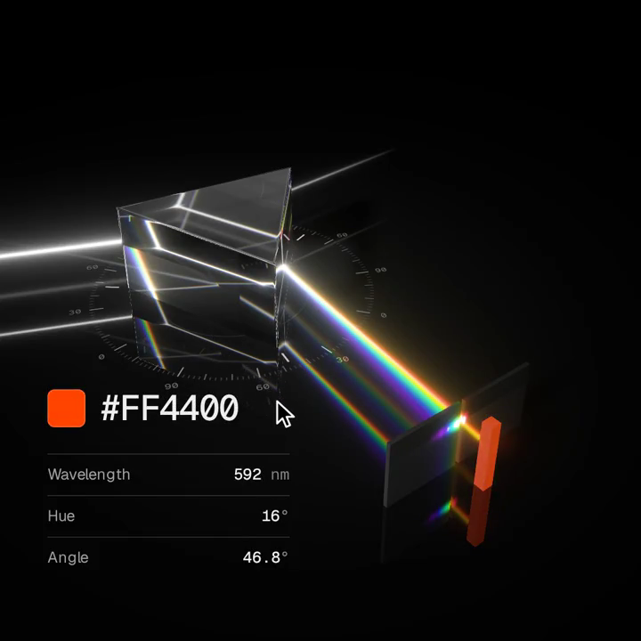
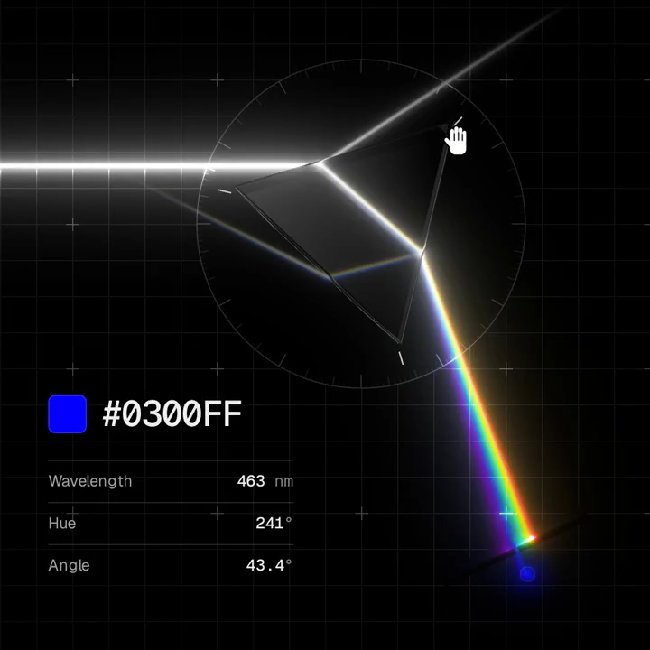
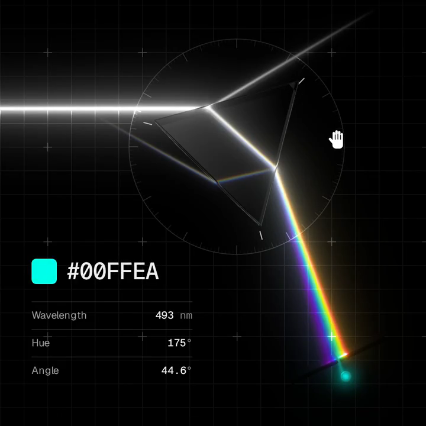

## 問題

需要比較自訂顏色選擇器時，僅看靜態外觀無法交代拖曳會改變什麼，以及如何讀回選中的顏色。

## 做法

- 作者展示三個以 UI SDK 製作的版本，請讀者比較 A、B、C；本卡依媒體順序編為 A、B、C，不把偏好票選當成可用性測試。
- 三者均以黑底呈現白光進入稜鏡、彩光輸出；左下固定排列色塊、十六進位色碼及 Wavelength／Hue／Angle 數值。
- A 以圓周刻度和單一三角形為主；B 用有厚度的多層稜鏡與接光面；C 保留單一稜鏡並加入背景網格與圓形輔助線。
- 示範流程：游標在稜鏡附近拖曳 → 形體朝向與出射光線改變 → 左下色塊、色碼及數值更新；游標離開後仍保留選定結果。影片沒有展示提交、取消或文字輸入。

*A 的圓形刻度、藍色色塊與色碼，同處一張黑色畫布。*

*A 後段呈現綠色輸出，色碼與下方數值一起更新。*

*B 將多層稜鏡畫成立體物件，右側有接光面。*

*B 後段輸出橘紅色，左下仍保留相同的讀值位置。*

*C 使用網格與圓形導引線，主要操作物件仍是單一稜鏡。*

*C 後段呈現青色輸出，形體、光線與讀值對應同一次示範狀態。*

## 為什麼有效（推論）

把視覺操作物件與固定讀值區分開，可能讓使用者同時觀察手感與精確結果；三個版本沿用相同讀值骨架，有助於比較造型差異。未提供選色效率或準確率數據，稜鏡意象也不代表色彩計算符合真實光學。

## 借鑑要點

- **適合**：創意工具的選色探索、互動教學或可視化概念比較。
- **不適合**：必須快速輸入品牌色或要求嚴格色彩管理，卻只提供拖曳光學物件。
- **移植時注意**：補上可編輯色碼、鍵盤調整、焦點與取消規則；不要只靠顏色表示目前值。先確認實際任務，再決定立體材質是否值得保留。

## 來源與核對範圍

[作者原帖](https://x.com/ctatedev/status/2124035842704654727)的官方公開頁內嵌資料包含三段約 10 秒影片。逐段檢視每 2 秒取樣，保存每段初始與後段共六張影格；未保存原始影片，未執行 UI SDK 或判定已上線產品。
