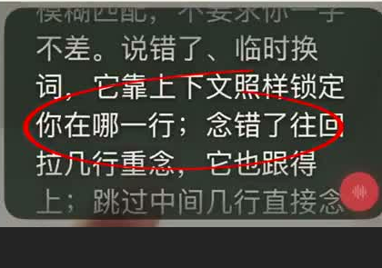

## 問題

對鏡頭說話時，講者需要看稿、知道目前讀到哪裡，並在念錯或跳句後找回位置。

## 做法

*約 305 秒：提詞文字位於畫面上方，下面有單行控制列；裁掉相機人像。*

*約 373 秒：稿件中當前段落較明亮，影片用紅色圈線強調閱讀位置。*

*約 441 秒：稿件顯示已往下推進，控制列仍留在同一位置。*

**影片觀察**：稿件置於相機畫面頂部，白色圓角控制條提供上下移動、數值調整、播放、編輯、大小與展開形狀入口；畫面不同時刻的文字位置改變。影片標註討論語句跳讀後的定位，但本次沒有聲音識別測試，不能證明追蹤準確率。截圖只取提詞區，並遮蔽底部殘餘人像、付費促銷與分享 QR code。

## 為什麼有效（推論）

將稿件與控制固定在靠近鏡頭的位置，可能減少讀稿時的視線移動；保留手動移動入口可補救自動定位不準。

## 借鑑要點

- **適合**：口播、教學與訪談中的短稿提示。
- **不適合**：只靠自動跟讀且沒有手動復位的長篇錄製。
- **移植時注意**：給出明確的暫停、當前位置與回退操作；大字模式和橫直屏需另驗，避免稿件遮住必要取景資訊。

## 來源與核對範圍

- [原帖 2093839738000281718](https://x.com/onenewbite/status/2093839738000281718)：已核對 X 官方公開頁面內嵌 Tweet／NoteTweet 快取。

- 本卡根據來源文字與已檢視媒體記錄，沒有執行產品功能驗收；作者成效宣稱不視為獨立測試。
