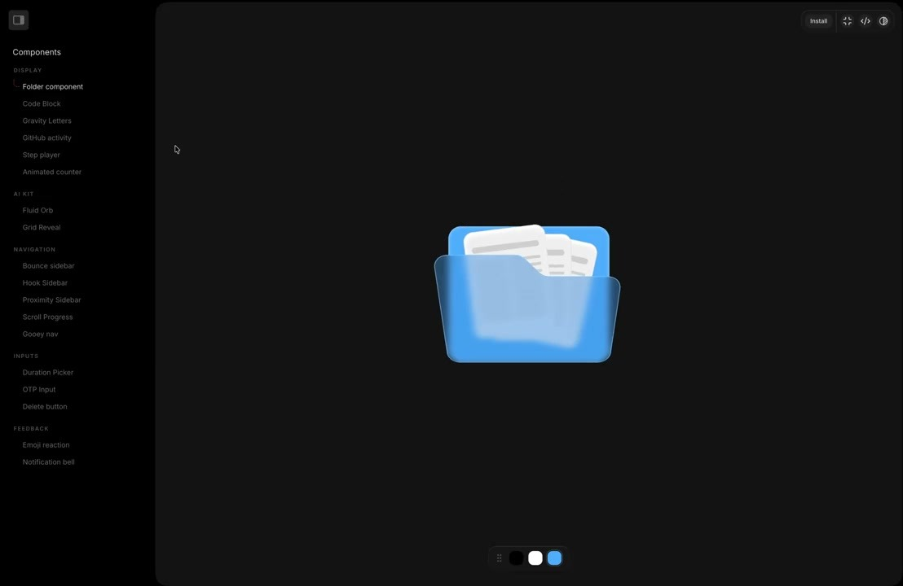
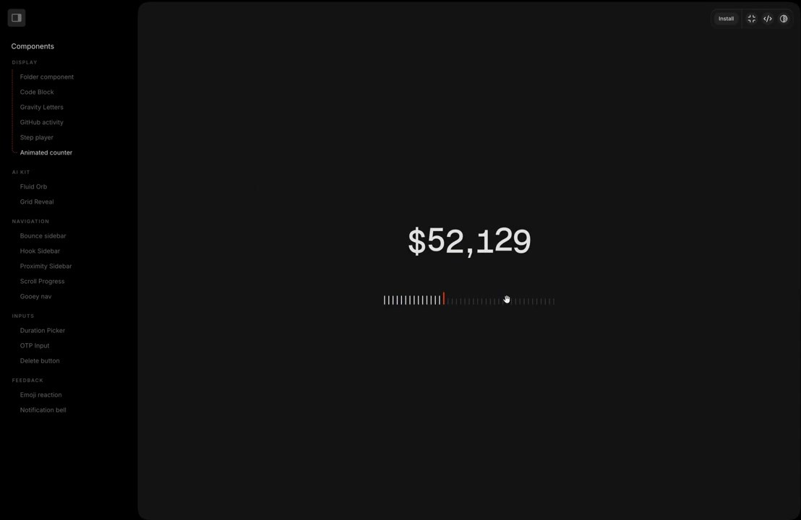
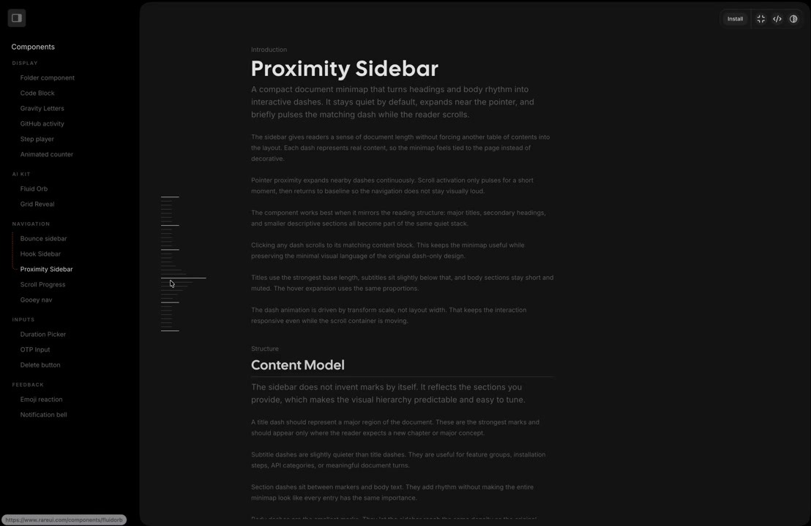
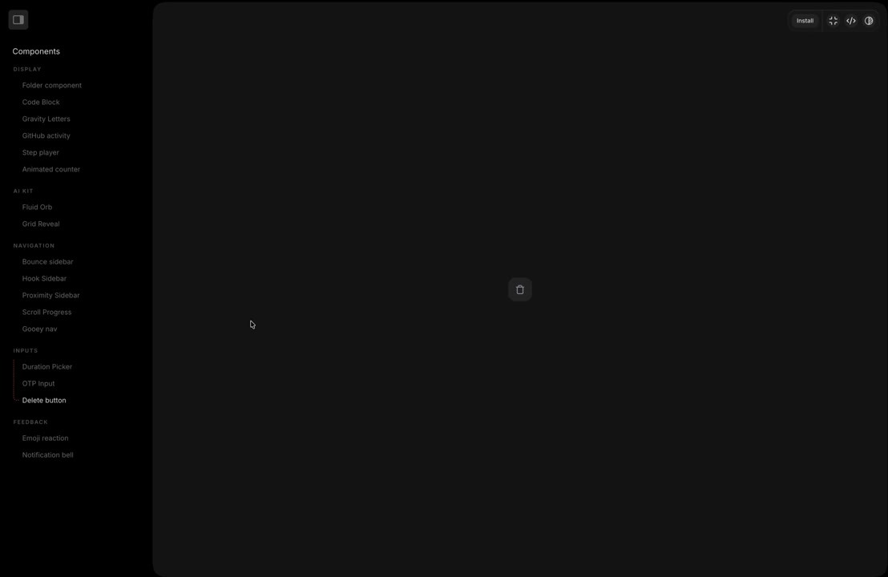

## 問題

AI 知道要做過渡動畫，卻沒有可對照的場景與節奏。

## 做法

- 原帖區分場景元件與基礎控件，列出文件夾、導覽、數字、二次操作與通知等類別。
- 當產品場景相近時，把該場景的過渡原型提供給 AI 作參考，而非只給抽象動效形容詞。
- 已檢視影片中的 Proximity Sidebar 說明：以短線表達章節與正文節奏，指針靠近時附近短線擴張，點擊短線捲到對應內容。畫面文字另說明捲動時只短暫強調對應項。這些是範例的設計說明，未實機操作驗證。

### 已檢視的素材

*場景範例顯示具有內容疊層的文件夾。*

*數字場景將數值放在畫面中央。*

*Proximity Sidebar 範例採左側導覽和右側說明。*

*Delete button 場景在獨立區域顯示垃圾桶圖標按鈕。*

## 為什麼有效（推論）

同場景參考可讓輸入、輸出與變化對應，可能比單看漂亮轉場更容易遷移。

## 借鑑要點

- **適合**：有明確狀態轉換的元件實作。
- **不適合**：只因視覺相似就照搬互動。
- **移植時注意**：補出自身的起始、等待、成功、取消狀態；採用參考前檢查鍵盤與減少動效需求。

## 來源與核實

- [原帖](https://x.com/ZaynHao/status/2096785434332500161)：已取得 X 公開頁面內嵌原始 Tweet / NoteTweet 資料，按相同 status ID 核對正文。
- 本卡的「做法」依原帖文字與已檢視素材撰寫；沒有執行產品功能驗收，效果解讀列為推論。
