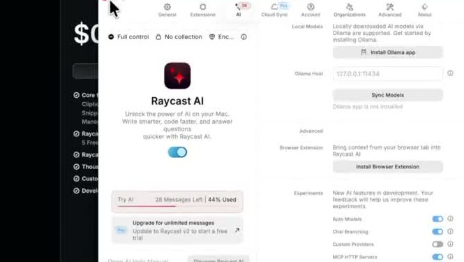

## 問題

命令入口需要快速完成一次動作，但持續 AI 對話也需要保留上下文與明確的對話入口。

## 做法

*命令欄列出搜尋結果，底部保留主動作與 Actions 的按鍵提示。*

*AI 面板作為另一個持續互動的入口；此圖僅保留介面中央區域。*

*影片後段回到 Raycast 網站的功能介紹，並非一段連續的命令操作。*

- 作者將操作語法歸納為輸入幾個字母、Enter 執行主動作、Command K 打開其他動作；這是作者觀察，未逐一驗證所有擴充。
- 影片畫面可見中央命令欄、結果列表與底部 Open Command／Actions 鍵盤提示；輸入自然語言問題時，上緣還有 Ask AI／Tab 的提示。
- 作者以「紐約現在幾點」比較命令欄與對話工具，指出選 Quick AI 或 AI Chat 的額外決策；此評價不能直接外推為所有人的體驗。

## 為什麼有效（推論）

- 主動作保持固定按鍵、其他動作放到同一入口，可能讓不同命令共用肌肉記憶；持續對話則需要額外考慮狀態保存。

## 借鑑要點

- **適合**：啟動器、搜尋命令與鍵盤密集工具。
- **不適合**：要求來回討論卻每次執行後消失且不保存內容的對話流程。
- **移植時注意**：分別定義一次性命令與持續對話的完成條件；圖像只保留命令介面，去除講者人像與桌面內容。

## 來源與核實範圍

- [@bearliu 原帖](https://x.com/bearliu/status/2111709116695760959)；發表時間：2026-10-18T06:41:01+00:00。
- 依原帖文字與本次實際檢視的素材整理；未操作產品驗證功能。`date` 為收錄日期；原帖發表日期另記於 `published_at`。
