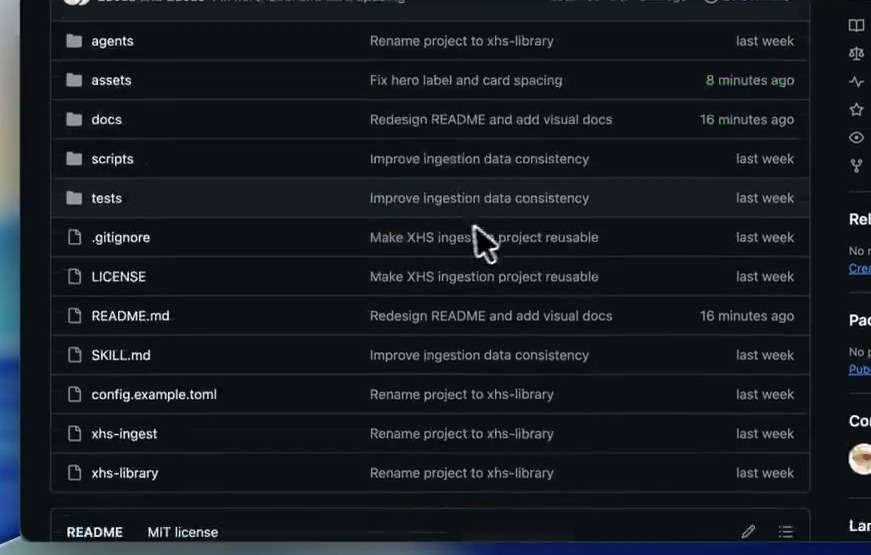
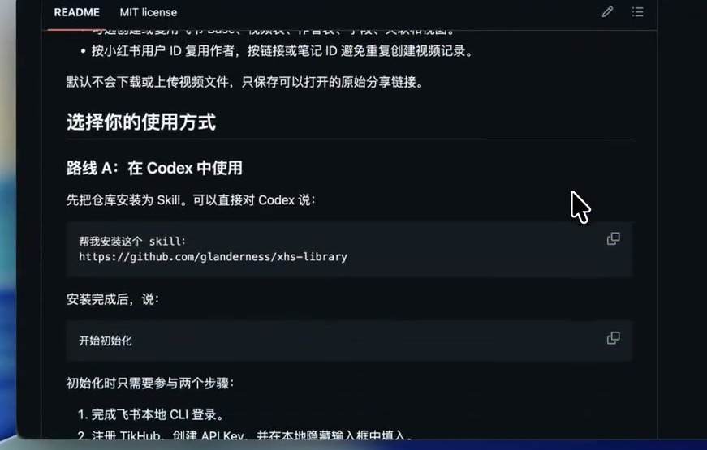
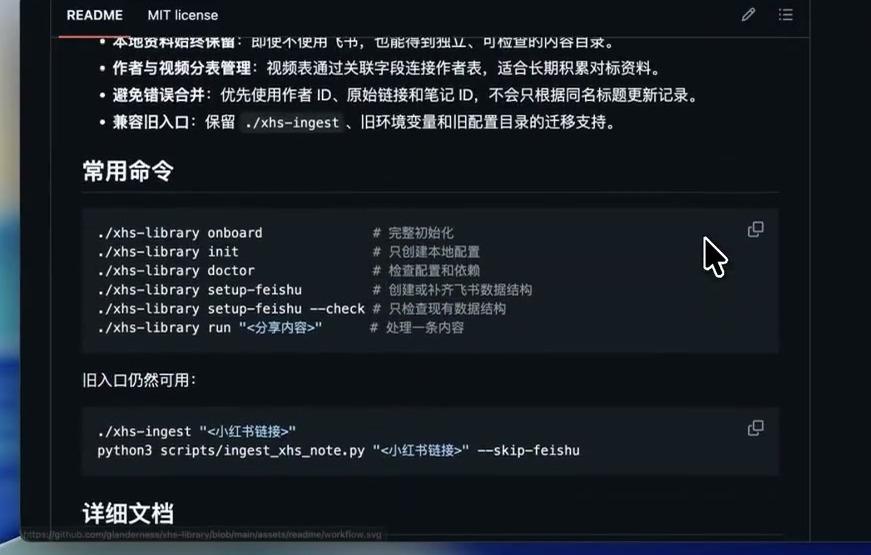

## 問題

專案首頁堆有資訊，讀者卻無法迅速判斷用途與開始方式。

## 做法

- 先檢查 README 的內容結構與視覺問題，再重排用途和使用方法的順序。
- 結構調整後，才補專案頭圖、流程圖與徽章。作者以自己的 xhs-libraray 專案說明流程，未提供可驗證的轉換率數據。

### 已檢視的素材

*示範先顯示專案檔案與 README 入口。*

*README 內以圖文區塊呈現專案功能。*

*正文分節介紹用途與開始方式。*

*使用方法以命令區塊排列於說明之下。*

## 為什麼有效（推論）

把理解用途和如何開始放在裝飾之前，可能避免讀者只看到漂亮封面卻找不到入口。

## 借鑑要點

- **適合**：開源專案首頁與工具介紹。
- **不適合**：需要法律或合規固定順序的文件。
- **移植時注意**：保留可執行的最短使用步驟；流程圖應解釋真實資料流而非填空裝飾。

## 來源與核實

- [原帖](https://x.com/beefnoode/status/2080952940815347875)：已取得 X 公開頁面內嵌原始 Tweet / NoteTweet 資料，按相同 status ID 核對正文。
- 本卡的「做法」依原帖文字與已檢視素材撰寫；沒有執行產品功能驗收，效果解讀列為推論。
