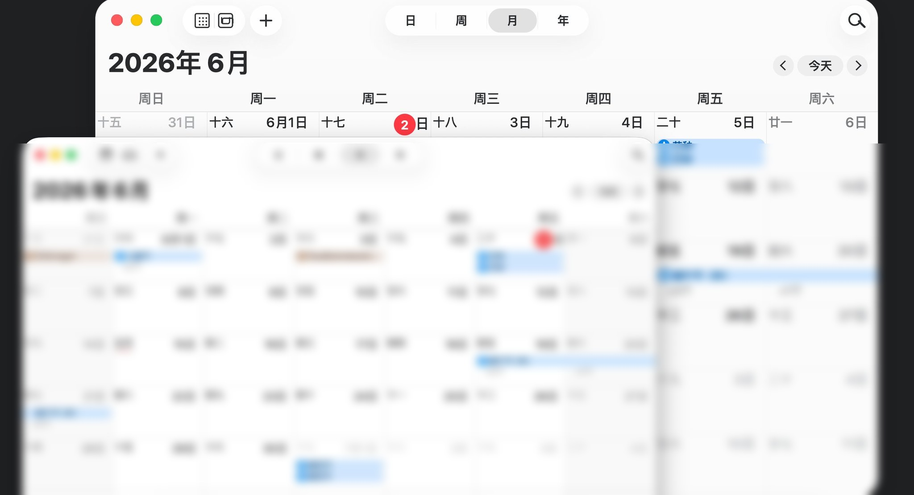

## 問題

把既有 UI 圖像轉成 HTML 時，如何避免只有外觀近似、文字與互動卻不可編輯？

## 做法

- 原帖以日曆截圖作為參考與還原示例，畫面可見月份、日／週／月／年切換、日期格與事件條。
- 作者描述先整理佈局比例、層級、字體、間距、圓角與陰影，再把導航、表單、表格等交給 HTML／CSS；複雜插畫和 Logo 保留為圖片資產。
- 作者另要求區分參考畫布與瀏覽器視窗，再用實際渲染截圖檢查比例、裁切和密度；本次只核對貼文與附圖，未執行還原專案。

*日曆參考與還原圖疊放，月份、切換入口和事件條可用來比較結構。*

## 為什麼有效（推論）

先分清可編輯結構和視覺資產，可能減少後期難以修改的整頁圖片；明確尺寸也有助於定位縮放偏差。

## 借鑑要點

- **適合**：已有截圖或 mockup 的局部還原及原型實作。
- **不適合**：沒有視覺參考、仍在探索資訊架構的設計任務。
- **移植時注意**：不要把畫面相似當作鍵盤可及性、響應式或資料功能通過；移植需另加真實內容和互動驗證。素材已移除可辨識事件文字。

## 來源與核對範圍

- [原帖 2062793099135648107](https://x.com/KyrieCheungYep/status/2062793099135648107)：已核對 X 官方公開 HTML 內嵌的同 ID Tweet／NoteTweet 正文；發佈時間為 2026-06-05T07:06:14+00:00。
- 已下載並檢視原始媒體；影片僅保留關鍵影格，沒有保存原始影片。媒體出處與擷取時間見本目錄 `evidence.json`。
- 本卡只把貼文文字、附圖與錄影可確認的內容列為觀察；未執行產品驗收，效果解讀列為推論。
