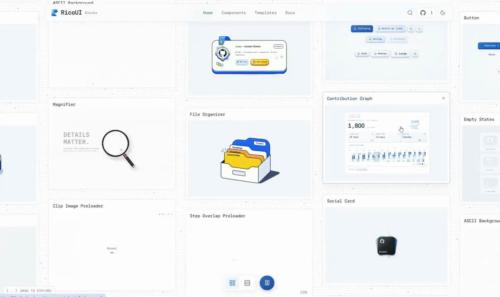
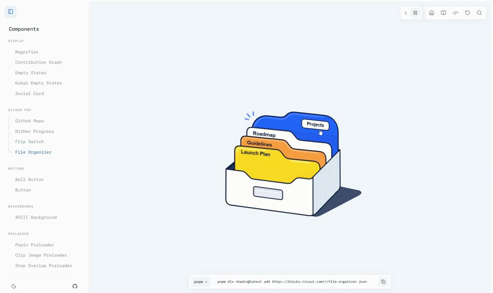
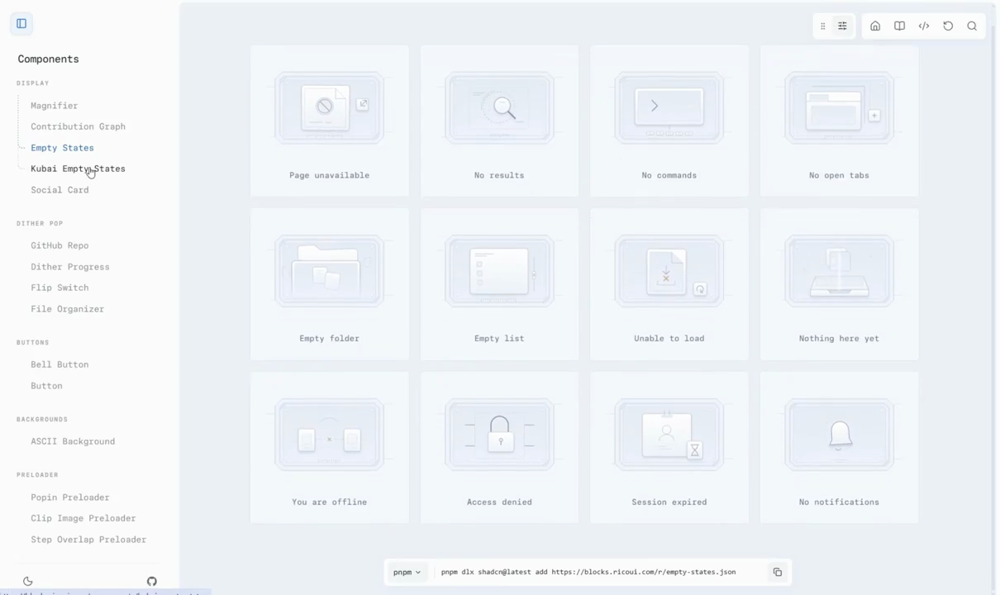

## 問題

挑選視覺元件時，使用者需要先廣泛比較，再細看某個元件，並知道怎樣把當前選擇帶回專案。

## 做法

*18.5 秒：元件以帶名稱的預覽網格呈現，Magnifier、File Organizer 與 Contribution Graph 等可並排掃描。*

*37.0 秒：左側保留分類與元件名稱，中間放大 File Organizer，底部浮列顯示套件管理器、對應安裝指令與複製圖示。*

*46.3 秒：選擇 Empty States 後，中間改為十二種具名狀態，底部指令對應 empty-states.json。*

- 左側以 Display、Dither Pop、Buttons、Backgrounds、Preloader 分組，選中項目以藍字標示；在不同示例間切換時仍保留這個導覽結構。
- 單一元件可佔據中央大面積空間；一組空狀態則以四欄三列展示，標示 Page unavailable、No results、Empty folder、Access denied 等不同語意，而非只用同一個空盒圖示。
- 錄影可見從元件總覽切入個別展示，之後在側欄切換其他元件；底部安裝列隨目前展示的元件更新。未驗證複製圖示與指令的執行結果。
- [官方 README](https://github.com/ricocc/ricoui-blocks)說明可複製原始碼或透過 shadcn Registry 帶入專案。本卡只摘要機制，未將現行 README 的所有元件與承諾回填成歷史影片事實。

## 為什麼有效（推論）

- 分類維持位置，中央依素材性質採大預覽或變體網格，可能兼顧探索與比較；安裝入口貼近選擇結果，可減少另找文件的切換。
- 空狀態具名有助於區分無資料、權限不足與載入失敗，但插圖本身仍不能替代產品中的原因說明和下一步。

## 借鑑要點

- **適合**：元件庫、圖示庫及提供可安裝素材的設計工具。
- **不適合**：只有展示影片、沒有對應可取得資產的目錄。
- **移植時注意**：安裝列必須對應當前選中元件，提供可讀名稱、版本與複製成功回饋；窄視窗避免遮住預覽。將無結果、離線、權限拒絕分別對應實際處理動作。

## 來源與核對範圍

- [RicoUI 原帖](https://x.com/ricouii/status/2121541444368466169)，發布於 2026-11-14T09:51:11+00:00。
- [Kubai 轉推](https://x.com/Kubai087/status/2121557246308196371)，發布於 2026-11-14T10:53:58+00:00；原作者為 RicoUI，並非 Kubai。
- [官方程式庫](https://github.com/ricocc/ricoui-blocks)提供實作參考。已核對官方 X SSR 原文及 48.75 秒示範，保留三張關鍵影格，未保留原始影片。以 concept 收錄示範流程，不把公開程式庫等同完整產品驗收。
