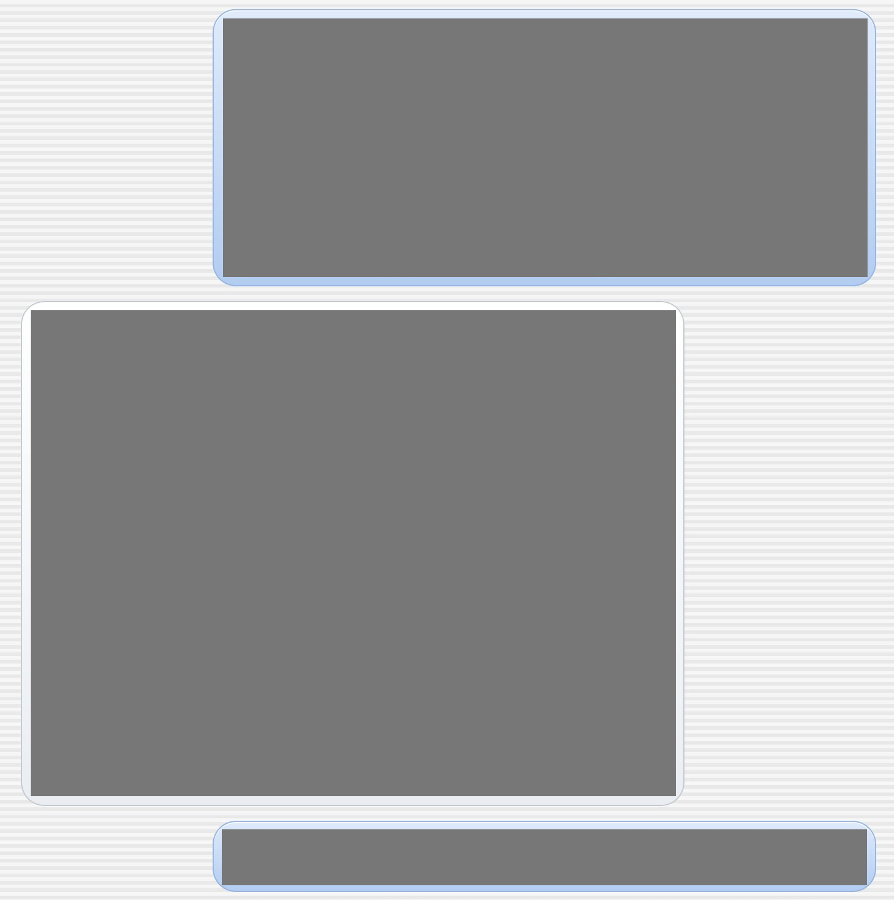
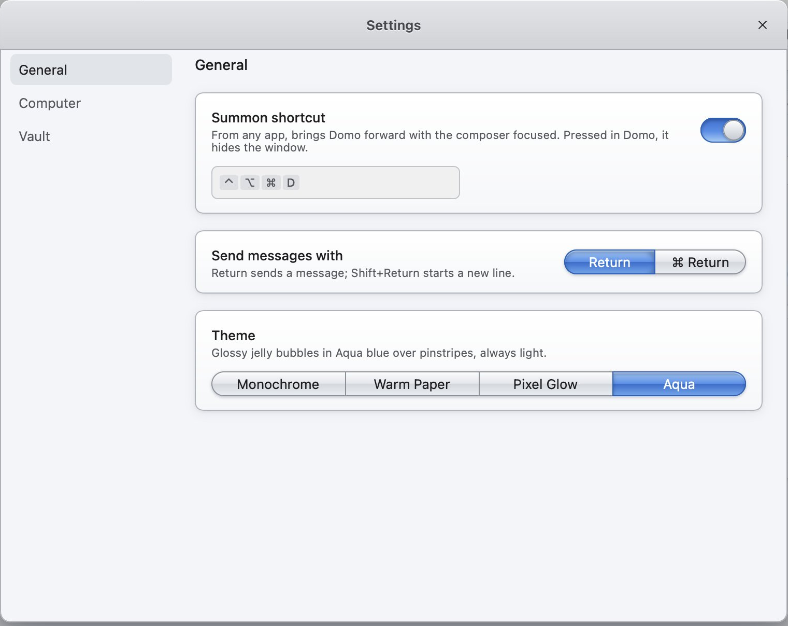

## 問題

將復古 Aqua 材質用於桌面 Agent 時，除了聊天氣泡，設定中的切換、選項與輸入區也需要一致的視覺語言；只展示單顆氣泡不足以比較完整介面。

## 做法

### 來源與案例邊界

[Kieran Zhang 原帖](https://x.com/ninthbit_ai/status/2124867730985890055)時間為 **2026-11-23T14:08:39+00:00**。原帖稱用 Claude 製作、基於 Rune（提及 @thdxr），受 Kubai 的聊天氣泡技巧啟發，並參考 [Aqua 元件庫](https://aqua.duca.dev)；這是作者的實作來源陳述，未檢查程式碼或元件庫。該帖是編輯版本，資料列出的初始 ID 為 `2124866537278546106`，本卡引用的版本為 `2124867730985890055`，不把兩者算成兩個作品。

[Kubai 引用帖](https://x.com/Kubai087/status/2124870165238354274)時間為 **2026-11-23T14:18:20+00:00**，只有讚賞文字，沒有獨立媒體。主題製作者與畫面發布者為 Kieran，不能把此衍生介面歸為 Kubai 或 Rune 官方設計。

本卡保守標為 `concept`：已看到產品介面的主題實作截圖，但沒有此主題已上線的證據。`platforms` 僅記錄畫面中的 macOS 桌面外觀，不推定其他平台支援。與 [012 訊息氣泡概念比較](../kubai-999-012-message-bubble/case.md)相關，但這裡的獨立觀察對象是具體桌面介面的聊天與設定主題，不是六種氣泡材質比較，故另建卡片而不覆寫 012。

### 實際靜態圖片觀察

*第一張原圖的聊天區裁圖：藍色右側氣泡與灰白左側氣泡使用圓角、細描邊與高光，後景為水平細條紋；灰色實心區為收錄時遮除的內容，不是原設計。*

- 原圖可見左右錯位的長段落氣泡與圖片附件；為避免收錄完整提示詞、工作內容、路徑及任務識別碼，本地裁圖已用不透明區塊遮除全部對話與附件，只保留輪廓、間距及背景。不把原圖內談及的修改工作當成已完成產品行為。
- 同張原圖另顯示底部膠囊輸入區、圓形加號與向上箭頭按鈕；此部分未另存素材，也未觀察送出結果。

*第二張原圖的 Settings 區域裁圖：左側 General／Computer／Vault 導覽，右側包含快捷鍵、送出方式與 Theme；Aqua 及 Return 以藍色高光標示選中。*

- Theme 為四段橫向選項：Monochrome、Warm Paper、Pixel Glow、Aqua；Aqua 段為藍色，其餘為銀灰。說明文字描述藍色果凍氣泡、條紋及固定淺色，這是介面文案，未驗證所有狀態。
- 「Send messages with」使用同樣銀灰／藍色分段外觀；快捷鍵開關也使用藍色槽與圓形滑塊。設定卡片為白灰底、細框及柔和陰影，標題列帶垂直漸層。
- 兩張來源均為 `photo`，沒有影片時間軸，也不是連續操作紀錄。不能據此還原主題切換的觸發、過渡或結束過程，亦不能證明開關、快捷鍵或儲存可用。

## 為什麼有效（推論）

- 同一套藍色高光同時標示氣泡角色與控制項選中狀態，可能讓復古材質超越單點裝飾，形成介面整體感；兩種語義仍須分別測試，不能只靠藍色區分。
- 水平條紋和高光提供風格辨識，但長段文字、圖片附件與高密度設定下的可讀性尚無測試證據。

## 借鑑要點

- **適合**：已有聊天與偏好設定、要探索完整桌面主題的 Agent 介面。
- **不適合**：直接當成 Rune 官方已發布主題、動效樣本或可及性驗收。
- **移植時注意**：先定義氣泡、輸入區、分段控制與開關共用的高光及描邊；再以長文、程式碼、附件、鍵盤焦點和停用狀態驗證。保留低裝飾基準，另測文字對比與縮放。
