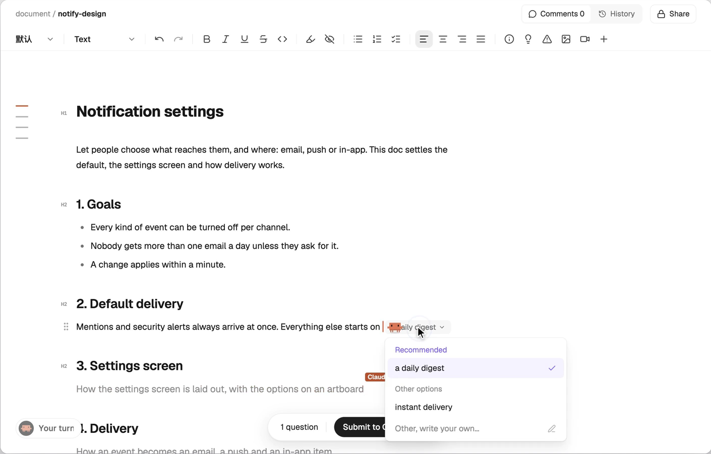
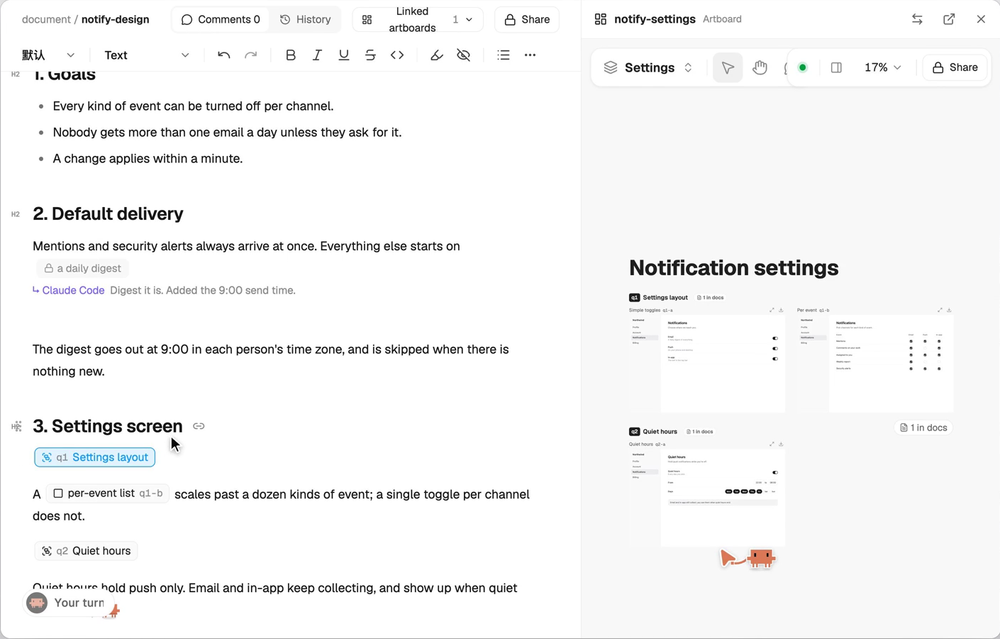
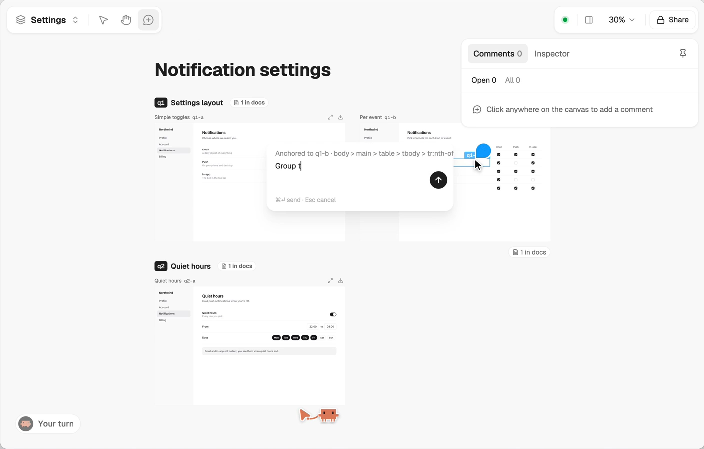
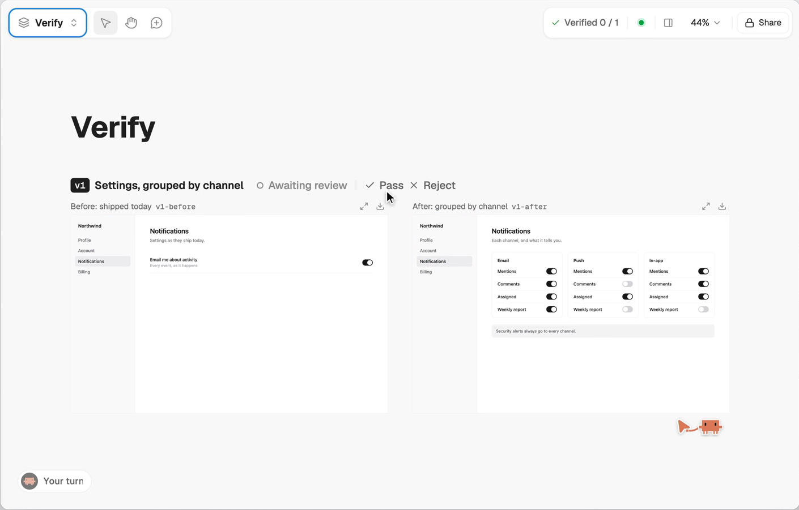
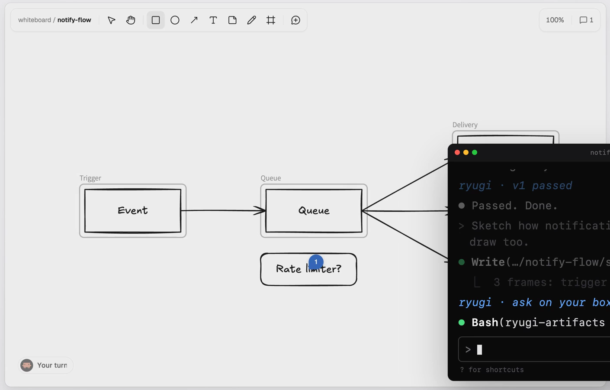

## 問題

與 Agent 討論規格時，問題、設計稿與實作證據散落在聊天和檔案中，難以指出要改哪一段，也難以確認改動是否符合已接受的設計。

## 做法

*10.75 秒：問題直接出現在設計文件的 Default delivery 段落旁。*

*25.08 秒：點擊 Settings layout 引用後，設計稿在文件右側打開。*

*32.25 秒：畫布上可見代理游標與正在處理的設計區域。*

*53.75 秒：Verify 頁並排呈現畫面，供人比較與判定。*

*75.25 秒：白板以 Event、Queue 和通道方框連線，新增 Rate limiter? 草圖。*

**影片觀察**：文件內提出問題 → 回答留在原段落 → 點引用在旁邊開設計稿；之後切換畫布，可見代理工作的游標位置；完成後進入 Verify 比較頁，由人通過或打回。另一段白板展示新增方框與提問。這些是展示中的連續片段，不代表本次重新跑過 Agent 工作流。

**官方 README 核對**：Document 支援段落評論與行內問題；Artboard 用於比較候選方向；Whiteboard 讓雙方畫結構；Verify 將構建畫面與已批准設計並置。產品公開提供 artifacts CLI，故列為 product；影片內設計任務仍屬示範。與[一般 Agent 審查建議](../kubai-agent-ui-review/case.md)不同，本卡記錄承載審查的具體介面。

## 為什麼有效（推論）

引用旁開可保留決策上下文；工作位置與前後比較讓討論有可指認的對象；通過／打回將最終判斷留給人。沒有證據可據此保證 Agent 會正確理解每次修改。

## 借鑑要點

- **適合**：人與 Agent 共同修改設計規格、比較方案與驗收。
- **不適合**：僅需單次文字回答，或把截圖相似度當成功能驗證的流程。
- **移植時注意**：把每個回答與驗收綁到明確文件版本；顯示未完成問題、拒絕理由及重驗狀態，另驗實際互動。

## 來源與核對範圍

[作者原帖](https://x.com/__oQuery/status/2118545909692723663)官方快取與附片已檢視；另讀取[官方倉庫](https://github.com/Innei/ryugi) README 核對 Document／Whiteboard／Verify。影格裁切為產品視窗，排除後方終端機；未安裝或執行 CLI。
