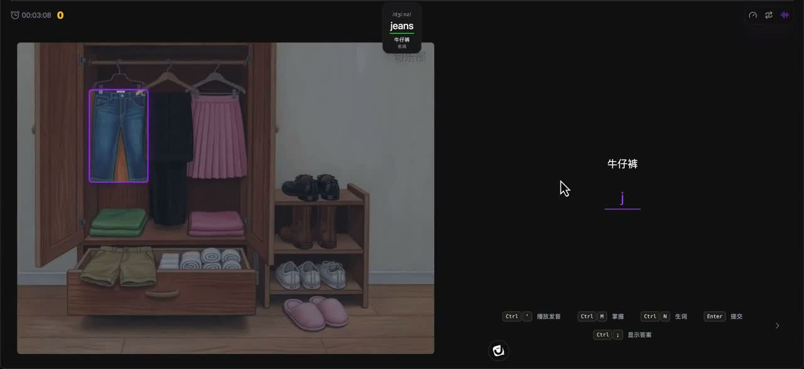
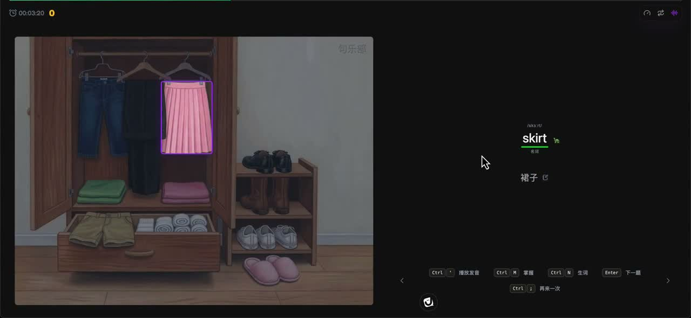
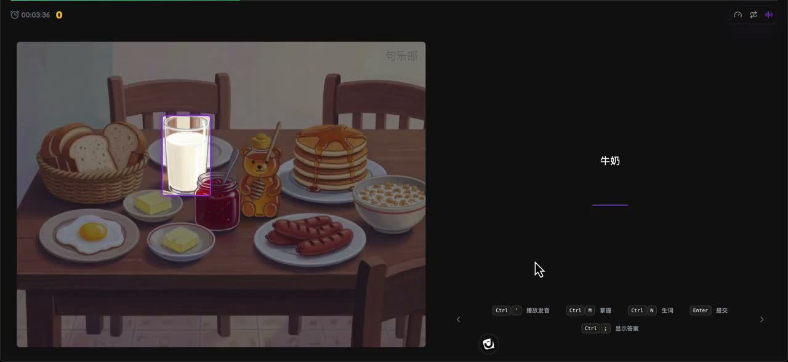
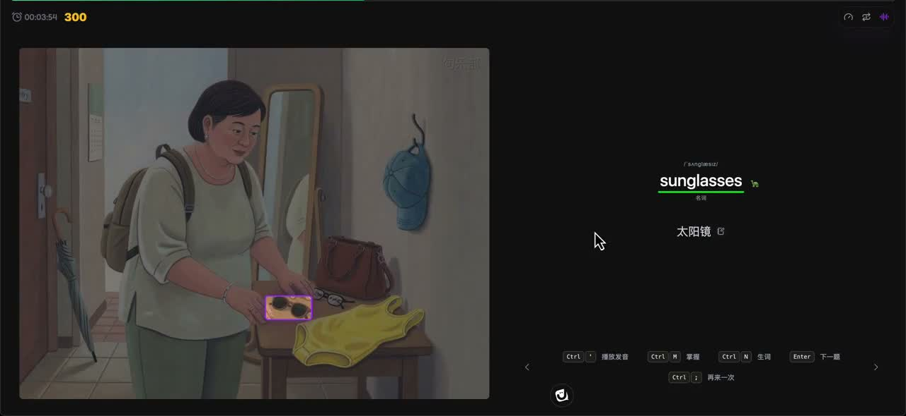

## 問題

孤立詞表缺少生活位置線索；練習時也容易直接讀答案，沒有先嘗試回想。

## 做法

*約 1.5 秒：衣櫃場景中牛仔褲以紫框標示，右側是詞彙作答區。*

*約 7.3 秒：裙子成為目標，右側顯示 skirt 與中文詞義。*

*約 16.1 秒：場景換成早餐桌，牛奶被高亮。*

*約 27.8 秒：出門場景高亮太陽眼鏡，右側顯示 sunglasses。*

**影片觀察**：左側生活插圖中逐項切換紫色目標框，右側從中文提示／輸入位置切成英文與中文詞義；頂部保留分數與細長進度。示範跨衣物、早餐、出門場景。截圖已裁掉瀏覽器網址、分頁與書籤。

**發文者說法**：孩子半個月認識近百詞是個人回饋，沒有前後測或對照；不據此斷言記憶成效，也未從貼文確認產品名稱。

## 為什麼有效（推論）

把詞和物件位置綁在一起，可能提供額外回想線索；目標框能讓同一張圖承載多題而不必重學版面。

## 借鑑要點

- **適合**：生活名詞、基礎外語與情境辨識練習。
- **不適合**：抽象概念或一張圖有多種合理命名卻只容許一個答案。
- **移植時注意**：容許同義詞、語音或鍵盤輸入；高亮不可只依顏色，錯誤後保留物件與解釋。

## 來源與核對範圍

- [原帖 2100907100876771434](https://x.com/cuixr1314/status/2100907100876771434)：已核對 X 官方公開頁面內嵌 Tweet／NoteTweet 快取。

- 本卡根據來源文字與已檢視媒體記錄，沒有執行產品功能驗收；作者成效宣稱不視為獨立測試。
