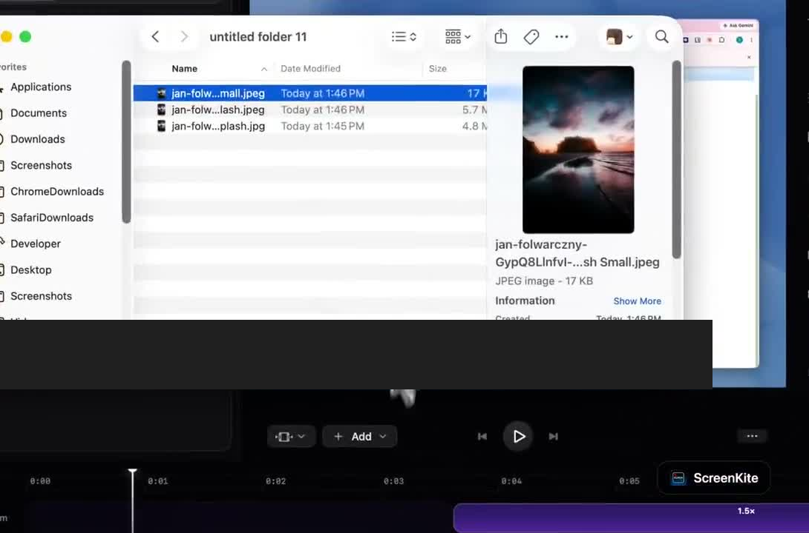
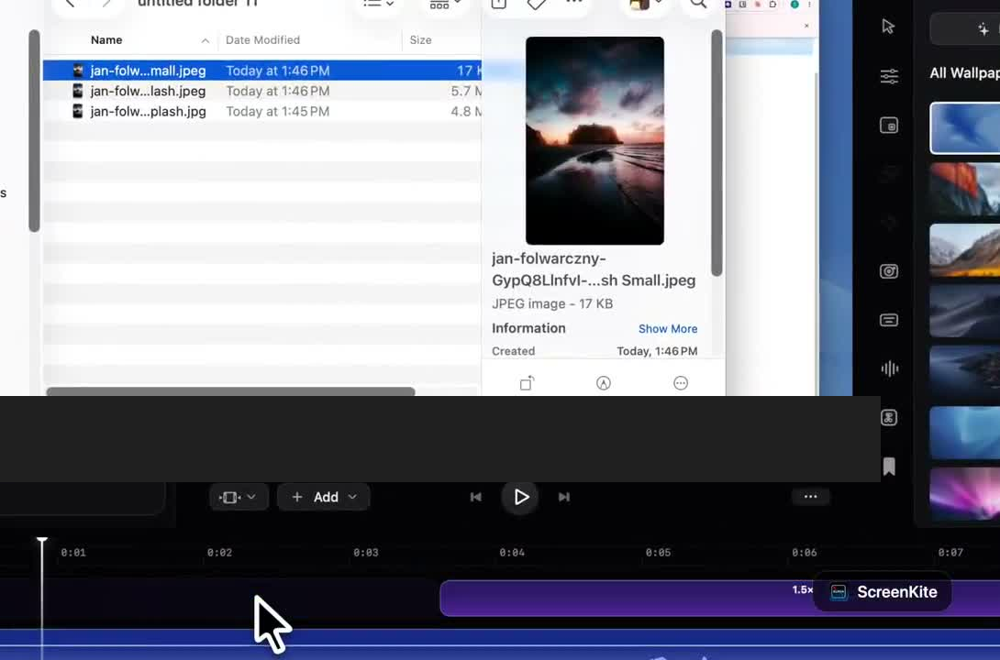
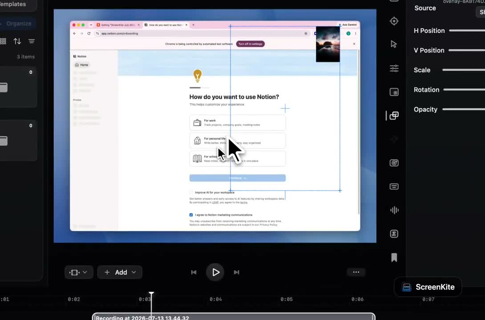
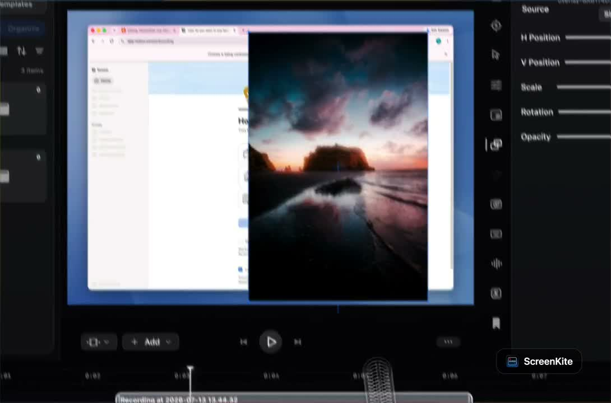

## 問題

錄屏剪輯時若要為片段補圖，先匯入再找素材再放上軌道會打斷編輯節奏。

## 做法

*檔案管理員在編輯器上方選取圖片，底部仍看得到時間線。*

*素材被拖向時間線；檔案管理員與軌道在同一畫面可對照。*

*圖片已在預覽右上角疊加，底部時間線保留對應片段。*

*圖片在預覽中放大，右側保留 Position、Scale、Rotation、Opacity 等屬性。*

**原作者影片觀察**：從檔案管理員拖圖片 → 底部軌道出現素材片段 → 中央預覽顯示疊圖 → 在預覽與右側屬性中調整。dingyi 主帖是使用偏好，具體行為來自其引用的 ScreenKite 官方發布帖。影片有檔案列表，截圖需排除本機路徑；本卡保留展示檔名，不記錄任何用戶家目錄。

不採用「比 ScreenStudio 更好」的概括評價作成效結論。

## 為什麼有效（推論）

把匯入與定位合成一次拖放，可能縮短常用素材操作；預覽與屬性並存則兼顧直覺調整與精細值。

## 借鑑要點

- **適合**：時間線、畫布或混合素材編輯器。
- **不適合**：沒有可預期落點，或拖放後不知道素材進到哪條軌道的介面。
- **移植時注意**：顯示落點、插入時段與重複匯入處理；提供鍵盤／按鈕匯入替代，驗證撤銷與素材遺失恢復。

## 來源與核對範圍

- [原帖 2077982220514685370](https://x.com/dingyi/status/2077982220514685370)：已核對 X 官方公開頁面內嵌 Tweet／NoteTweet 快取。
- [ScreenKite 原始發布帖](https://x.com/i/status/2077954288140386314)：引用 payload 明示新增拖放素材到時間線，官方附片已下載並檢視。
- 本卡根據來源文字與已檢視媒體記錄，沒有執行產品功能驗收；作者成效宣稱不視為獨立測試。
