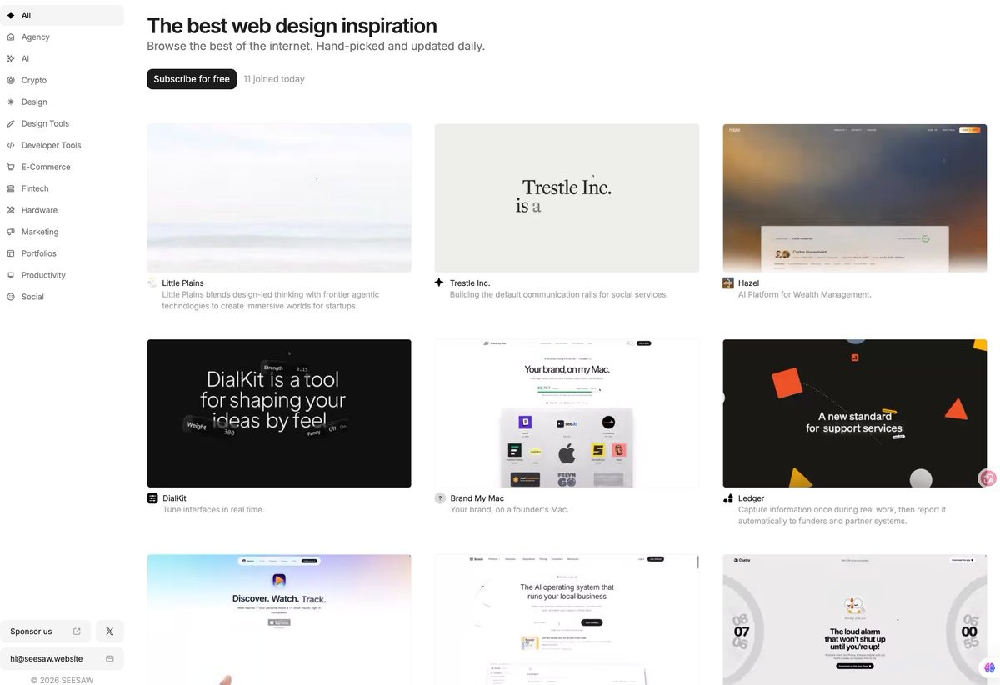

## 問題

「做得高級」無法告訴設計工具應調整哪一項畫面特徵。

## 做法

- 原帖建議在開工前按產品類別挑近似參考。
- 接著指出喜歡的是字體比例、首屏留白或產品截圖呈現；同時說明不適合自己內容、不應模仿的部分。
- 把截圖連同選擇理由一起交給 AI。

### 已檢視的素材

*參考畫廊以左側分類與多欄網站縮圖提供方向比較。*

## 為什麼有效（推論）

將整體好感拆成可定位的特徵，可能減少工具對審美需求的猜測。

## 借鑑要點

- **適合**：首頁與產品介紹的方向溝通。
- **不適合**：直接複製競品版面與品牌。
- **移植時注意**：參考應貼近內容密度與使用任務；每張圖註明採用項與捨棄項。

## 來源與核實

- [原帖](https://x.com/ianneo_ai/status/2096499980861350125)：已取得 X 公開頁面內嵌原始 Tweet / NoteTweet 資料，按相同 status ID 核對正文。
- 本卡的「做法」依原帖文字與已檢視素材撰寫；沒有執行產品功能驗收，效果解讀列為推論。
