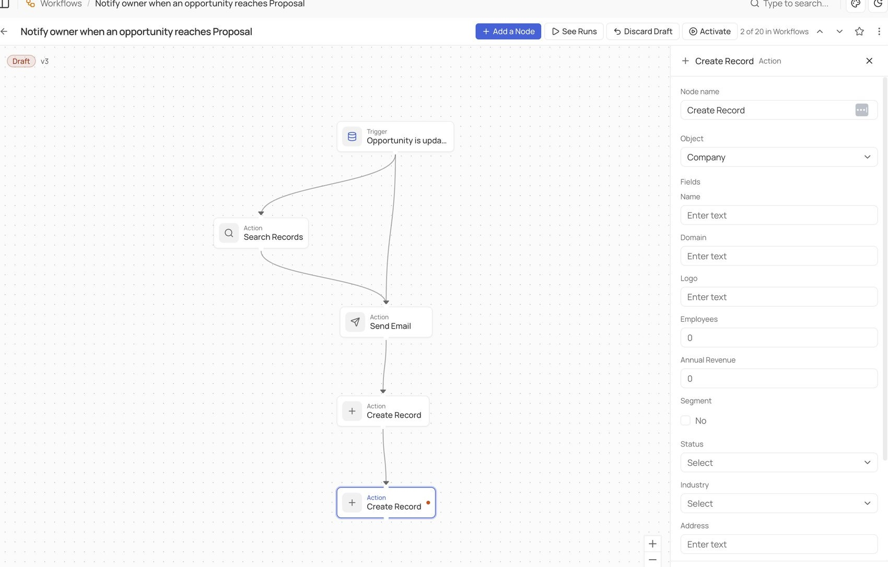
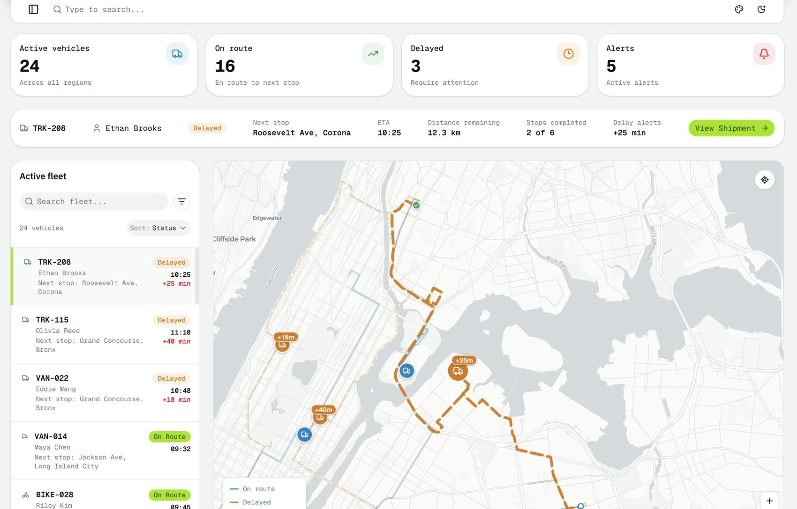

## 問題

業務頁面除了表格，也需要呈現自動化流程或地理位置；如何保留共同的操作結構？

## 做法

- 原帖四張應用畫面分別包含機會清單、工作流、專案時間軸與物流地圖；作者聲稱都以 shadcn/ui 製作，本次未審查程式碼。
- 工作流把節點連線置於中央，選取的 Create Record 節點有外框，右側顯示對應欄位設定；頂部另列測試與儲存等操作。
- 車隊頁頂端用四個摘要卡顯示 Active vehicles、En route、Delayed、Alerts；下方左側車輛列表與右側地圖並排，列表中保留狀態標籤。

*流程節點在中央，選取節點的欄位設定固定於右側。*

*地圖上方是統計摘要，左側列出車輛與狀態。*

## 為什麼有效（推論）

讓主要視圖隨任務改變、讓摘要及細節面板位置保持一致，可能減少跨頁重新定位的負擔。截圖沒有證明節點操作或地圖選取已連動。

## 借鑑要點

- **適合**：同時有列表、流程和地圖的桌面業務工具。
- **不適合**：只靠單一窄欄閱讀的手機頁面。
- **移植時注意**：先決定列表選取、地圖聚焦與右側設定的同步規則；補上鍵盤操作和窄視窗替代，不能把元件外觀當作可用性保證。

## 來源與核對範圍

- [原帖 2089691327852392536](https://x.com/ajaypatel_aj/status/2089691327852392536)：已核對 X 官方公開 HTML 內嵌的同 ID Tweet／NoteTweet 正文；發佈時間為 2026-08-18T12:30:11+00:00。
- 已下載並檢視原始媒體；影片僅保留關鍵影格，沒有保存原始影片。媒體出處與擷取時間見本目錄 `evidence.json`。
- 本卡只把貼文文字、附圖與錄影可確認的內容列為觀察；未執行產品驗收，效果解讀列為推論。
