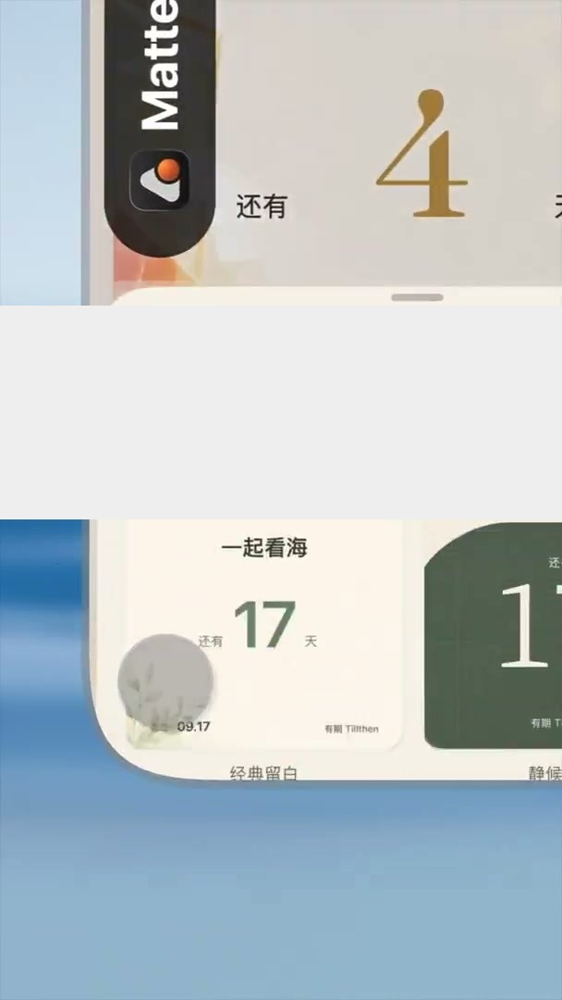

## 問題

使用者想替倒數事件挑選分享卡片，需要比較模板並確認最終外觀。

## 做法

- 影片展示倒數日卡片的大圖預覽，不同模板保持事件與天數這些核心內容，改變色塊與版式。
- 底部面板標為全部模板，提示選擇後會回到大圖預覽，再保存或分享；模板以並排卡片展示。
- 原帖自稱系統性重構，但沒有舊版對照，因此不宣稱比較優劣。

### 已檢視的素材

*大圖卡片以事件與天數作主要資訊。*

*切換樣式後，主資訊維持在大圖預覽內。*

*模板過渡期間可見前後卡片的相對位置。*

*底部模板清單以縮圖並列，選定後回大圖再保存或分享。*

## 為什麼有效（推論）

先選模板、再看完整內容，可避免在小縮圖直接提交，並減少誤分享。

## 借鑑要點

- **適合**：個人卡片與海報生成。
- **不適合**：需要同時比較大量數值的工作介面。
- **移植時注意**：切換模板時保留內容；分享前交代輸出範圍並檢查文字溢出。

## 來源與核實

- [原帖](https://x.com/peekbomb/status/2097523338897960986)及其內嵌媒體；已核對原始 ID、正文與關鍵影格，未操作產品驗收。
