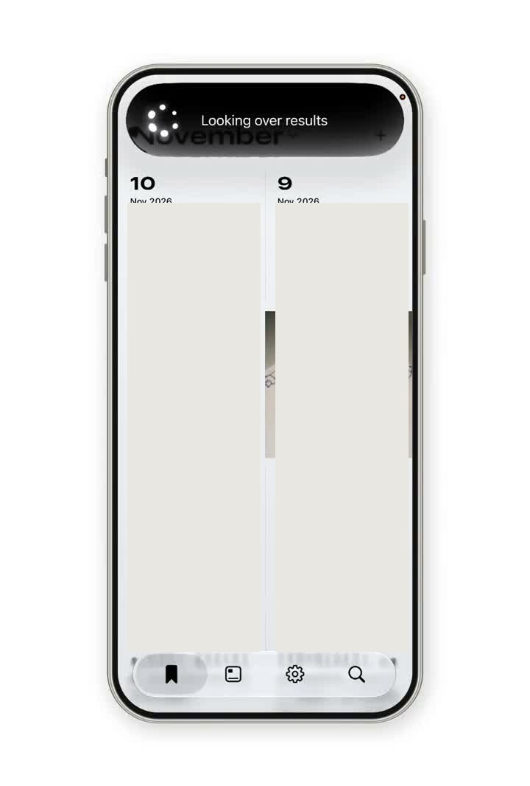
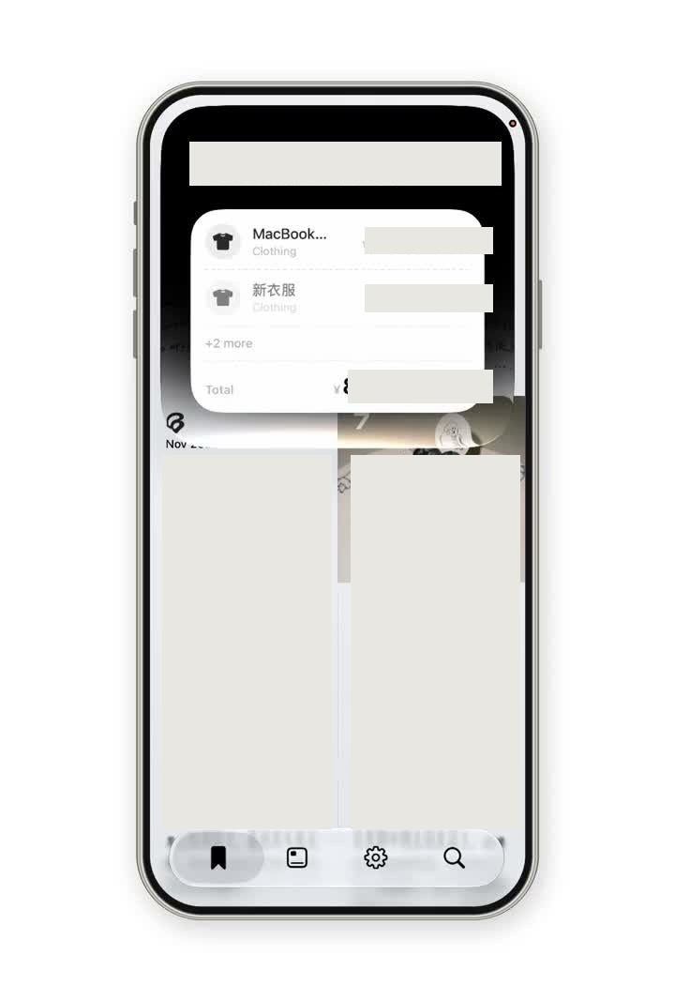
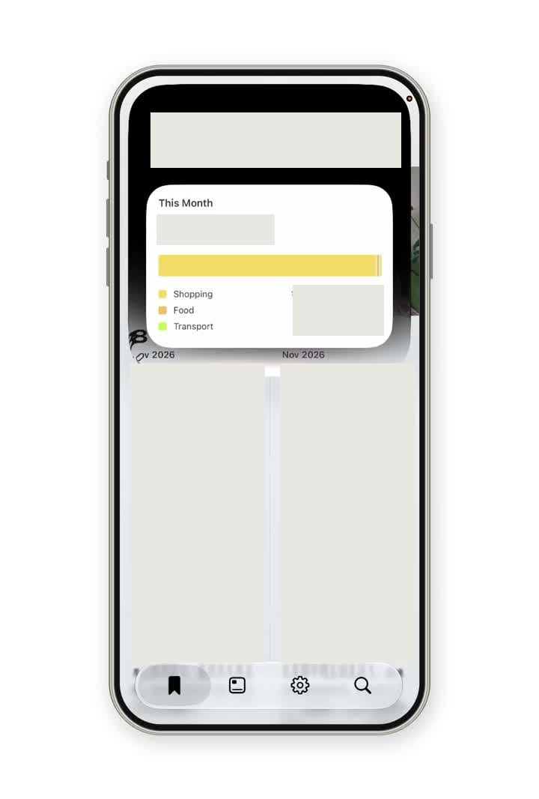

## 問題

使用者正在瀏覽多張卡片時，若要再向助理說明當前畫面，容易失去原有操作脈絡。

## 做法

*卡片網格維持在背景，助理狀態出現在上緣。*

*助理浮層顯示一張收支摘要卡。*

*後段回答改為當月支出摘要，原頁面仍在下方。*

- 影片起始是雙欄卡片網格，上方出現助理狀態；原頁面在提問過程仍保持可見。留存素材已遮去日記、照片與金額等個人內容。
- 中段助理在畫面頂部呈現一張收支摘要卡，後段改成當月支出與分類摘要；這些回答浮在原卡片網格上方。
- 原作者說明全局手勢與屏幕感知；本次可見的是示範中的浮層回答與卡片變化，無法核實其是否為已公開上線的系統能力，也不能確認每一步是否直接修改原卡片。

## 為什麼有效（推論）

- 保留原頁面並把回答貼近當前內容，可能減少在應用與助理間切換的成本。

## 借鑑要點

- **適合**：與當前文件或卡片內容相關的助理入口。
- **不適合**：未向使用者交代讀取範圍便擷取其他應用內容的流程。
- **移植時注意**：顯示助理讀取了哪張卡、修改前後的差異與撤銷入口；不要僅憑此片宣稱已具備任意卡片編輯。

## 來源與核實範圍

- [@zmangmor 原帖](https://x.com/zmangmor/status/2120113564761673729)；發表時間：2026-11-10T11:17:18+00:00。
- 依原帖文字與本次實際檢視的素材整理；未操作產品驗證功能。`date` 為收錄日期；原帖發表日期另記於 `published_at`。
