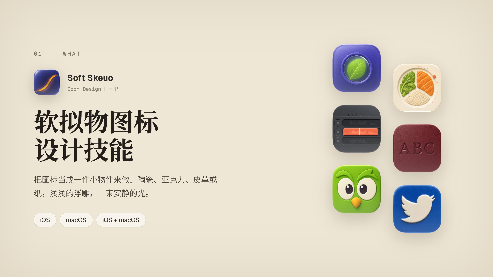
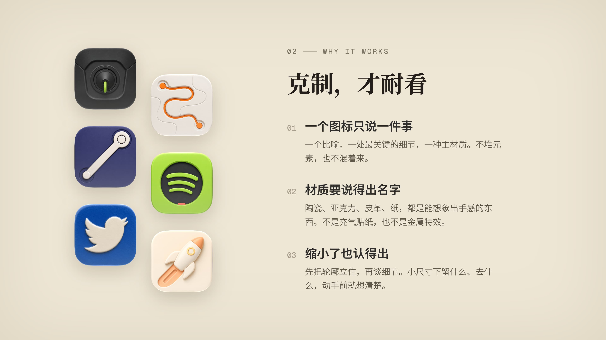
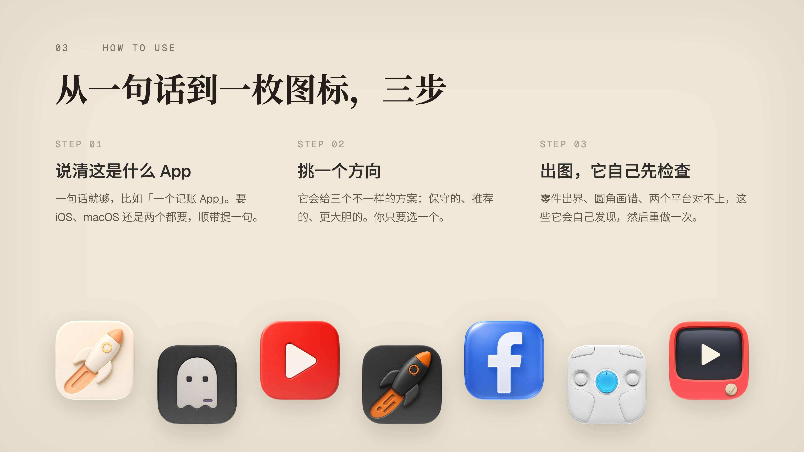
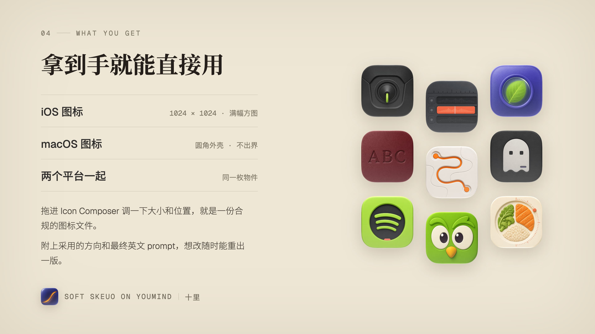

## 問題

擬物圖標若同時堆疊多個符號與過強光影，小尺寸時會變得難辨識，也難以形成一致系列。

## 做法

*相同底板與柔和光影串起不同物件。*

*設計說明把克制與單一意象放在核心。*

*三步流程與多個生成範例並排。*

*交付說明旁以圖標網格呈現系列一致性。*

- 四張原圖是作者的技能／圖標展示，不是完整 App 介面；多款圖標以圓角方形底板、單一中央物件和柔和的內外陰影組成。
- 展示頁把「一個圖標只說一件事」、材質服務於辨識及小尺寸可辨識列為設計準則；例如扳手、火箭、幽靈與信封各以獨立輪廓為主。
- 不同底色仍沿用相近容器比例與柔和光線；圖中也展示 iOS 與 macOS 交付說明，但本次只核對可見圖像，沒有核對實際檔案或尺寸。

## 為什麼有效（推論）

把變化集中在物件意象，把容器和光線保持一致，可能同時兼顧系列感與個別辨識；低對比材質讓輪廓不必與強烈高光競爭。

## 借鑑要點

- **適合**：App 圖標方向探索、可較大尺寸呈現的品牌入口。
- **不適合**：十六像素功能工具列，或需要用細微顏色差異表示狀態的系統控件。
- **移植時注意**：先以單色輪廓和小尺寸驗證語義，再加入陰影；深淺背景都檢查邊緣。展示中的現有品牌圖標只能作形式比較，不能當成可自由挪用資產。

## 來源與核對範圍

- [okooo5km 原文](https://x.com/okooo5km/status/2088112695841333315)（發布：2026-08-14T03:57:16+00:00）。

已核對 X 公開原文的嵌入式 Tweet／NoteTweet 資料及本卡所列原始素材。`kind: concept` 表示本次僅確認公開展示／設計方法，沒有把示範等同正式上線或端到端驗證。
