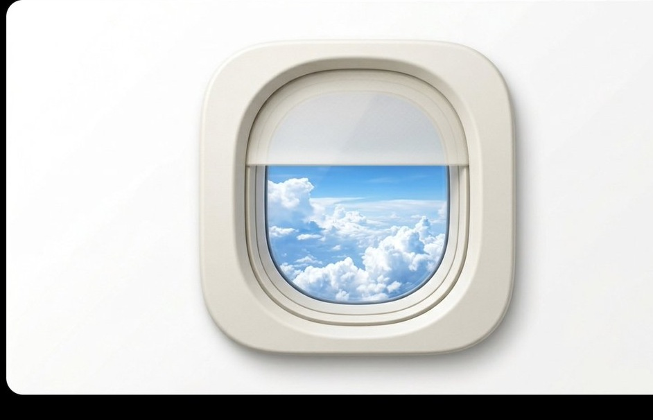

## 問題

旅行題材圖標如何靠一個簡單物件表達用途，又避免把整張風景硬塞進小尺寸？

## 做法

- 原圖展示一個米白色飛機窗框，窗內是藍天白雲；外框以圓角、內外兩層邊緣和陰影形成厚度。
- 風景被限制在機窗內部，外圍留白；窗框和背景的低彩度讓藍色內景成為主要色彩。
- 發文者評價 Google Flow 與提示詞，引用的原帖提到可依主題輸出輕擬物圖標；本次只能核對此單一成品，未取得可重現提示詞。

*厚窗框圍住藍天白雲，外部留白使單一主體突出。*

## 為什麼有效（推論）

熟悉的機窗輪廓可能讓旅行意象在不加文字時仍可辨識；柔和厚度提供物件感，但小尺寸是否清晰仍需另測。

## 借鑑要點

- **適合**：旅行、航班或收藏場景的插圖式圖標。
- **不適合**：需要通用且明確語義的系統操作圖示。
- **移植時注意**：縮到實際尺寸再檢查內景細節；保持同一光源與外框厚度。原始截圖已裁去生成工具與帳號介面。

## 來源與核對範圍

- [原帖 2037127563018223796](https://x.com/dingyi/status/2037127563018223796)：已核對 X 官方公開 HTML 內嵌的同 ID Tweet／NoteTweet 正文；發佈時間為 2026-03-26T11:20:33+00:00。
- 已下載並檢視原始媒體；影片僅保留關鍵影格，沒有保存原始影片。媒體出處與擷取時間見本目錄 `evidence.json`。
- 本卡只把貼文文字、附圖與錄影可確認的內容列為觀察；未執行產品驗收，效果解讀列為推論。
