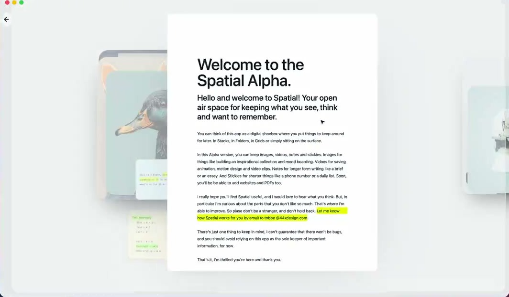
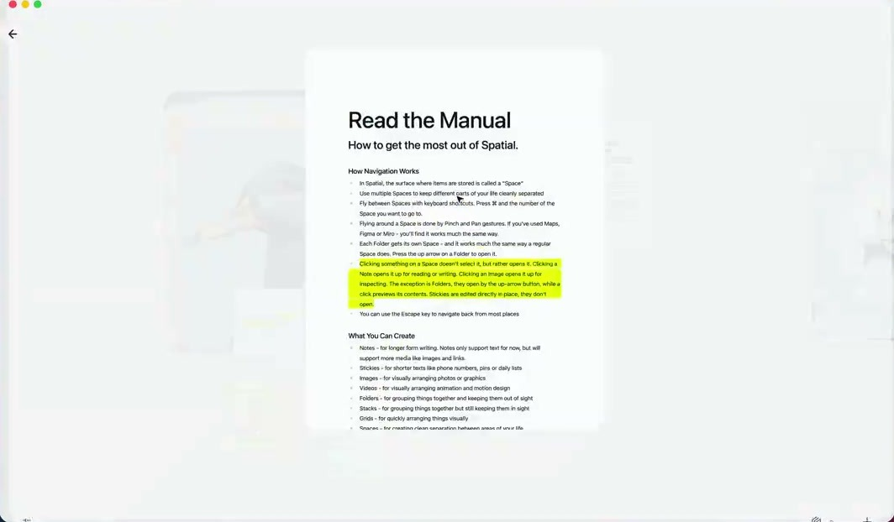
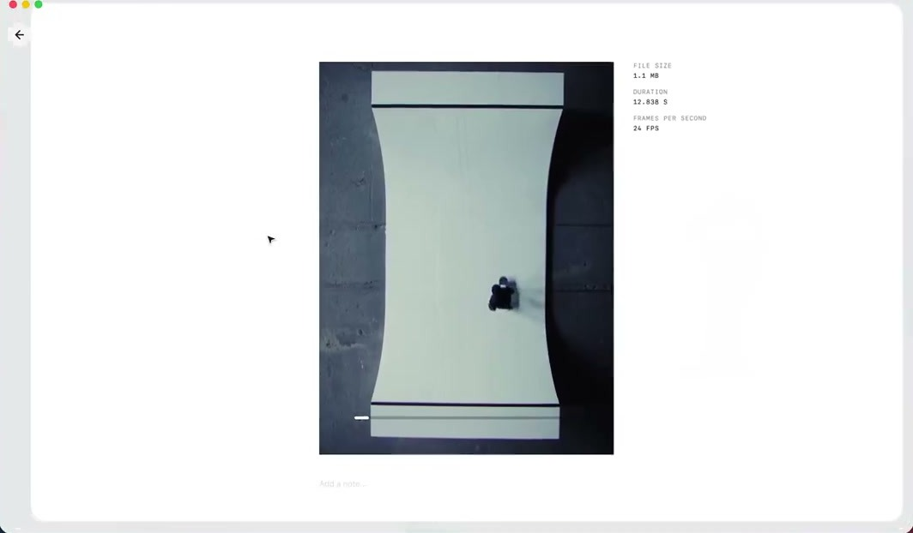
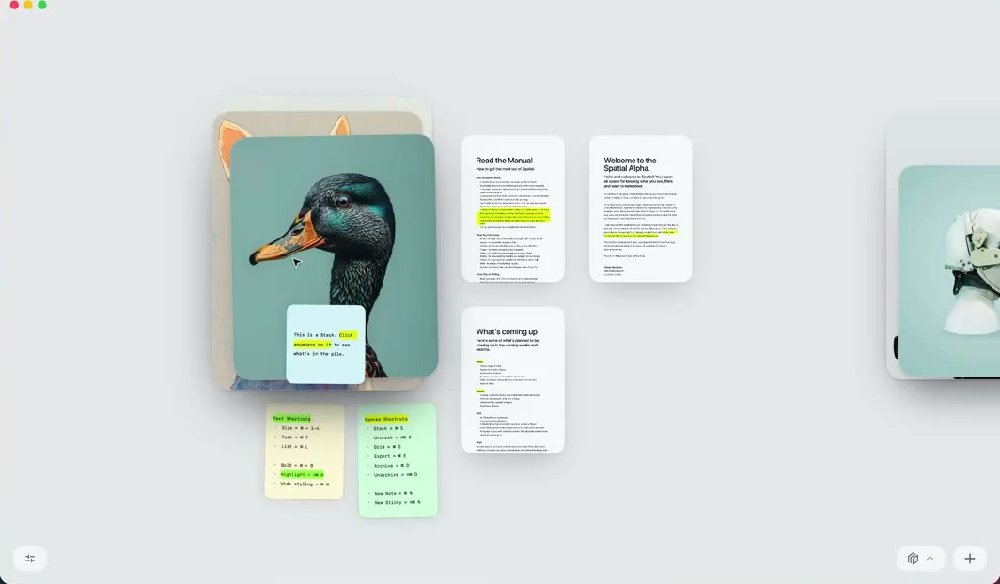

## 問題

自由畫布既要容納多個素材，也要讓單篇內容能清楚閱讀。

## 做法

- 示範在淺灰畫布上放置重疊圖片堆、文字卡、便箋與影片。關鍵影格先後顯示單篇文字放大、手冊放大、影片聚焦，以及回到多卡總覽。
- 總覽保留物件的空間位置，左側圖片堆以重疊邊緣顯示不只一張；卡片上的提示教使用者點擊堆中的任意位置查看內容。原帖提到慣性，但此處不從靜態影格推算物理參數。

### 已檢視的素材

*聚焦文字卡時，卡片放大到畫布中央。*

*手冊卡以相同方式放大供閱讀。*

*影片進入聚焦狀態，周圍仍留有畫布空間。*

*回到總覽後，可見圖片堆、文字卡和便箋的相對位置。*

## 為什麼有效（推論）

聚焦狀態提供閱讀空間，總覽保留素材之間的位置關係；是否易找回仍取決於縮放和返回行為。

## 借鑑要點

- **適合**：靈感收集與自由排布筆記。
- **不適合**：強依賴固定列順序的高密度清單。
- **移植時注意**：提供明確的回總覽與搜尋；不能只依賴手勢或記住空間位置。

## 來源與核實

- [原帖](https://x.com/LgyLight/status/2082067767638073692)及其內嵌媒體；已核對原始 ID、正文與關鍵影格，未操作產品驗收。
