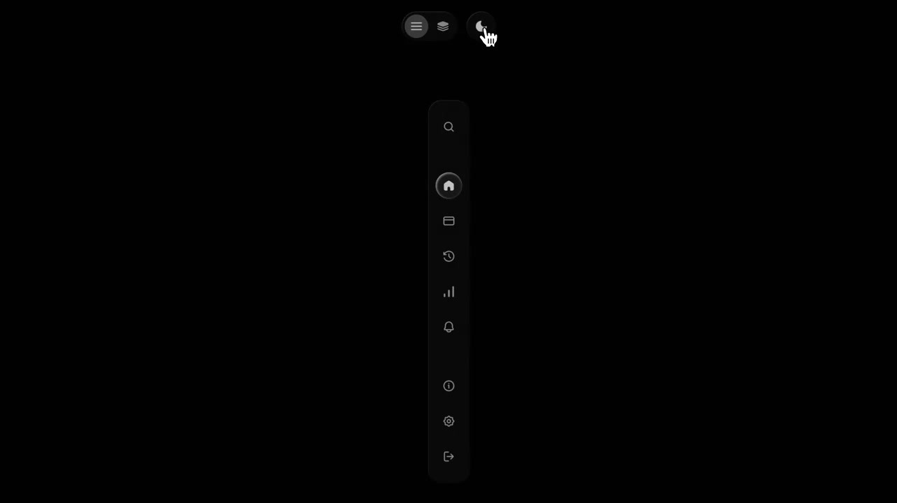
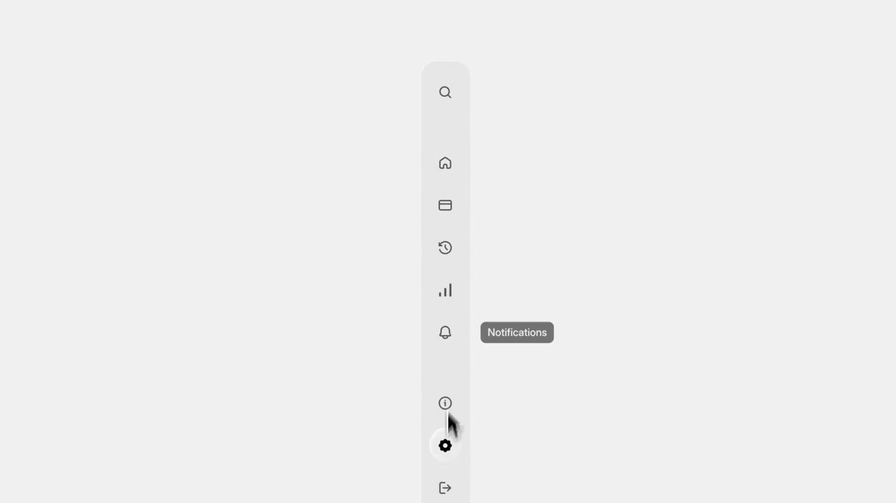
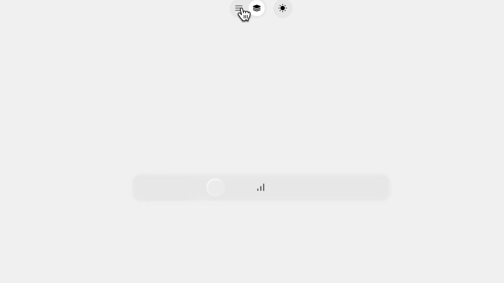

## 問題

圖標導覽節省寬度，但使用者仍需要確認入口含義。

## 做法

- 示範把搜尋、首頁、通知與設定等圖標排成窄直欄，分別展示淺色與深色版本。懸停時在右側顯示文字提示，圖標附近可見液滴般的裝飾；畫面末段也展示橫向展開的狀態。
- 關鍵影格可以確認兩種配色、提示和展開外觀，無法量測液滴的精確曲線或觸發延遲。

### 已檢視的素材

*深色版本以窄直欄排列功能圖標。*

*淺色版本在通知圖標右側顯示文字提示。*

*深色狀態保留相同圖標順序。*

*另一狀態將原先窄欄展開成橫向區域。*

## 為什麼有效（推論）

將文字放在懸停層可保留窄欄，但觸控和鍵盤使用者仍需要取得同等資訊。

## 借鑑要點

- **適合**：桌面工具的輔助導覽。
- **不適合**：觸控裝置唯一的導覽入口。
- **移植時注意**：保留可存取名稱與鍵盤焦點；液滴裝飾不能遮擋提示。

## 來源與核實

- [原帖](https://x.com/Daiiors/status/2090107550654153159)及其內嵌媒體；已核對原始 ID、正文與關鍵影格，未操作產品驗收。
- 引用示範來源：https://x.com/rndr_realm/status/2089824030677172313。
