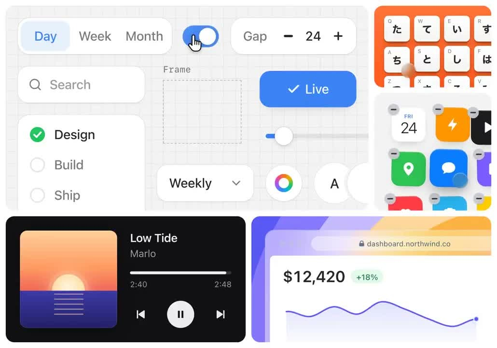
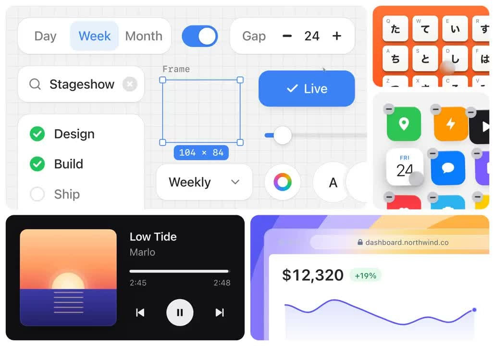
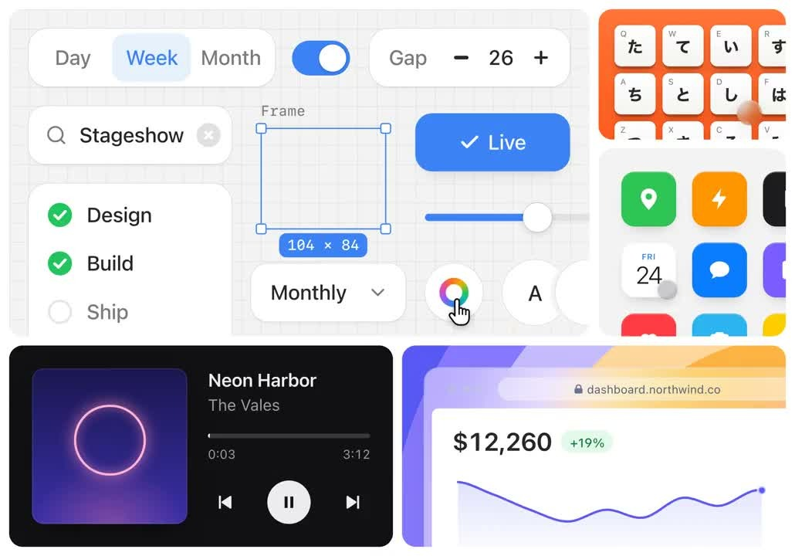
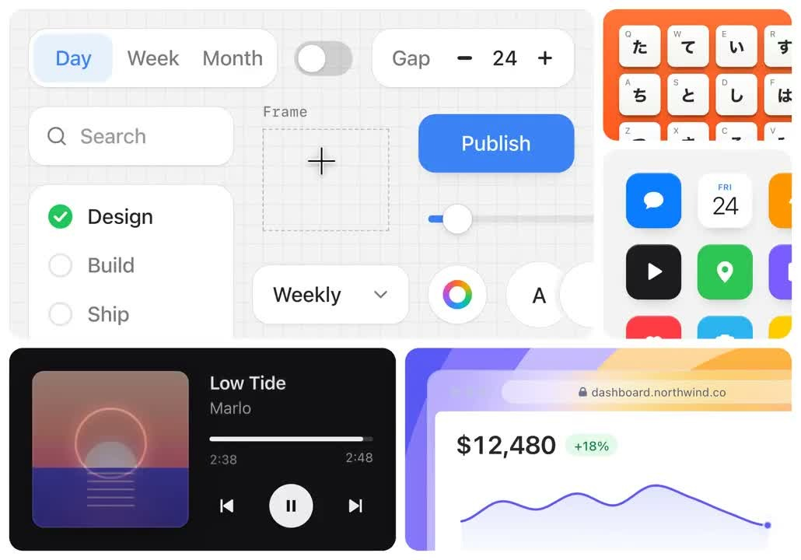

## 問題

產品示意畫面需要表達功能和操作狀態，但不一定要放進完整的真實產品畫面。

## 做法

*初始拼貼包含日期切換、清單、播放器和圖表。*

*搜尋文字與選框尺寸提示出現，日期切換至 Week。*

*Gap 數值改變，播放器更換曲目。*

*按鈕與滑桿更新狀態，各模組仍維持原本位置。*

- 影片把分頁、搜尋框、勾選清單、選框、滑桿、播放器、圖示網格與折線圖排成模組化拼貼。
- 展示過程中，Day 切到 Week，搜尋框填入 Stageshow，數值由 24 調到 26；播放器更換封面與曲目，按鈕從 Live 變為 Publish。
- 觸發由示範游標與編排動畫呈現，變化留在各自元件內；結尾仍維持同一組模組。原作者稱它們是 faux UI，不能當成已上線產品。

## 為什麼有效（推論）

- 每格只呈現一種容易辨識的狀態變化，可能讓短片不用旁白也能交代互動感。

## 借鑑要點

- **適合**：功能宣傳、元件示範與概念提案。
- **不適合**：需要證明實際功能完整可用的驗收報告。
- **移植時注意**：每格選一個主要狀態，避免同時播放太多動畫；清楚標示示意介面。

## 來源與核實範圍

- [@benjitaylor 原帖](https://x.com/benjitaylor/status/2116593247854453244)；發表時間：2026-10-31T18:08:49+00:00。
- 依原帖文字與本次實際檢視的素材整理；未操作產品驗證功能。`date` 為收錄日期；原帖發表日期另記於 `published_at`。
