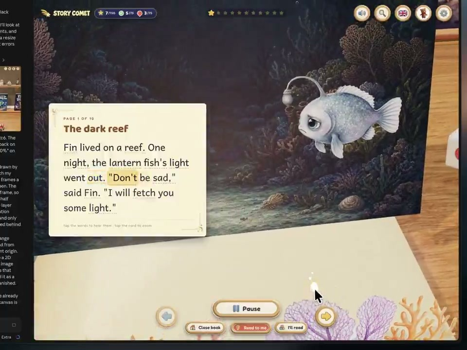
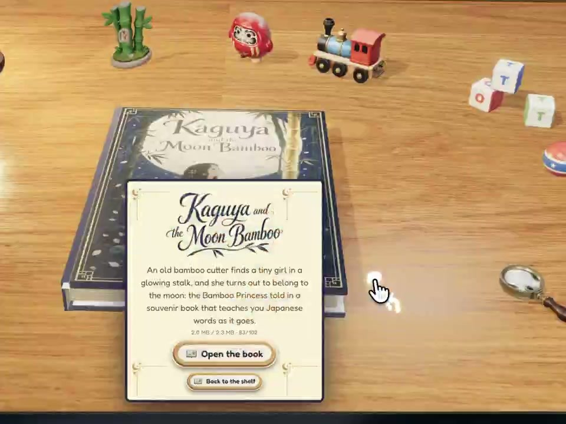
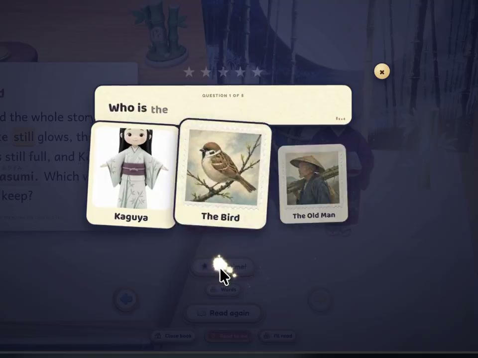
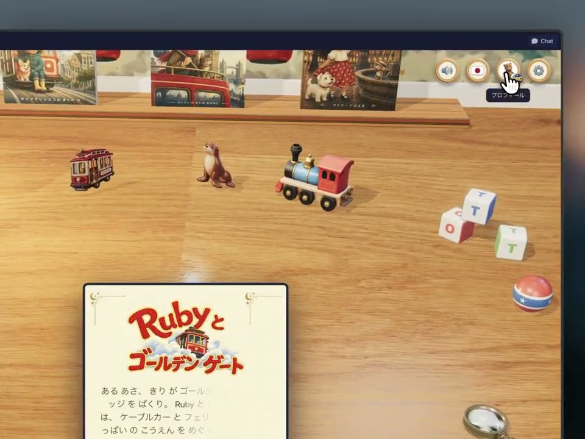

## 問題

兒童需要持續閱讀的動機，家長則需要理解學習進度。

## 做法

- 原帖介紹動畫故事書，提供多語言介面、封面與配音，並可即時切換語言。
- 兒童可作答測驗、收集 pins 與 3D souvenirs；家長能追蹤進度。
- 前三本免費，其他書籍由會員解鎖。這是作者的產品介紹，未實測學習效果或付款流程。

### 已檢視的素材

*故事頁結合插畫、短文與下方操作列。*

*書桌總覽以實體書封和收藏物呈現內容。*

*測驗以一個問題與三張圖片選項呈現。*

*返回書桌可見書封與分散擺放的收藏物。*

## 為什麼有效（推論）

將閱讀、測驗與收藏連接可能形成持續探索的循環；分開家長與孩子的目標有助於安排入口。

## 借鑑要點

- **適合**：兒童閱讀與語言學習。
- **不適合**：以獎勵數量替代理解程度的評估。
- **移植時注意**：分清完成閱讀與答題正確的含義；付費入口與帳戶設定應由成人掌控。

## 來源與核實

- [原帖](https://x.com/MengTo/status/2098027027760840864)：已取得 X 公開頁面內嵌原始 Tweet / NoteTweet 資料，按相同 status ID 核對正文。
- 本卡的「做法」依原帖文字與已檢視素材撰寫；沒有執行產品功能驗收，效果解讀列為推論。
