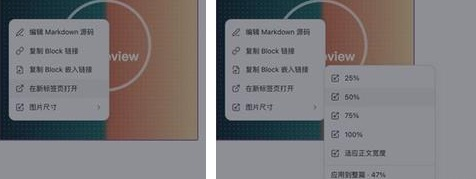
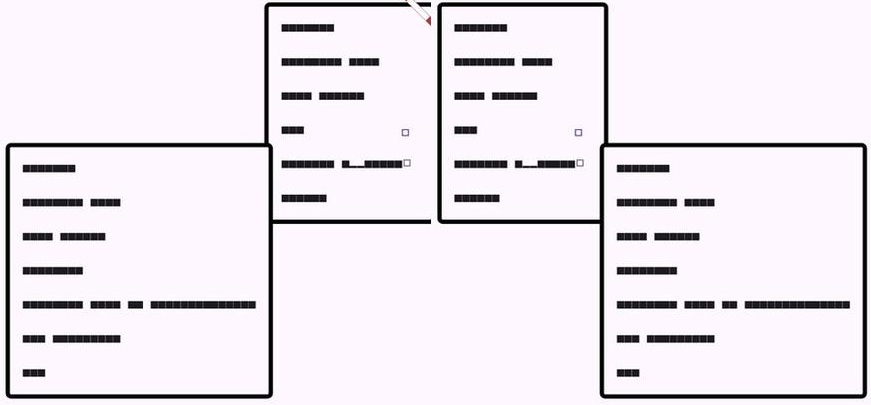
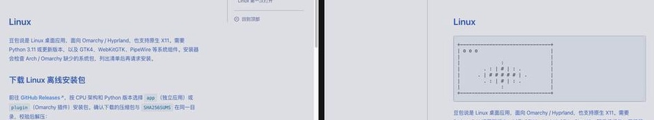

## 問題

把同一組設計技巧移植到多個產品時，容易把「每處都加效果」當作完成；如果沒有記下原問題、修改後的行為及不適用處，就難以審查哪些改動有必要。

## 做法

### 來源與觀察範圍

[原帖](https://x.com/quanruzhuoxiu/status/2124466296939245649)作者 Leyang 稱為 23 個作品做了 74 項改進；[Kubai 引用帖](https://x.com/Kubai087/status/2124467225503645764)只表示稱讚與提供精簡版，並非這批作品的作者。已用 X 頁面內的原始貼文資料核對兩位作者及 `quoted_tweet_results.rest_id` 的引用關係。

實際打開[公開對比文件](https://my.feishu.cn/docx/G4w7dvYZnolLkxx1aOXcCX6xntd)，頁首標題為「从 Vibe Design Tips 到 Studio 的 74 组前后对照」，目錄列 001–021 主題；導言說有些圖是改前／改後，有些是按壓、拖動或等待狀態。這不等於每張都是同條件的前後版本。本次只讀取上述 11 列並保存 002A、002C、003A 三張圖的設計區域；沒有驗證全部 74 組，亦沒有複製完整 Prompt。

### 1. 同一張表分開「原問題、改後規則、視覺證據」

文件每節使用編號、改前、改後、對照截圖四欄。001A 把較弱的按壓反饋對應到按下底色與內陰影，文字另列松手觸發、移出取消、禁用狀態與減弱動態；001B 則記錄等待時禁用、失敗保留草稿、原位重試。這些是作者的實作描述，本次未操作確認。

### 2. 用具體狀態說明改動，同時寫明不改的產品

*002A 原比較圖的局部：左側只有圖片父選單，右側另展開含 25%、50%、75%、100% 的尺寸子選單；兩側裁切後並排，沒有改變選單內容。*

- 作者記錄的問題：指標斜移時擦過相鄰項，圖片子選單可能關閉。
- 作者記錄的步驟：展開圖片選單 → 指標斜穿時暫留子層 → 進入目標時取消關閉；方向鍵和 Escape 保留。靜態圖只能看到子層有無，不能證明延遲長度、指標軌跡或鍵盤行為。
- 002B 明確保留 Vibelet 的單層檔案／會話選單，LifeOS Pro 沿用 Obsidian 宿主工具欄；未把所有產品硬改成多層懸停選單。

*002C 原圖局部可見兩組選單，子層分別朝左、朝右展開；文字已在原圖呈方塊，僅保留構圖證據。*

002C 的文字另說觸屏彈層、原生選單沿用平台方式；LanDesk 點擊展開後，左右斜移仍能選中目標。這是作者陳述，不能由此圖確認產品內實際操作成功。

### 3. 裝飾按內容與平台篩選，不全站鋪滿

*003A 的 Linux 區域局部：左側標題後直接是說明及下載段落，右側標題下多出帶框 ASCII 圖；此裁切只展示這一處排版差異。*

003A 記錄加入終端配對、Linux 語音波形、區網連線與報告插圖，並列窄屏／強制配色回退。003B 記錄四個官網使用低對比 4×4 Bayer 紋理，強制配色時隱藏；003C、003D 則保留其他官網底色、產品圖和應用內容表面。圖中僅核對到 Linux 插圖的存在，未檢驗回退、所有網站或其他插圖。

## 為什麼有效（推論）

- 四欄把「為何改」與「改了什麼」放在同一列，可能比單獨展示美化後畫面更利於逐項審查；未提供審查效率或使用者成效數據。
- 把「維持原狀」也寫成一列，可讓審查者分辨有意保留與漏做，尤其適合宿主控制的選單、觸屏及原生元件。
- 靜態圖與行為規則並存，但證據能力不同：截圖能確認畫面，無法證明只提交一次、斜移容錯、失敗恢復或減弱動態已正確實作。

## 借鑑要點

- **適合**：同一技巧要套用到多個產品或平台，需要逐項審閱取捨的改版。
- **不適合**：把作者自述的改動數量當成功指標，或把 74 列拆成 74 張未獨立觀察的技巧卡。
- **移植時注意**：每列固定產品／觸發／問題／改後規則／例外，圖說標示是前後比較還是不同狀態；另用可重跑操作驗證鍵盤、取消、等待與重試。觸屏、宿主元件與強制配色須各自判斷，不能直接複製滑鼠邏輯。

## 與既有卡片的關係

[級聯選單安全區](../kubai-999-002-menu-safe-triangle/case.md)已收錄技巧本身；[Agent 介面審查](../kubai-agent-ui-review/case.md)已收錄狀態與版本比較建議。本卡新增的是 Leyang 公開比較表中的實際組織方式、保留原樣的列及三處可見範例，不重複宣稱技巧原創或產品驗收。
