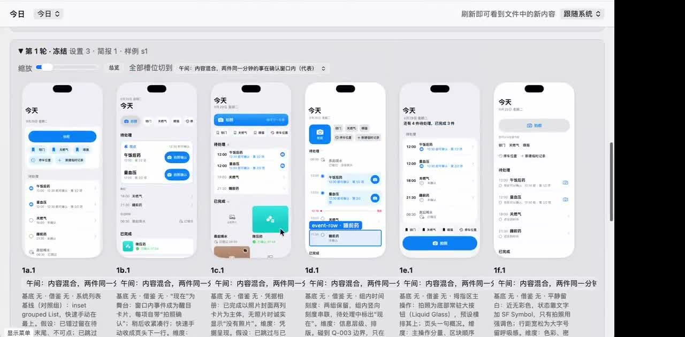
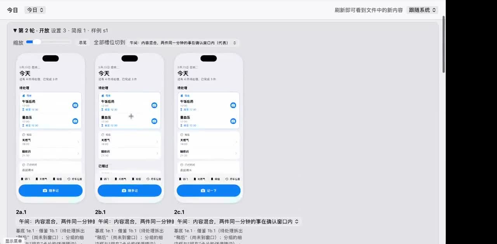
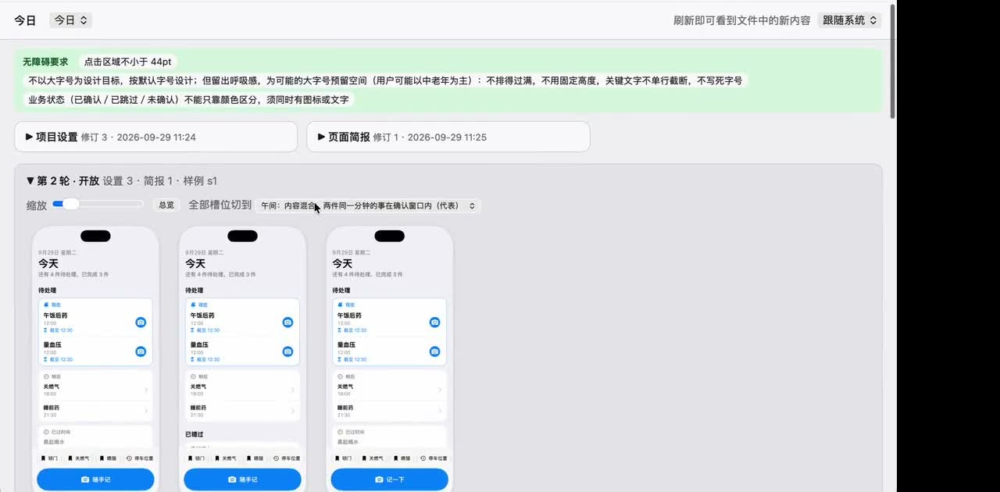

## 問題

同一個「今天」任務頁有多種可能的版面，單看一張完成稿不容易比較摘要、列表與新增入口的取捨。

## 做法

*第一組手機稿並排展示多種「今天」任務頁布局。*

*第二組縮小為三張手機稿，保留相同裝置比例。*

*頁面回到說明與三個候選版面的比較區。*

- 原帖附片先在網頁中並排多張手機稿，每張下方有版本標記與說明；各稿均以「今天」為頁面主題。
- 前段可見不同的頂部摘要、任務列表與藍色操作入口；後段縮小為三個並排方案。
- 影片展示比較稿與捲動過程；沒有證明這些稿已上線，也沒有展示完整任務操作。原帖主題是 SwiftUI 預覽的緩存與裝置一致性，此卡只整理其中可見的介面比較方式。

## 為什麼有效（推論）

- 保持同一裝置外框並列方案，可讓評審將注意力放在資訊層次，而非不同截圖尺寸。

## 借鑑要點

- **適合**：任務頁、列表頁的版面評審。
- **不適合**：只比較品牌情緒、內容完全不同的作品集。
- **移植時注意**：固定相同任務資料與裝置尺寸，再比較摘要占位、列表密度與主要動作；不要把模擬稿當成使用驗證。

## 來源與核實範圍

- [@fatbobman 原帖](https://x.com/fatbobman/status/2105111904691908939)；發表時間：2026-09-30T01:46:03+00:00。
- 依原帖文字與本次實際檢視的素材整理；未操作產品驗證功能。`date` 為收錄日期；原帖發表日期另記於 `published_at`。
