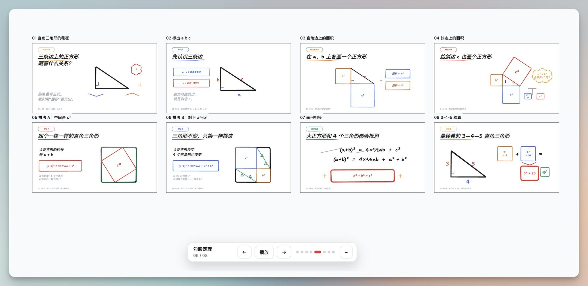

## 問題

解釋幾何推導時，如何保留各步驟的視覺關係，而不一次把所有註解堆在一張圖？

## 做法

- 截圖把八張幾何解說畫面分成上下兩排，每張有編號、標題、三角形或正方形示意以及短文字。
- 步驟中反覆沿用三角形和邊上的正方形，後段再進入公式與結論；下方有簡報控制列及圓點式頁面進度。
- 作者說明離線 App 支援 Agent Skill 與腳本，並仍在探索生成解說影片。本次只核對公開畫布截圖，沒有把可編排等同於已可輸出影片。

*八個分鏡沿用相同幾何元素，下方控制列提供逐步演示入口。*

## 為什麼有效（推論）

共用圖形語言、逐格引入一個論點，可能讓讀者保留前一步與下一步的關係；圖多仍要有清楚閱讀順序。

## 借鑑要點

- **適合**：幾何教學、步驟說明與白板式演示。
- **不適合**：沒有連續推導、只需一張圖就能解釋的單一事實。
- **移植時注意**：核對公式和圖形比例，保持編號與導覽一致；提供文字版步驟。腳本能力與影片輸出需分別實測。

## 來源與核對範圍

- [原帖 2082281547080872347](https://x.com/vista8/status/2082281547080872347)：已核對 X 官方公開 HTML 內嵌的同 ID Tweet／NoteTweet 正文；發佈時間為 2026-07-29T01:46:22+00:00。
- 已下載並檢視原始媒體；影片僅保留關鍵影格，沒有保存原始影片。媒體出處與擷取時間見本目錄 `evidence.json`。
- 本卡只把貼文文字、附圖與錄影可確認的內容列為觀察；未執行產品驗收，效果解讀列為推論。
