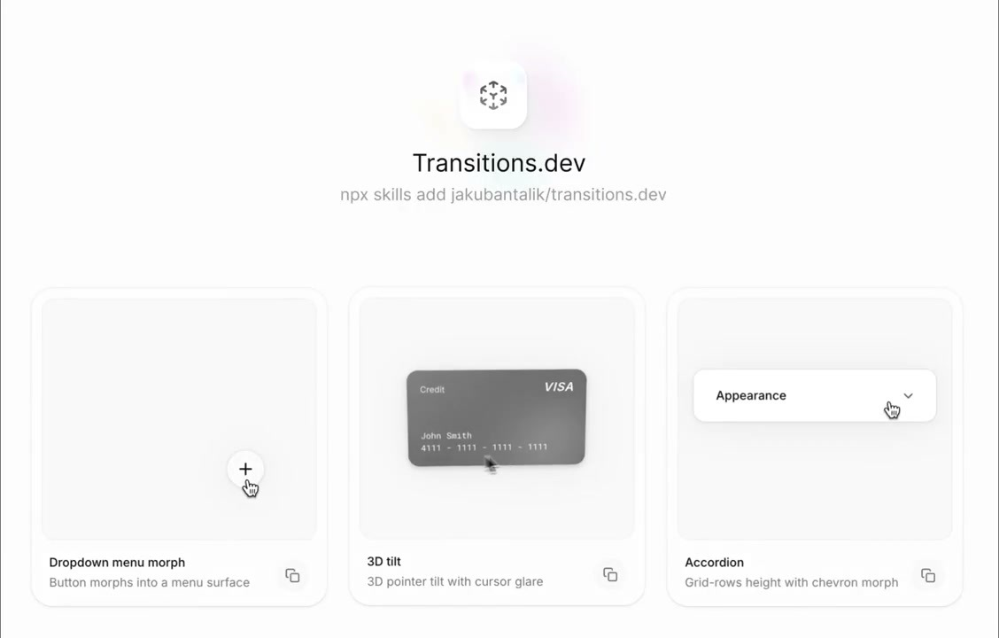
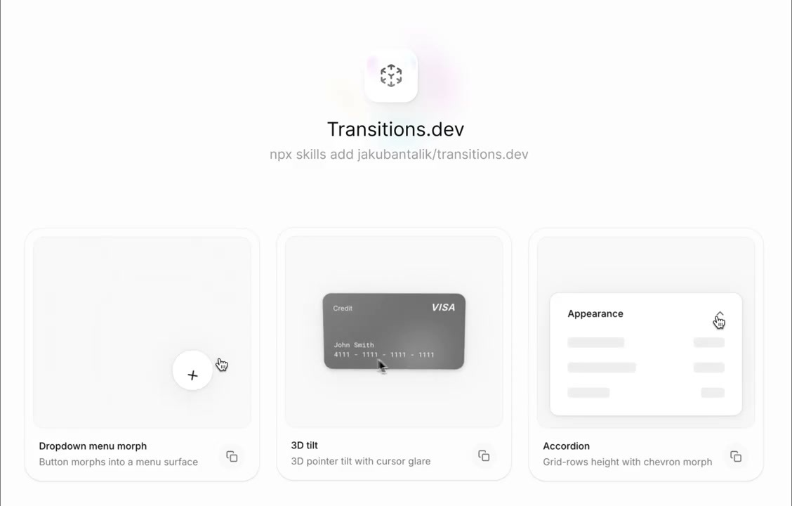
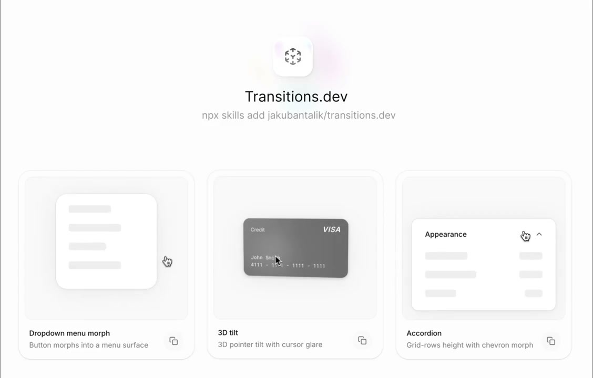
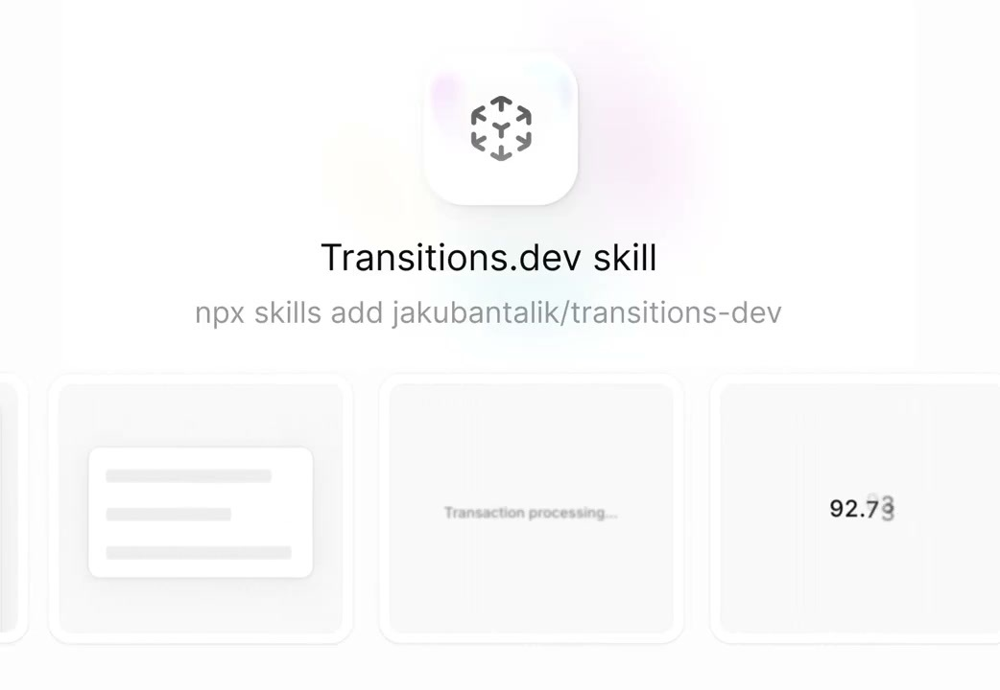
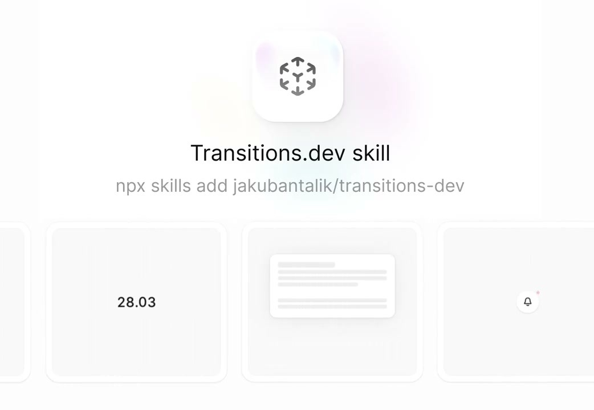
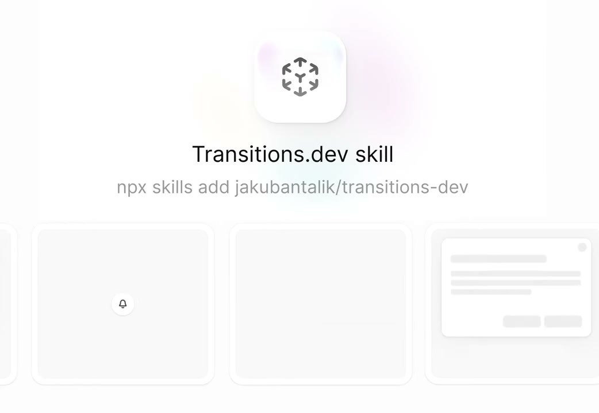

## 問題

展開選單或折疊內容時，如何讓使用者理解新表面從哪裡出現、與原入口有什麼關係？

## 做法

- 引用的開發者原帖影片將 Dropdown menu morph、3D tilt、Accordion 並排，每張示例卡底部有名稱、短說明與複製入口。
- 左側加號入口與展開後的選單使用同一中央區域；錄影可見緊湊按鈕、展開表面及收回按鈕三種狀態。
- 右側 Appearance 列展開後露出內容行，右上角箭頭狀態同步改變；中間卡片隨指標呈現傾斜示範。
- 本批吸收 dingyi 的 2049423162933395583：它引用同一開發者的較早示範，補充可用 CSS／React 轉用的來源脈絡；未安裝任何 skill。

*較新示例：加號入口、3D 卡片與收合的 Appearance 列並排。*

*Appearance 展開，箭頭與內容區同時改變。*

*加號入口已展開成圓角選單表面。*

*較早示例的元件畫廊，保留可試看的狀態。*

*較早影片中的另一個時間點，便於比較入口與結果。*

*較早示例的收尾狀態，不能據此推定底層實作。*

## 為什麼有效（推論）

入口和結果保留空間關係，可能讓狀態切換較容易追蹤；元件名稱和可複製出口則把欣賞動畫轉成實作入口。

## 借鑑要點

- **適合**：需要說明展開關係的選單、設定區與折疊說明。
- **不適合**：每次都會遮擋輸入或拖慢高頻操作的裝飾動畫。
- **移植時注意**：分開設計 focus、Escape、外部點擊與 reduced-motion；影片無法驗證可及性、實際動畫時長及效能。

## 來源與核對範圍

- [原帖 2069513317693964418](https://x.com/dotey/status/2069513317693964418)：已核對 X 官方公開 HTML 內嵌的同 ID Tweet／NoteTweet 正文；發佈時間為 2026-06-23T20:09:59+00:00。
- 已下載並檢視原始媒體；影片僅保留關鍵影格，沒有保存原始影片。媒體出處與擷取時間見本目錄 `evidence.json`。
- 本卡只把貼文文字、附圖與錄影可確認的內容列為觀察；未執行產品驗收，效果解讀列為推論。

合併來源：[dingyi](https://x.com/dingyi/status/2049423162933395583)（2026-04-29）；引用開發者 [較早展示](https://x.com/Jakubantalik/status/2048793795391873435) 與 [較新展示](https://x.com/Jakubantalik/status/2069445373765239184)。
