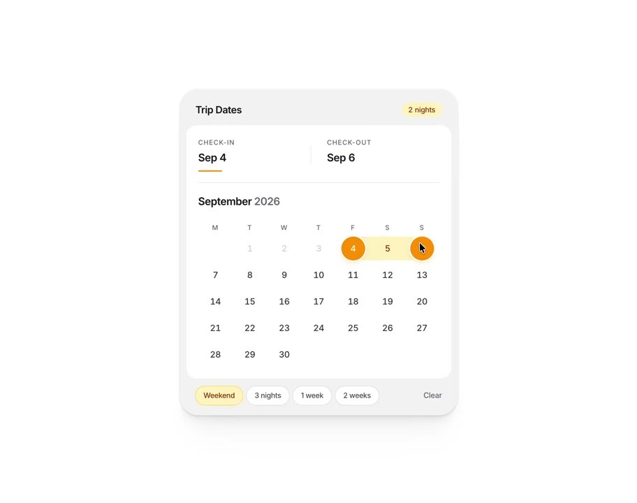
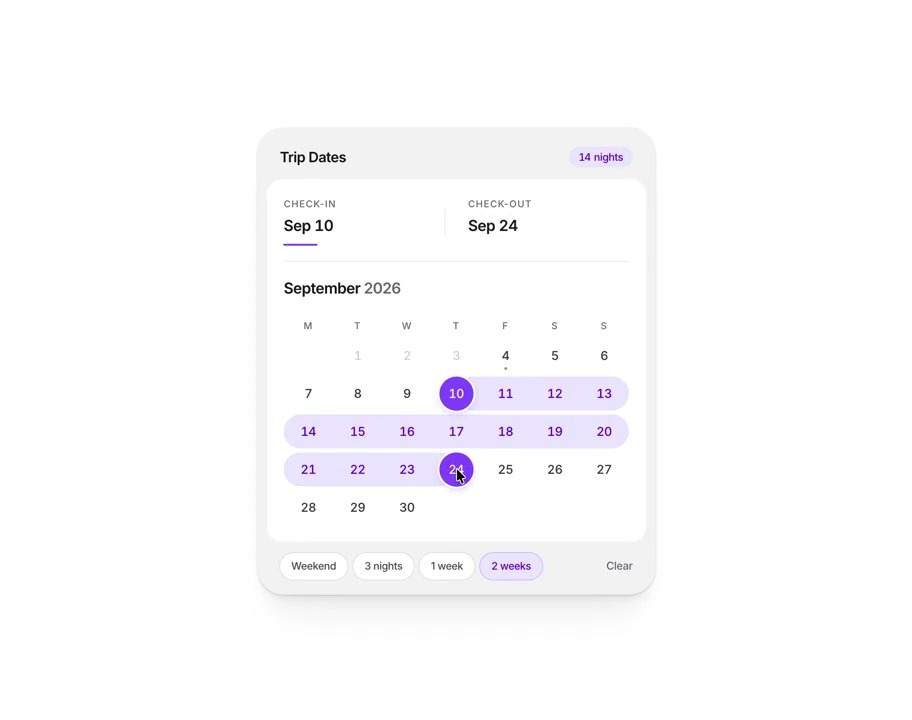
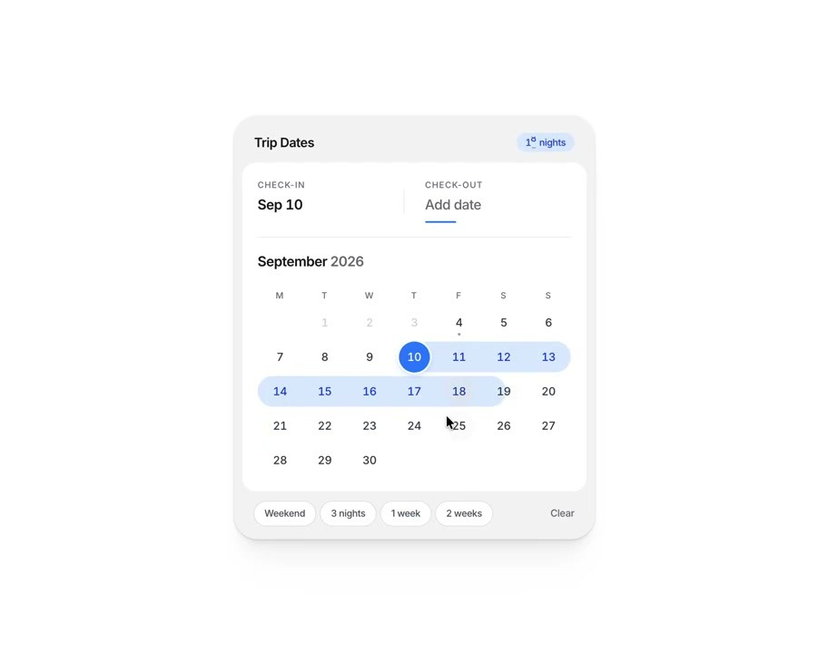
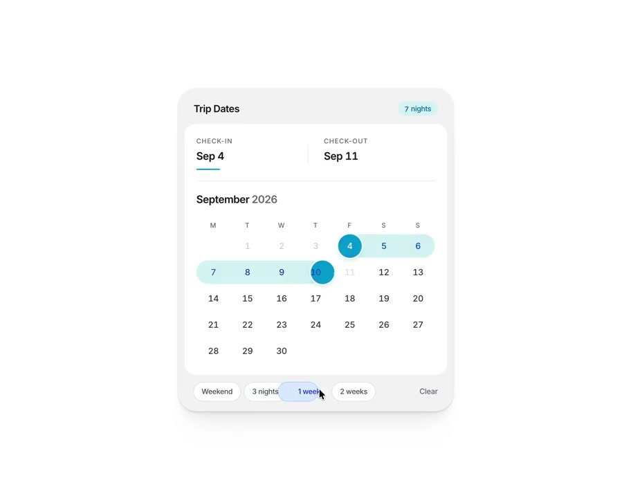

## 問題

選日期範圍時，使用者需要同時確認起訖日、停留長度和跨週範圍。

## 做法

- 示範上方並排 CHECK-IN 與 CHECK-OUT，右上以色彩徽章顯示 nights。
- 選定起訖後，兩端日期以實心圓強調，中間範圍用淺色連續帶填滿；跨週時色帶在每列延續。
- 底部提供 Weekend、3 nights、1 week、2 weeks 與 Clear。影格展示 14 nights 範圍、套用捷徑後的不同日期，以及不同配色的狀態。

### 已檢視的素材

*起訖日摘要與晚數標記位於日曆上方。*

*14 nights 狀態以兩端實心圓和跨週淺色色帶表示完整範圍。*

*一週捷徑與日曆範圍使用相同主色。*

*另一預設狀態保留底部 Clear 與晚數捷徑。*

## 為什麼有效（推論）

摘要與日曆雙重表達可減少只看色帶時的誤讀；預設晚數可減少重複點選。

## 借鑑要點

- **適合**：住宿或行程日期範圍。
- **不適合**：只有單日或非連續日期的選擇。
- **移植時注意**：明確區分晚數與天數；驗證跨月、不可選日期、鍵盤及螢幕閱讀器的範圍宣告。

## 來源與核實

- [原帖](https://x.com/taiyo_ai_gakuse/status/2091912520009470409)及其內嵌媒體；已核對原始 ID、正文與關鍵影格，未操作產品驗收。
- 引用示範來源：https://x.com/insporadesign/status/2091528207962947664。
