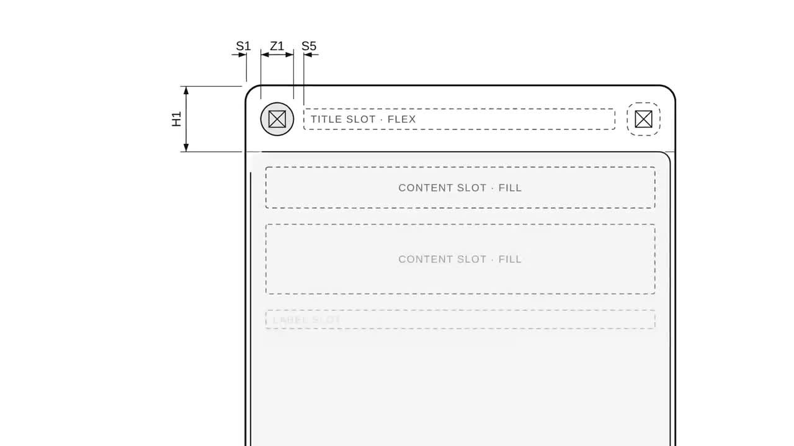
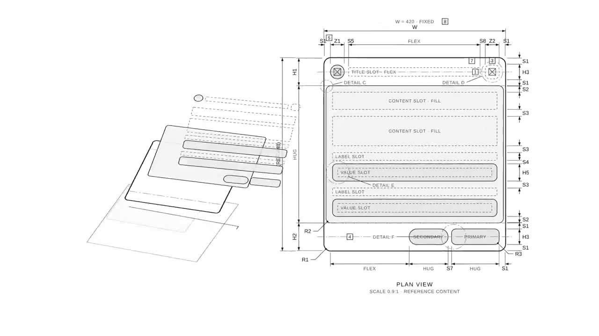
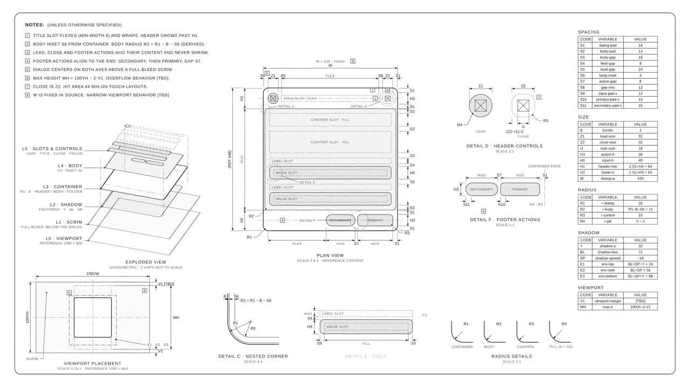

## 問題

設計評審只看成品時，很難確認元件邊距、內部槽位與可替換部分。

## 做法

*局部圖用尺寸線與虛線標註標題和內容槽位。*

*分層爆炸圖與完整元件正視圖並列。*

*最後整合多視角、細節和規格表成一張工程圖。*

- 影片從圓角元件的邊框與圖示局部開始，逐步展開成標有尺寸線的正視圖。
- 畫面使用 TITLE SLOT FLEX、CONTENT SLOT FILL 等槽位標記，配合虛線框表達可填入的內容區。
- 後段把爆炸分層、完整正視圖、圖示和按鈕細節、尺寸表整合成一張技術圖；這是規格展示，不是原產品的運作動畫。

## 為什麼有效（推論）

- 將槽位命名和尺寸線放在同一視野，可能使評審從「像不像」轉向確認結構與約束。

## 借鑑要點

- **適合**：設計系統交付、可組合元件與密集規格評審。
- **不適合**：需要教初學者完成任務、卻先給大量工程標線的操作入口。
- **移植時注意**：尺寸值必須連回實際 token；不要照抄影片中未能辨識的小字數字。

## 來源與核實範圍

- [@slashui 原帖](https://x.com/slashui/status/2114299273252606017)；發表時間：2026-10-25T10:13:23+00:00。
- [原始技能展示](https://x.com/enesozturkdev/status/2114035471953326126)。
- 依原帖文字與本次實際檢視的素材整理；未操作產品驗證功能。`date` 為收錄日期；原帖發表日期另記於 `published_at`。
