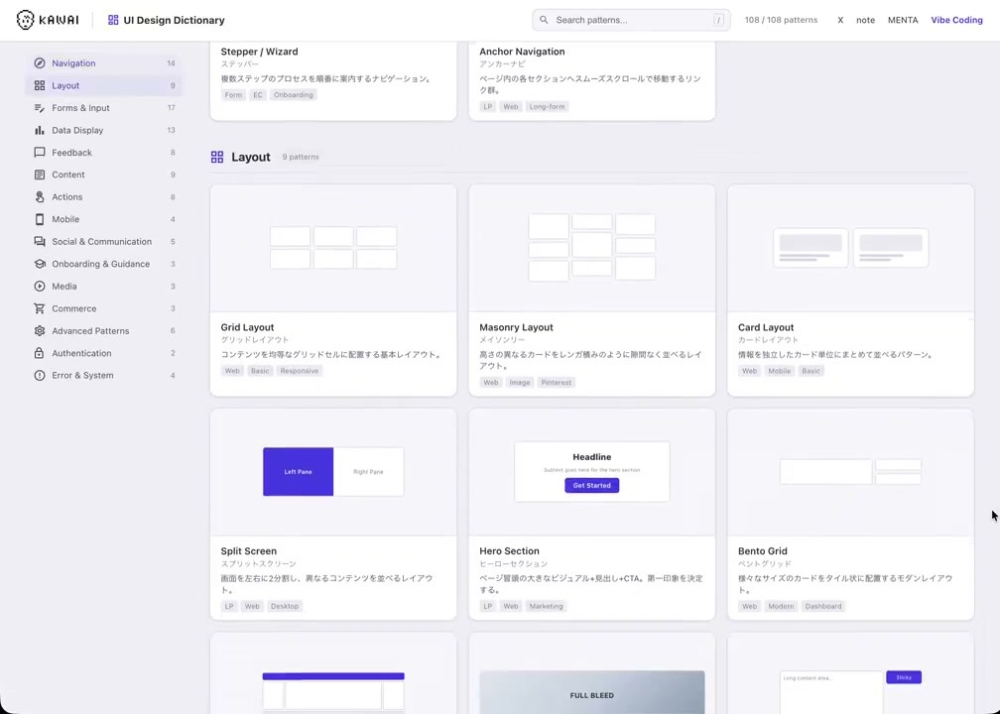
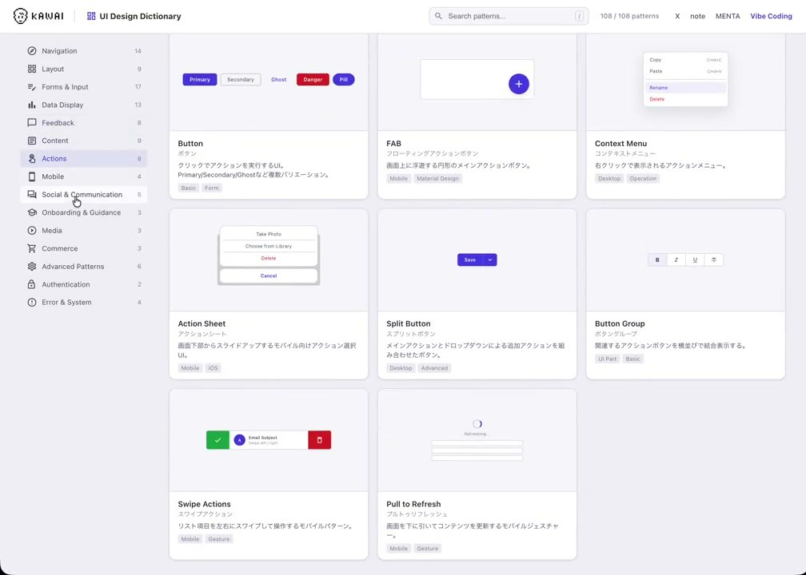
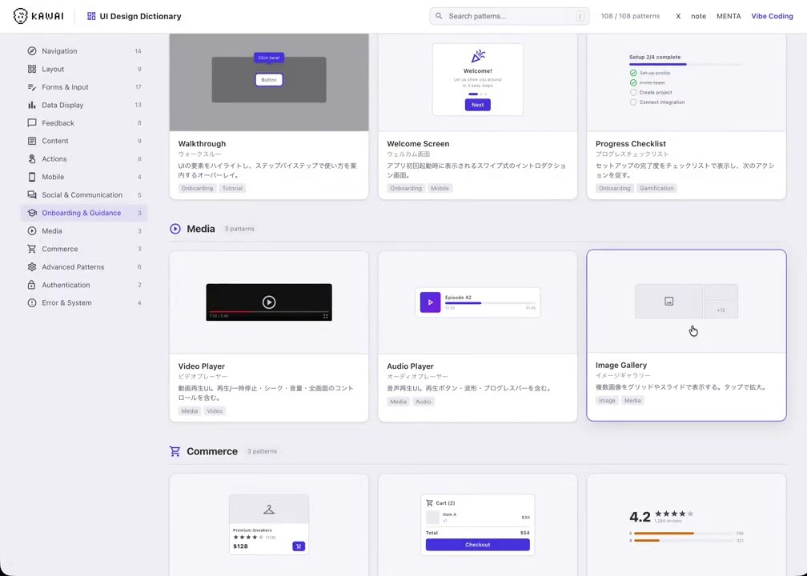
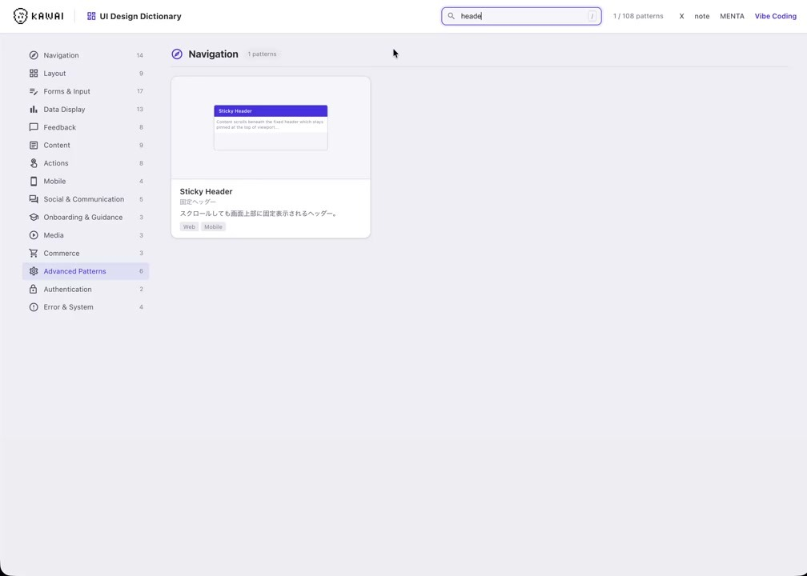

## 問題

使用者知道想要的控件樣子，卻不知道名稱，難以向 AI 表達。

## 做法

- 原帖介紹可按用途查找的 108 種 UI 模式詞典，使用名稱與可動迷你範例並列。
- 分類包含導覽、表單、資料展示、引導、商務與驗證；例子有 OTP、底部面板、命令面板與骨架屏。
- 建議操作順序是看範例、知道名稱，再用名稱向 AI 提需求。

### 已檢視的素材

*詞典以分類側欄和具名元件卡片組成可瀏覽清單。*

*多個小型範例在同一網格內展示不同控件。*

*浮層、提示與其他狀態以迷你畫面示範。*

*搜尋收斂清單至一張匹配元件卡。*

## 為什麼有效（推論）

名稱配可動例子能連接視覺記憶與專業術語；用途分類提供另一條查找入口。

## 借鑑要點

- **適合**：非設計背景的需求溝通與原型探索。
- **不適合**：只憑名稱就認定行為完全一致。
- **移植時注意**：補充開啟方式、焦點與關閉規則；同名模式在手機與桌面可能不同。

## 來源與核實

- [原帖](https://x.com/kawai_design/status/2087011119042814053)：已取得 X 公開頁面內嵌原始 Tweet / NoteTweet 資料，按相同 status ID 核對正文。
- 本卡的「做法」依原帖文字與已檢視素材撰寫；沒有執行產品功能驗收，效果解讀列為推論。
