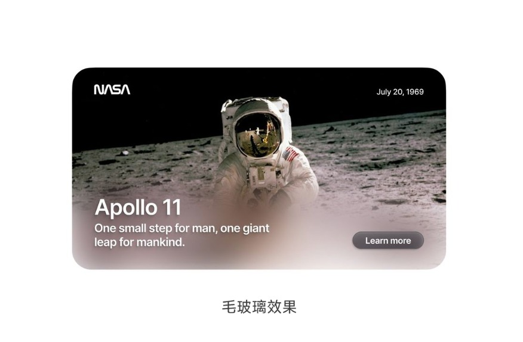
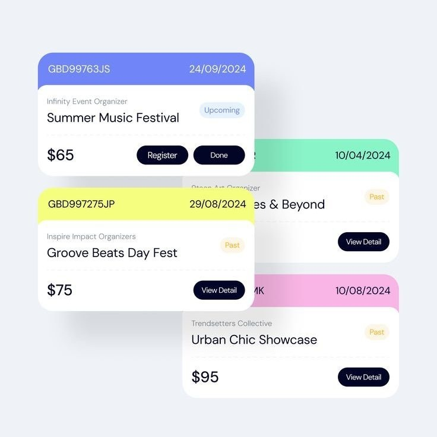
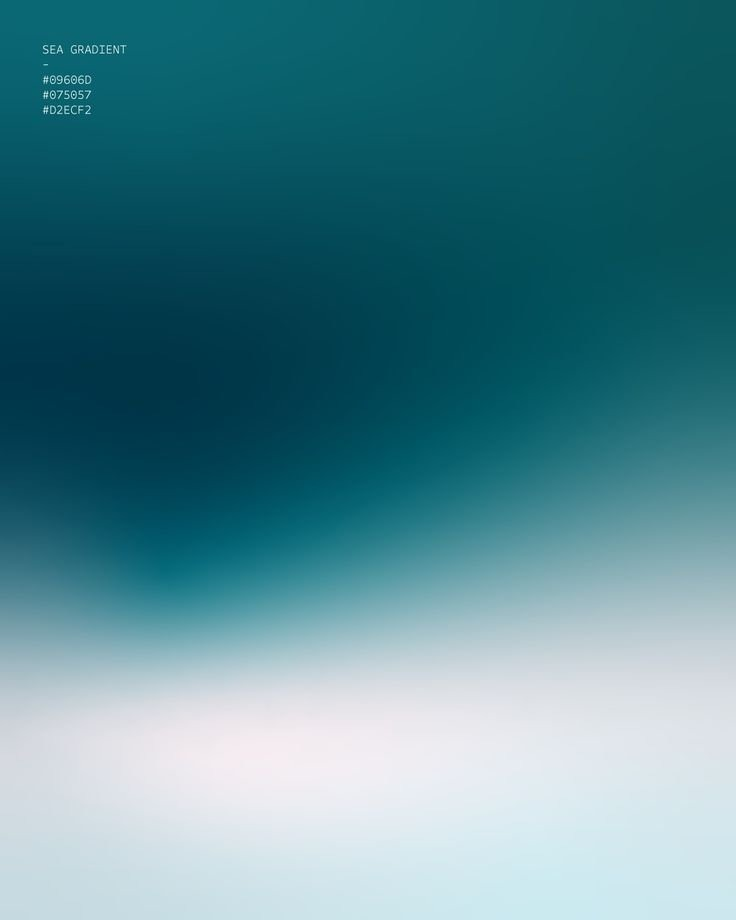

## 問題

同時要求大量特效和全面優化，容易失去問題原因，也讓頁面缺少完整狀態。

## 做法

- 全文將修整分為三輪：先查內容順序、首屏與模組主次，再查字級、顏色、間距、邊框與陰影，最後補懸停、點擊、載入、空白、錯誤與手機適配。
- 每輪先列出問題並排序，一次只改影響最大的一項，記錄改動的數值；避免把局部修整變成整頁重寫。
- 文中的例子用低對比 1px 邊框與淡陰影區分層級，以 8 的倍數作間距起點；字級和動畫時長都是作者示例，並非通用規格。
- 按鈕同時定義 primary、secondary、ghost、destructive，以及 disabled、loading 等狀態。裝飾效果不得遮住文字和主要操作，手機端可減少粒子、關閉視差或改靜態圖。

### 文章內已檢視素材

*毛玻璃示例僅在下方文字區模糊背景，保留上方主體。*

*卡片重疊以輕陰影交代前後層次。*

*低飽和背景紋理作為視覺材質示例，而非已驗證的產品流程。*

## 為什麼有效（推論）

先處理結構可避免用特效遮蓋資訊問題；每次聚焦一項，較容易判斷哪個改動帶來改善或回歸。

## 借鑑要點

- **適合**：既有生成頁的局部品質修整。
- **不適合**：沒有目標使用者與內容、只想套任意「高級風」。
- **移植時注意**：數值需配合文字密度和裝置測試；錯誤狀態還要提供恢復操作，動效需支援減少動態設定。

## 來源與核實

- [原帖](https://x.com/sts81998850/status/2084653106944753931)；原始資料已核對 ID，本文不代表產品實機驗收。

- 文章來源：X 公開狀態頁內嵌 ArticleEntity，已讀取完整 plain_text 與 content_state，並檢視文章媒體。
