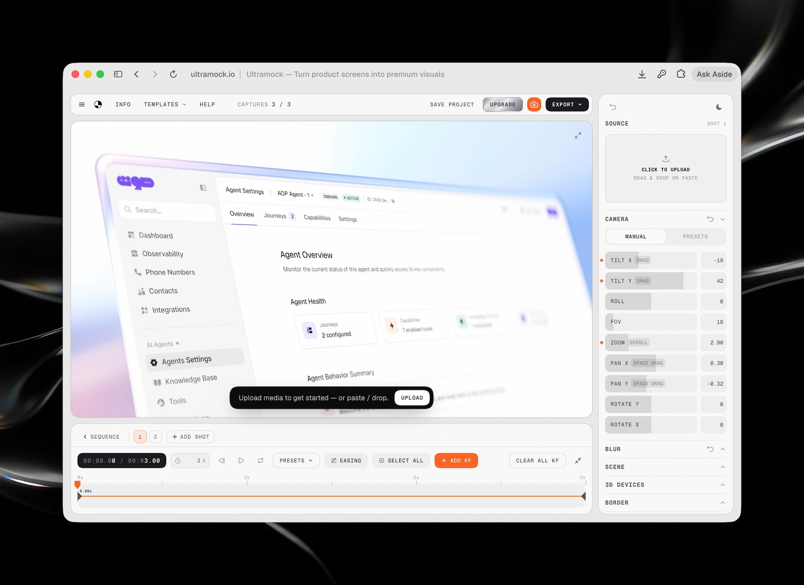
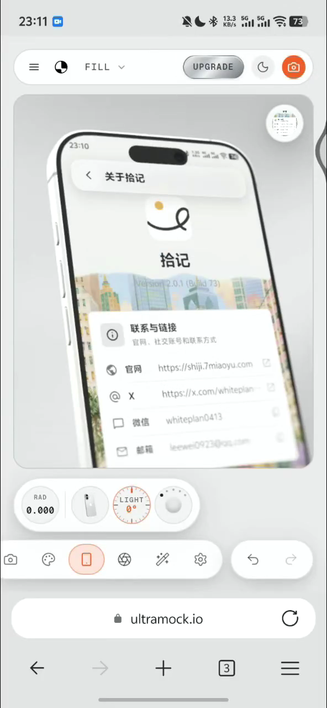
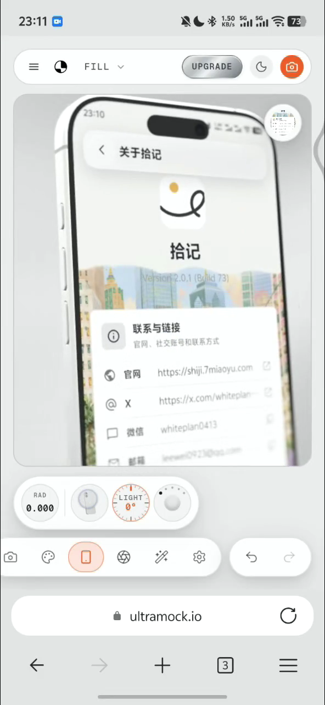
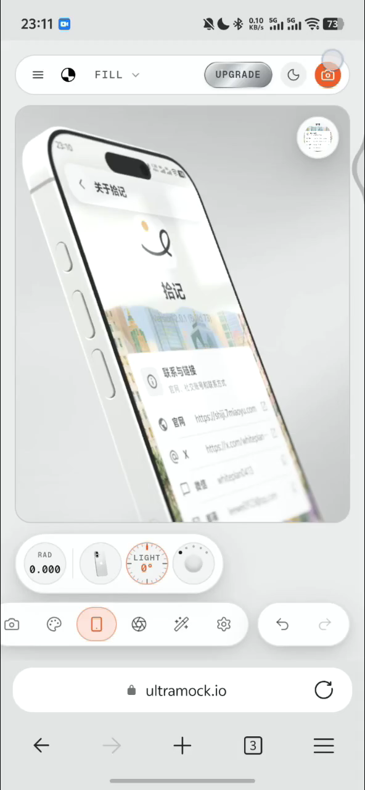

## 問題

製作產品截圖展示圖時，使用者需要同時判斷角度、背景與裝置外框；若設定與預覽分離，很難逐次比較效果。

## 做法

*桌面版以中心場景、右側設定和底部素材區協同編輯。*

*手機版預覽置頂，編輯控制放在下方。*

*同一裝置的角度改變，畫布結構維持不變。*

*另一傾角保留於相同手機編輯場景。*

- 桌面截圖以大型畫布呈現傾斜的產品介面，右側配置多組參數欄，底部有場景／素材選擇區；中心預覽是主要視覺焦點。
- 同批另一筆原貼文引用 @joshmillgate 的手機示範；手機畫面將裝置預覽放上方，圓形與膠囊控制集中在下方，避免照搬桌面右欄。
- 手機影片可見同一手機模型依序變成不同傾斜角度，之後仍留在編輯畫布內。這支持「在原場景比較姿態」的觀察，不能證明觸控手勢、輸出格式或渲染效能。

## 為什麼有效（推論）

預覽保持穩定、設定靠近預覽，可能讓使用者把注意力留在構圖而非工具導覽；手機把控制收進底部，也較容易保留足夠的畫布寬度。

## 借鑑要點

- **適合**：截圖包裝、裝置模型與行銷素材編輯器。
- **不適合**：需要逐像素檢查原始 UI 的產品驗收，或不容許透視變形的文件輸出。
- **移植時注意**：分開提供場景預覽與原尺寸檢視；手機控制加上可讀名稱與當前值，避免只靠圖標猜測。輸出前檢查透視後的文字可讀性。

## 來源與核對範圍

- [dingyi 原文](https://x.com/dingyi/status/2074991424710545908)（發布：2026-07-08T22:58:01+00:00）。
- [合併來源 @Leewei60269181](https://x.com/Leewei60269181/status/2093718731159748922)（發布：2026-08-29T15:13:39+00:00）。

已核對 X 公開原文的嵌入式 Tweet／NoteTweet 資料及本卡所列原始素材。`kind: concept` 表示本次僅確認公開展示／設計方法，沒有把示範等同正式上線或端到端驗證。
