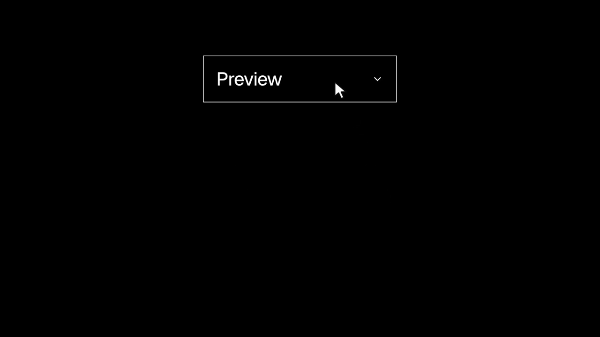
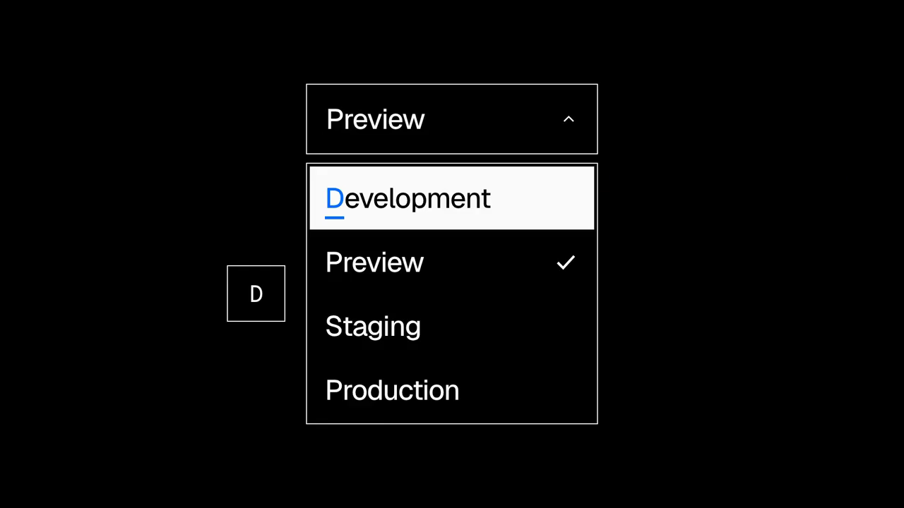
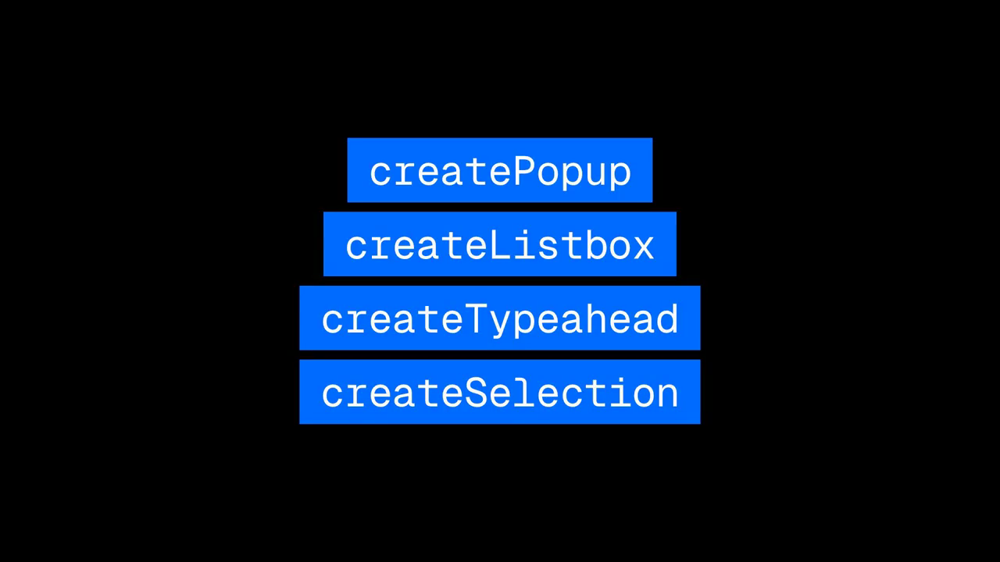
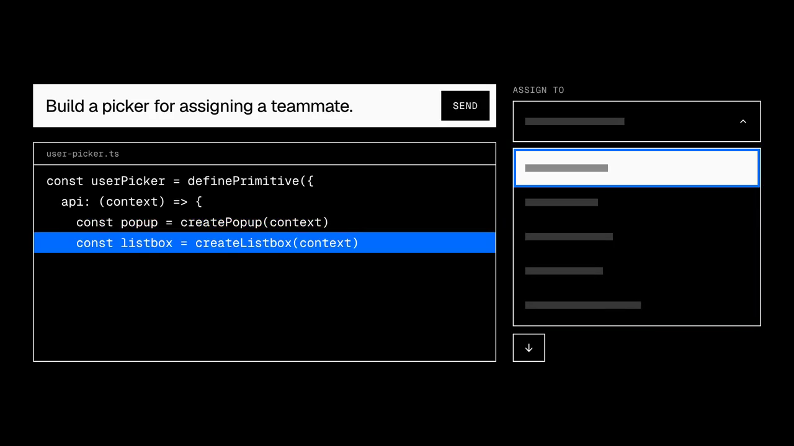
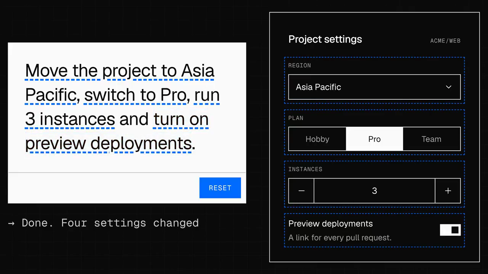
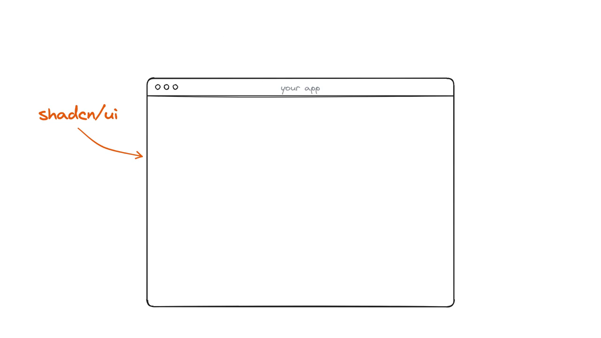
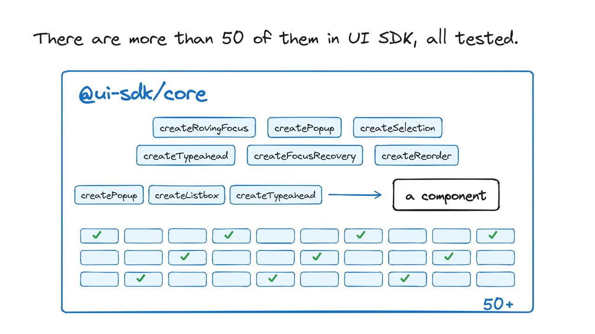
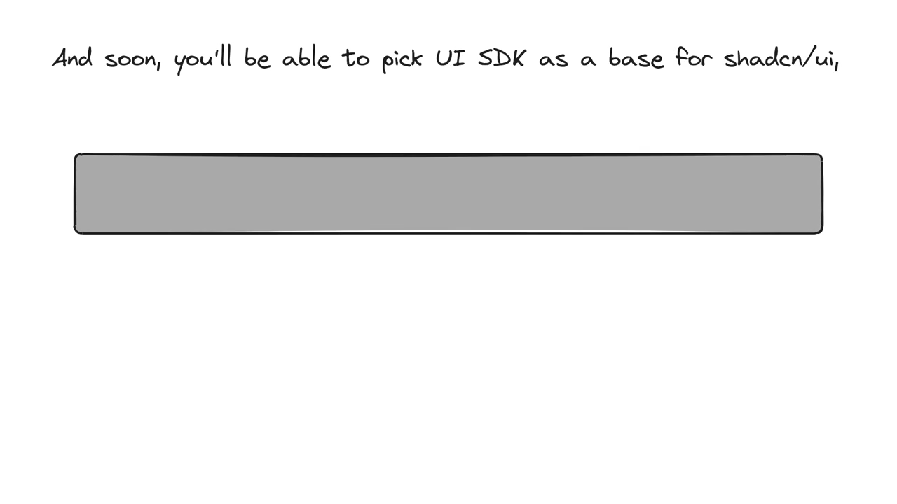

## 問題

讓 Agent 拼出選單外觀容易，但開關彈層、鍵盤跳選、焦點恢復與選取狀態仍須一致，否則畫面可看卻難以可靠操作。

## 做法

*12.7 秒：環境選擇器收合，顯示 Preview 與展開箭頭。*

*21.17 秒：展開後 Preview 仍有勾選，輸入 D 則將 Development 高亮。*

*29.63 秒：影片列出 createPopup、createListbox、createTypeahead、createSelection。*

*46.57 秒：左邊呈現行為組合程式，右邊顯示成形中的指派選擇器。*

*97.37 秒：自然語言要求與 Project settings 並列，畫面顯示區域、方案、實例與預覽設定。*

**影片觀察**：開啟選擇器 → 顯示選項 → 按字母 D 將 Development 高亮，同時 Preview 的勾號仍在，將鍵盤定位與已選值分開表達。接著把彈層、列表、輸入跳選和選取列成可組合行為，再展示選擇器與 Agent 修改設定的片段。

**官方文件核對**：UI SDK 將行為放在 core，透過框架適配器渲染，讓專案自行控制樣式；官方入口列有 Select、Combobox 等元件與 Agent 連接文件。這是 Beta 產品，文件與 API 可能變動。本卡聚焦行為組合與可操作介面，不把宣傳片中的分數當無障礙驗證，也不轉述尚未逐項核對的呼叫次數、成本或瀏覽器支援表。

## 為什麼有效（推論）

把鍵盤定位、選取與彈層生命週期拆開，可能讓不同外觀沿用一致規則；對人可辨識的狀態也有助於 Agent 操作後核對結果。但使用行為庫不等於自動通過無障礙或端到端驗收。

## 借鑑要點

- **適合**：Agent 參與建構的客製表單、選單與工作台。
- **不適合**：只需原生 select 就足夠，卻為視覺效果引入額外交互層。
- **移植時注意**：先寫出開啟、跳選、確認、Escape 取消與焦點返回的契約，再用鍵盤與讀屏驗證；Agent 動作需有清楚的允許範圍與應用回調。

## 來源與核對範圍

[lencx 整理](https://x.com/lencx_/status/2121174537127735305)官方快取內含[Vercel 發布原帖](https://x.com/vercel/status/2120950020249895314)與影片；附片已下載檢視。貼文短網址解析至[官方倉庫](https://github.com/vercel-labs/ui)與[官方文件](https://ui-sdk.dev/docs)，已閱讀 README 與入口說明。另有 [WebMCP 倉庫](https://github.com/webmachinelearning/webmcp)連結，本卡未據此判定各瀏覽器支援狀態；未執行套件。

## 2026-11-27 補充：行為原語的跨框架示意

*10 秒：空白應用框與 shadcn/ui 標記，先建立元件所屬層次。*

*110 秒：core 框中列出焦點、彈層與選取等行為，再指向組合元件。*

*220 秒：影片以可選 base 的示意說明後續整合方向；這是作者預告。*

[宝玉配音整理](https://x.com/dotey/status/2126070816534151538)（發布 `2026-11-26T21:49:17+00:00`）引用 [shadcn 原作者說明](https://x.com/shadcn/status/2126032449582813307)（發布 `2026-11-26T19:16:50+00:00`）。已核對兩帖原文與原作者影片的三張影格：由應用外觀 → 可組合行為 → base 選項示意，補充同一流程，不另建卡。影片內「已測試」及未來可用性是作者陳述，本次未執行套件或無障礙測試。

- 本次新增的[shadcn 原帖](https://x.com/shadcn/status/2126032449582813307)發布於2026-11-26T19:16:50+00:00；宝玉的配音介紹發布於同日21:49:17+00:00，兩者是不同影片來源，不混作同一版本。
