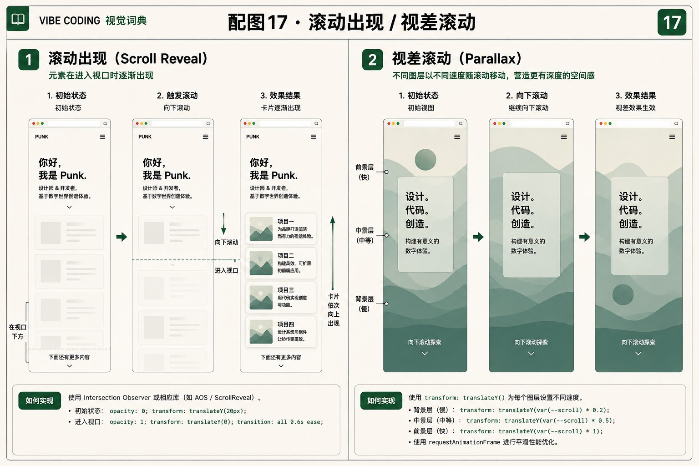
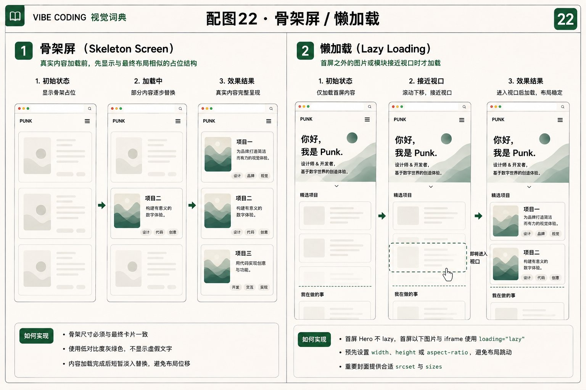
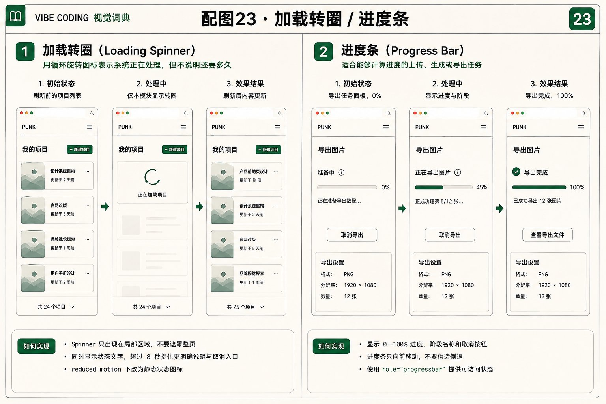
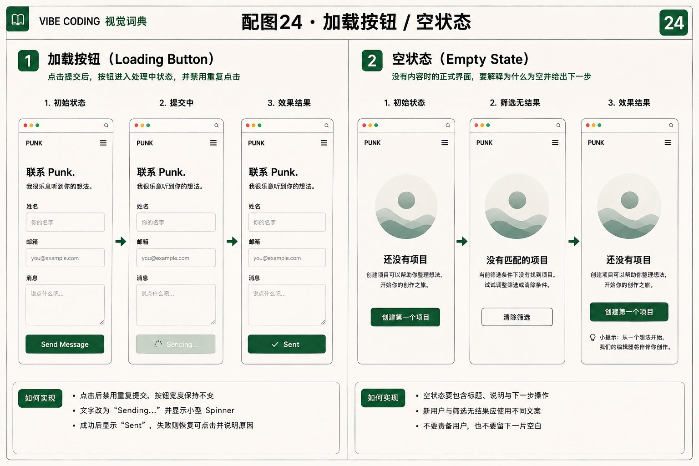
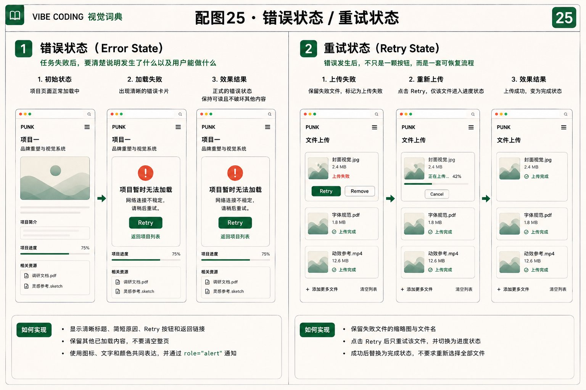
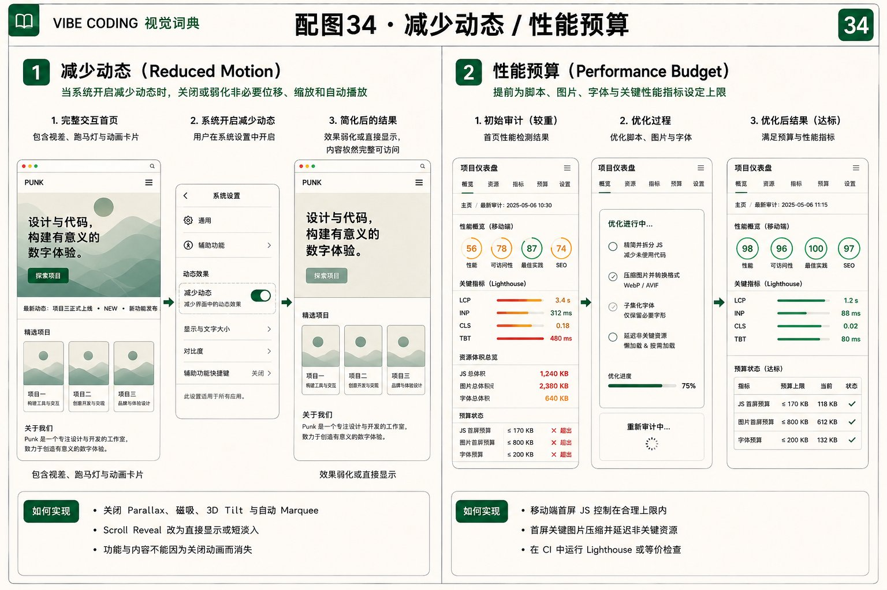

## 問題

向 Agent 說「加一點動效」或「做好載入」仍有太多歧義；需要明確交代觸發、過程、結束及失敗後能做什麼。

## 做法

*進入視口前後的內容與視差分層，均以三個狀態並排。*

*骨架屏對照最終內容，懶載入示意延後圖片出現。*

*轉圈只表達等待，進度條另外展示可計量的完成比例。*

*提交按鈕由預設到處理中再到完成；空狀態包含下一步入口。*

*錯誤卡片與重試入口、重試中的狀態並列比較。*

*減少動態示範與性能預算檢查放在同一教程圖中。*

- 已讀取原文章全文與十八張教程圖。文章把 41–80 號詞條分為滾動動作、提示載入、視覺風格與進階體驗；每個詞條包含概念、適用情境及給 AI 的描述方式。
- 教程圖延用同一綠色示範網站，不同做法以兩欄對照，每欄再用三個階段與箭頭呈現；比起只列效果名稱，能指出畫面在哪個時刻改變。
- 在等待類型中，Skeleton 對應最終內容骨架，Spinner 只表示處理中，Progress Bar 另有可量化進度；Loading Button 把提交、處理、完成留在同一控制項。
- Error 與 Retry 分成兩個詞條，圖中可見錯誤卡、重試入口與再次處理的狀態；空狀態另外提供建立內容的行動，不與錯誤混用。
- 文章將 Reduced Motion 與 Performance Budget 放在進階效果同章，而非只介紹 WebGL、傾斜卡片與遮罩。本次核對的是作者的圖解與文字，圖內時長、分數和數值都是示例，沒有獨立性能測量。

## 為什麼有效（推論）

在相同內容上比較不同狀態，可能讓需求討論聚焦於狀態差異，而非被不同配色或範例內容干擾。把重試也畫成一段流程，有機會避免只做一顆按鈕卻漏掉重試中的鎖定、再次失敗與成功回復。這些是對教程方法的解讀，沒有實際使用者測試。

## 借鑑要點

- **適合**：設計規格、Agent 任務說明、元件狀態盤點與非同步流程評審。
- **不適合**：把四十個詞條全部加到同一頁，或將圖中示例數值當成通用標準。
- **移植時注意**：對每個操作列出觸發 → 等待 → 成功／失敗 → 恢復；確定進度不可測時不要偽造百分比。保留鍵盤、觸控及減少動態版本；性能預算要以自己的裝置與內容實測。

## 來源與核對範圍

- [@AdrianPunk115 原貼文](https://x.com/AdrianPunk115/status/2084932520953753985)，發布 2026-08-05T09:20:23+00:00。
- [原始文章](https://x.com/i/article/2084692365483421696)，ArticleEntity metadata 首次發布 2026-08-05T09:20:23+00:00。
- 正文從作者原貼文頁的 SSR ArticleEntity／plain_text 取得；JavaScript 字串含 `\x3C`，正規化後才可解碼。沒有使用本地摘要補寫。
- 原始圖片從 ArticleEntity 的 media_entities 下載；十八張皆已檢視，本卡選存六張用於非同步狀態與動效邊界的具體對照。屬教程概念，非正式產品驗收。
