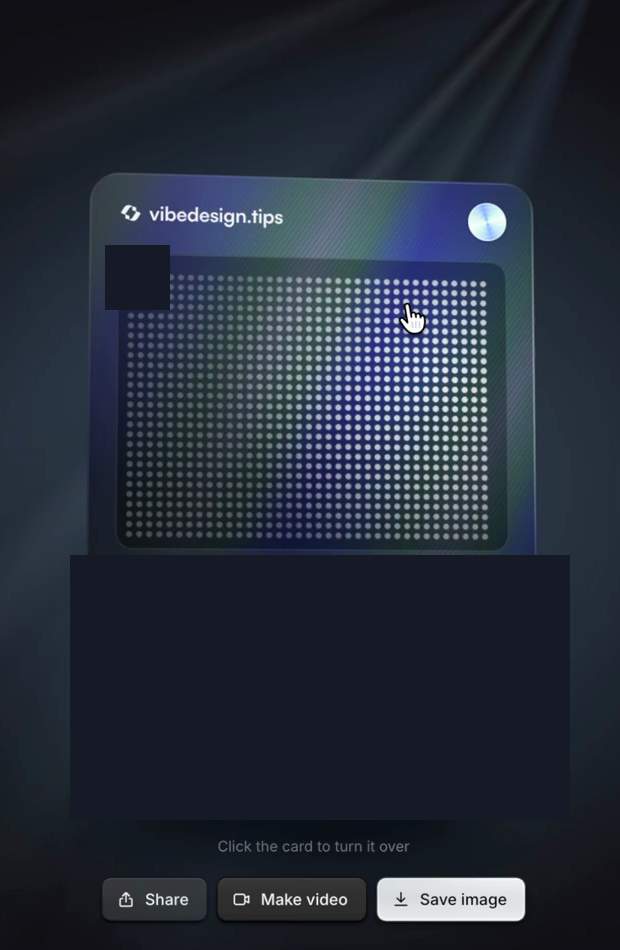
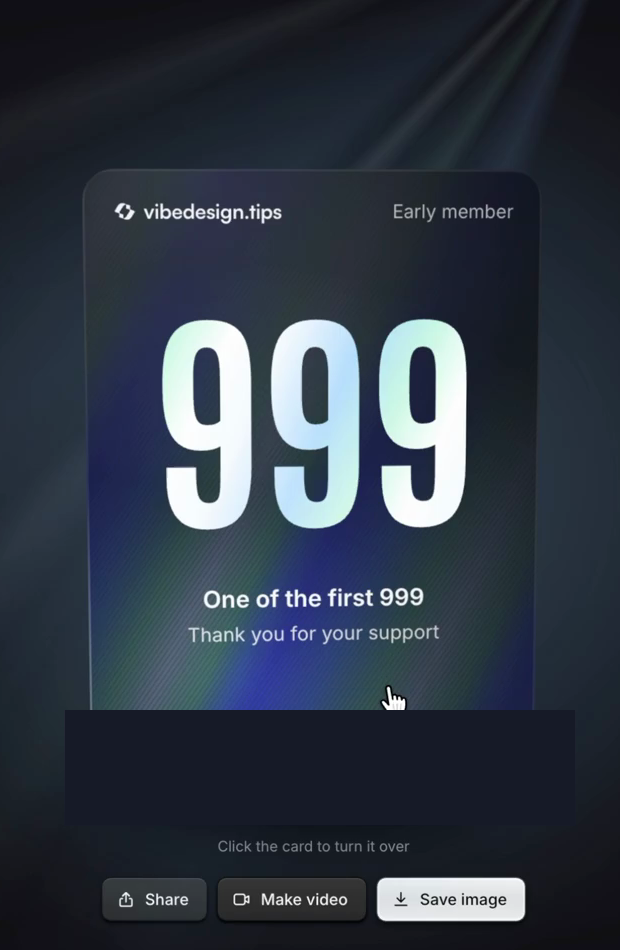
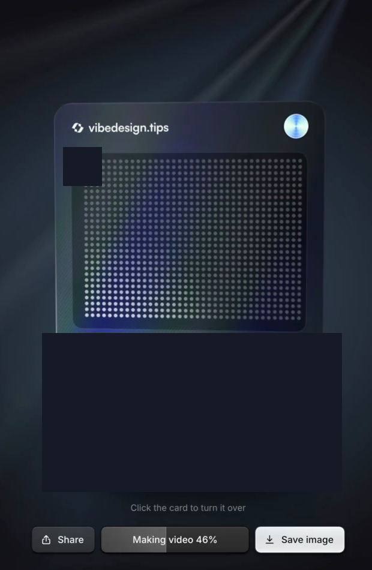
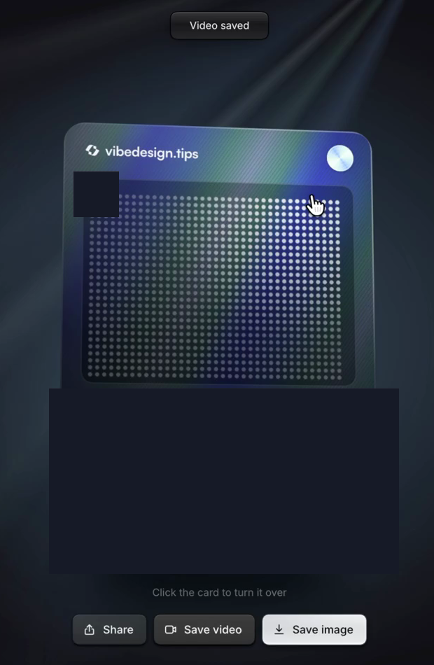

## 問題

早期會員的加入順序與支持紀錄需要變成可保存、可分享的紀念物。互動卡片在網頁上能傾斜與翻面，但分享給別人時，還需要清楚的靜態與動態匯出入口。

## 做法

本卡依作者公開的 32.138 秒示範觀察，不代表收錄者已建立會員卡或成功匯出。保留四張卡片專區關鍵畫面，裁去周邊介面；正面的姓名、個人編號、座位與點陣高亮位置，以及背面的個人編號均以不透明色塊遮蔽。大型 999 是全體早期會員名額的共同文案，不是持卡人編號。不保留會員名單、頭像、原始影片或完整 Prompt。

*6 秒：卡片正面保留點陣材質與 Share、Make video、Save image；個人識別區及點陣高亮位置已遮蔽。*

*9 秒：背面以共同名額 999、Early member 與致謝文字呈現早期會員身份；底部個人編號區已遮蔽，匯出按鈕仍在卡片外。*

*16 秒：中央操作改成 Making video 46%，卡片正面仍在預覽，Save image 保持可見。姓名、個人編號、座位及點陣高亮位置已遮蔽。*

*21 秒：頂部出現 Video saved 提示，中央按鈕變成 Save video；不能單憑此提示判定下載檔案內容。姓名、個人編號、座位及點陣高亮位置已遮蔽。*

- **預覽觸發 → 變化 → 結束**：示範中游標在卡面移動，卡片傾斜並改變彩色反光；點按後經側面轉至另一面，再停留於正面或背面。頁面提示 Click the card to turn it over。
- **影片匯出觸發 → 進度 → 完成**：影片先呈現 Make video，再展示不同角度的卡片與百分比進度，最後呈現 Video saved 和 Save video。這是作者錄影中實際可見的狀態序列，不是本次端到端下載驗證。
- **圖片與分享**：同一列可見 Save image 和 Share。本次沒有足以核對圖片檔或分享結果的證據。
- **作者聲明**：主帖宣布紀念卡已上線、可匯出圖片／影片及支援手機陀螺儀。註冊與社群人數也僅為當日作者說法，不作產品成效證據。
- **公開網站靜態核對**：2026-11-21 讀取官網首頁及其載入的 account.js；其中引用 member-card.js，包含紀念卡入口與匯出狀態文案。member-card.js 公開程式含 PNG 產生、MediaRecorder 格式判斷及 DeviceOrientationEvent 權限分支。這只證明公開程式存在，不證明各瀏覽器匯出、權限取得或實機感測成功；本次瀏覽器不可用，未登入或送出個人資料。

## 為什麼有效（推論）

- 正面的編號、點陣位置與背面的致謝分工，可能同時保留個人識別感與群體歸屬感。
- 把匯出操作放在卡面外，預覽時可保留物件感；製作中直接把同一按鈕改為百分比，可能減少使用者重複觸發。
- 靜態圖片與影片提供兩種保存形式，但沒有分享率、下載成功率或手機效能數據。

## 借鑑要點

- **適合**：早期支持者、活動參與者或里程碑的紀念憑證；有明確紀念內容，且使用者確實需要保存或分享。
- **不適合**：單純教程索引或高頻資訊列表；也不能把示範的編號與座位當成實際存取權限。
- **移植時注意**：先定義卡片內容、隱私範圍與圖片／影片輸出，再加傾斜效果。提供製作中、失敗、重試與下載完成狀態；裝置方向互動應另設權限說明與靜態替代。這些是移植建議，非本次已驗證行為。

## 來源與去重

- [作者主帖](https://x.com/Kubai087/status/2124108673089986975)：2026-11-21T11:52:26Z。已與指定公開個人資料快照及主帖官方 HTML 同 ID 內容核對。
- [作者直接回覆](https://x.com/Kubai087/status/2124108727192347131)：2026-11-21T11:52:39Z，連結至[官方網站](https://vibedesign.tips/)。
- [公開紀念卡資產](https://vibedesign.tips/assets/member-card.js)：僅讀取，未執行會員操作。
- 與 [018 全息卡片](../kubai-999-018-holographic-card/case.md)共用傾斜與翻面表現，但 018 是 Aster 材質示範，本例為 Vibe Design Tips 早期會員紀念物與影片匯出流程，故另建卡。
- 與[雜誌式教程索引](../kubai-magazine-design-notes/case.md)同產品，但本例不處理教程查找、Prompt／Skill 或教程打包下載；紀念卡匯出流程不同，故不併入該卡，亦未修改該目錄。
