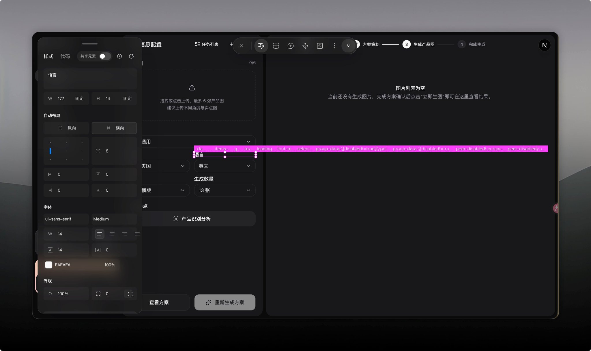

## 問題

設計者想調整既有網頁樣式時，如何把「這個元素」和具體樣式值一起交給編碼 Agent？

## 做法

- 附圖左側是樣式屬性面板，中間另有元素相關面板，右側是被檢視頁面；選中的水平元素以高亮框標出。
- 屬性面板包含間距、尺寸和字體等分組，底部有產生／複製描述的操作。作者表示可將 prompt 複製給其他 AI 工具進行還原。
- 引用的 OpenAI 原帖展示另一個 advanced annotation mode；本卡記錄發文者自己的附圖，不把兩個工具的功能或實作混為一談。

*選取框標出頁面元素，左側以屬性分組提供樣式調整。*

## 為什麼有效（推論）

先選元素再調整屬性，可能讓語言描述帶上清楚目標；可複製的交接內容有助於跨工具，但不保證 Agent 實作完全一致。

## 借鑑要點

- **適合**：視覺回饋、樣式微調與設計到編碼的交接。
- **不適合**：牽涉業務邏輯、資料狀態或跨頁資訊架構的改動。
- **移植時注意**：複製內容要包含穩定定位和預期結果，排除憑證與個人頁面資料；實作後要核對響應式及不同狀態。

## 來源與核對範圍

- [原帖 2059110885533381014](https://x.com/xin_pai88825/status/2059110885533381014)：已核對 X 官方公開 HTML 內嵌的同 ID Tweet／NoteTweet 正文；發佈時間為 2026-05-26T03:14:26+00:00。
- 已下載並檢視原始媒體；影片僅保留關鍵影格，沒有保存原始影片。媒體出處與擷取時間見本目錄 `evidence.json`。
- 本卡只把貼文文字、附圖與錄影可確認的內容列為觀察；未執行產品驗收，效果解讀列為推論。
