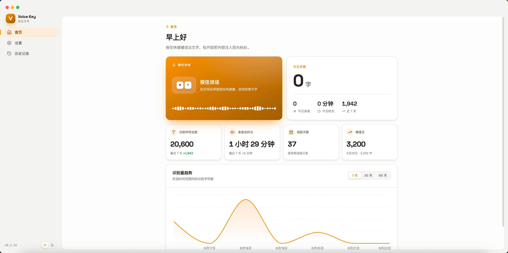
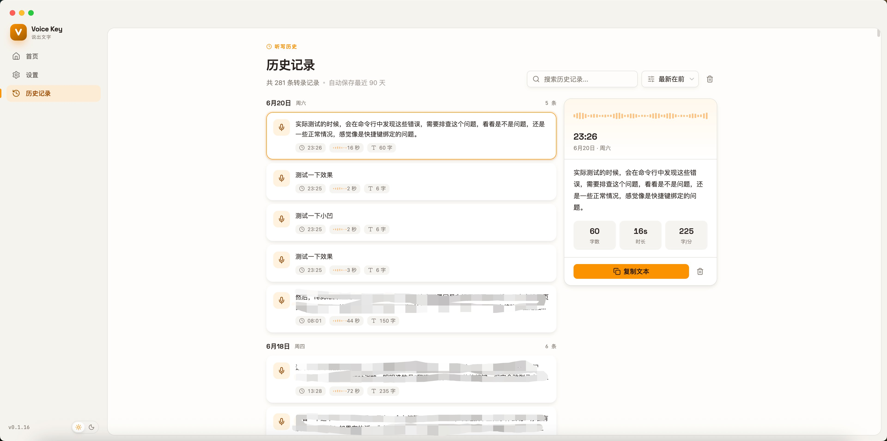
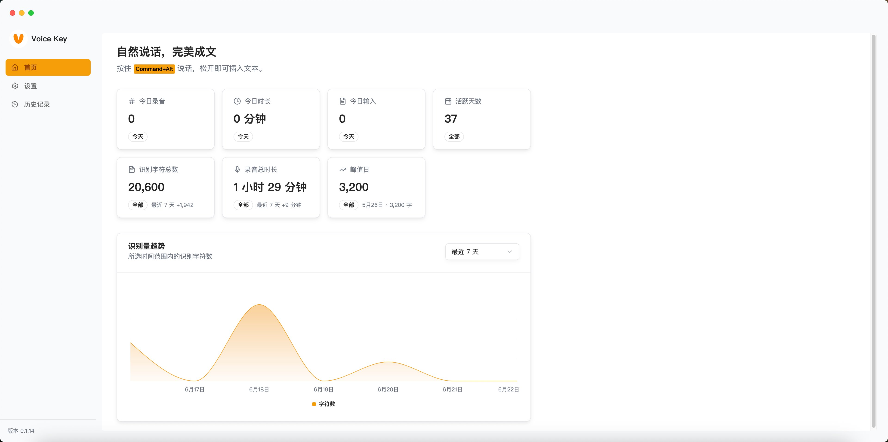

## 問題

語音輸入工具累積使用數據與歷史文字後，同一頁需要兼顧概況掃讀和單筆內容檢視。

## 做法

*改稿後以暖色主卡和次級數字卡建立概況層次。*

*歷史清單與右側詳情並排，選取項被框出。*

*原版使用同尺寸統計卡及下方趨勢圖。*

- 作者把前兩張稱為改稿後、第三張稱為原版；改稿後保留左側窄導覽，主區上方以暖色大卡和相鄰數字卡建立概況層次，下方配置趨勢圖。
- 歷史頁把多筆記錄排在左側主清單，選取項有暖色邊框；右側較窄區顯示單筆文字內容與操作。
- 原版概況把相近數字放在一組同尺寸卡片中，頁面留白較多。圖片能比較版面層次，不能證明可用性、準確率或效能已提升。

## 為什麼有效（推論）

以主卡突出最常看的資訊、次要數字保持較小，有機會縮短概況掃描；歷史清單旁保留詳情可減少開啟單筆後失去列表位置的情況。

## 借鑑要點

- **適合**：語音轉錄、使用統計與經常回看單筆記錄的桌面工具。
- **不適合**：手機窄螢幕直接照搬兩欄詳情，或用不同尺度卡片暗示並不存在的指標重要性。
- **移植時注意**：依真實任務決定首要數字；為選取狀態提供色彩以外的標記。窄螢幕改成列表進詳情，回退後保留捲動位置。

## 來源與核對範圍

- [pzx553 原文](https://x.com/pzx553/status/2068899205033115970)（發布：2026-06-22T03:29:43+00:00）。

已核對 X 公開原文的嵌入式 Tweet／NoteTweet 資料及本卡所列原始素材。`kind: concept` 表示本次僅確認公開展示／設計方法，沒有把示範等同正式上線或端到端驗證。
