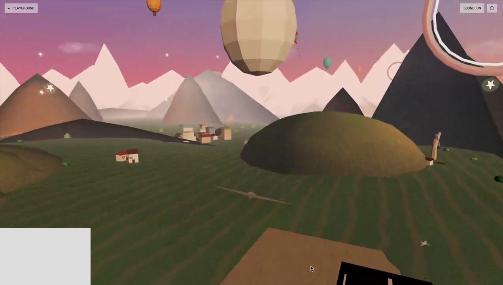
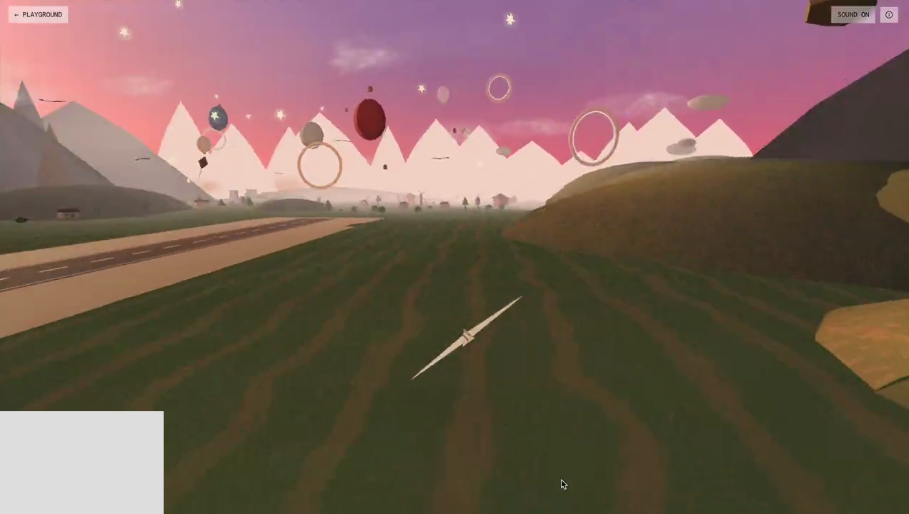
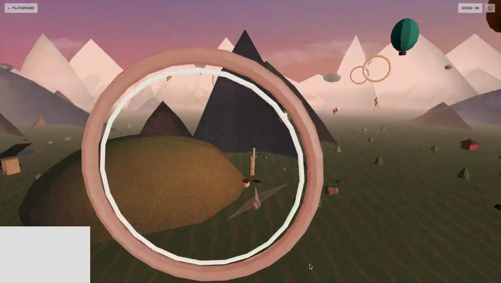

## 問題

用身體控制遊戲時，使用者需要看得見自己的姿勢如何影響虛擬物件，否則難以校準。

## 做法

*滑翔場景包含地形、熱氣球與空中目標，小窗已遮除。*

*飛行方向改變，地形與圓環仍提供導向。*

*接近大型圓環的後段場景，小窗已遮除。*

- 作者明確說用 webcam 飛行；原影片起始示範者張開雙臂，遊戲後段以第三人稱滑翔物件穿越山丘、熱氣球和空中圓環。
- 遊戲畫面左下原有即時攝影機小窗，讓身體輸入與主場景同時可見；為避免保存人物影像，卡片素材已遮除攝影機小窗，起始人物鏡頭不收錄。
- 可見飛行方向和視角隨過程改變，後段接近大圓環。影片無法證明精確的姿勢對應算法、延遲、成功判定或可及性。

## 為什麼有效（推論）

把輸入回饋與遊戲結果置於同一畫面，可能讓使用者自行理解控制映射；場景中的圓環也提供明確的空間目標。

## 借鑑要點

- **適合**：體感互動原型、展覽裝置與非精細的方向控制遊戲。
- **不適合**：需要快速精準輸入、使用者無法伸展雙臂，或攝影機環境不穩定的任務。
- **移植時注意**：提供鍵盤／觸控替代與重新校準；攝影機權限、處理位置和停止狀態要清楚。不能只以健全姿勢作為唯一通關條件。

## 來源與核對範圍

- [pauline_makes 原文](https://x.com/pauline_makes/status/2093453084814901435)（發布：2026-08-28T21:38:04+00:00）。

已核對 X 公開原文的嵌入式 Tweet／NoteTweet 資料及本卡所列原始素材。`kind: concept` 表示本次僅確認公開展示／設計方法，沒有把示範等同正式上線或端到端驗證。
