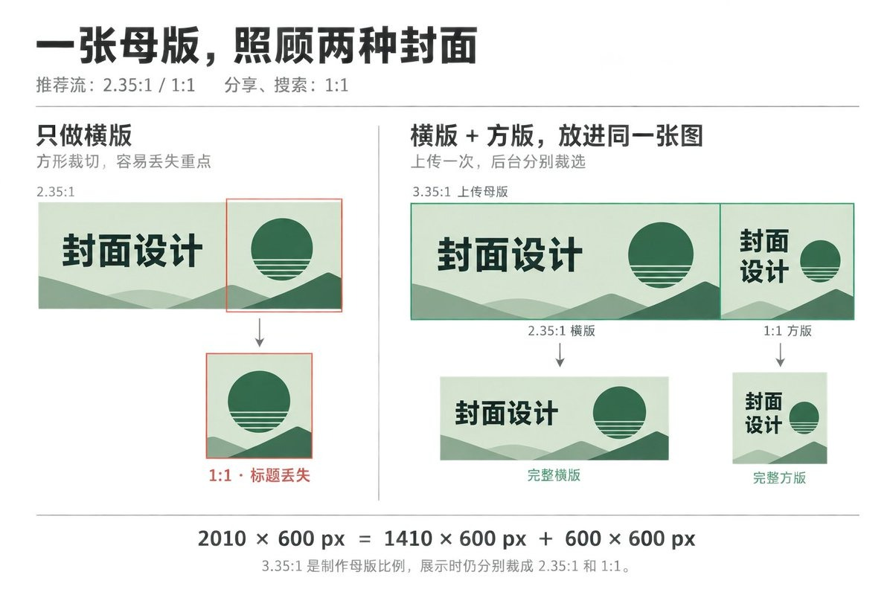

## 問題

只上傳一張封面，卻會在不同比例的入口展示，導致標題或主體被裁掉。

## 做法

- 原帖指出入口同時存在 2.35:1 與 1:1 封面，後台只上傳一張圖片。
- 示意圖把 3.35:1 母版分為左側 2.35:1 橫版與右側 1:1 方版，各自放入完整構圖。例子為 2010×600 = 1410×600 + 600×600；上傳後需分別裁選，並非把全部內容集中於中央。
- 3.35:1 是作者建議，並非本卡驗證過的平台規格。移植時應從實際裁切結果確認安全區。

### 已檢視的素材

*母版右側另放方版構圖；示意以 2010×600 分為 1410×600 橫版與 600×600 方版，再分別裁選。*

## 為什麼有效（推論）

同時考慮多種裁切可避免主體只在一種入口完整；效果取決於平台實際裁切方式。

## 借鑑要點

- **適合**：同素材多入口發布。
- **不適合**：各入口容許獨立上傳封面的系統。
- **移植時注意**：依平台支援分別裁選橫版與方版，讓兩塊各有完整標題；用真實預覽檢查，不以比例建議取代驗證。

## 來源與核實

- [原帖](https://x.com/loooool_fun/status/2101916962783994340)：已取得 X 公開頁面內嵌原始 Tweet / NoteTweet 資料，按相同 status ID 核對正文。
- 本卡的「做法」依原帖文字與已檢視素材撰寫；沒有執行產品功能驗收，效果解讀列為推論。
- 原帖內引用來源：https://x.com/loooool_fun/status/2101870879177429051。
