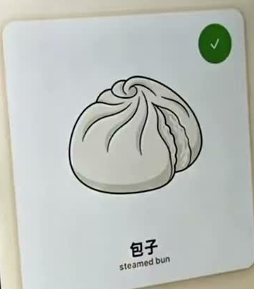
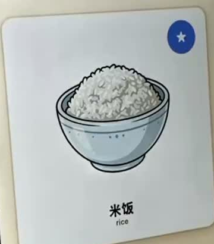
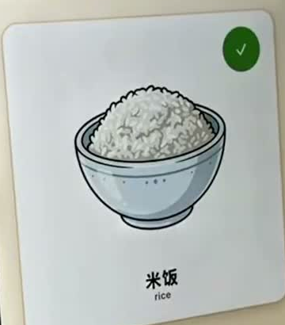

## 問題

兒童陪伴應用需要在開放對話與有明確下一步的教學活動之間切換，避免把所有任務都塞在對話文字裡。

## 做法

*約 29 秒：深色背景中央只有雲朵角色；裁掉下方對話與控制紀錄。*

*約 322 秒：教學卡以包子線稿搭配中英文詞名，右上顯示綠色勾號。*

*約 439 秒：米飯教學卡右上顯示藍色星形圖示。*

*約 497 秒：同一米飯卡右上改為綠色勾號。*

**影片觀察**：前段為角色陪伴畫面，後段切到淺色單卡，主圖占大部分面積，詞名放在圖下；米飯卡先出現藍色星形圖示，稍後變為綠勾。影格未涵蓋完整辨識過程，不能據此認定綠勾由哪一個語音判斷觸發。

**作者說明**：這是家庭自用的 iPad 陪伴應用，另提及人格、記憶及家長控制台；影片與卡片不作為這些能力已驗收的證據。保守列為 concept，未確認公開發行。影像只保留角色與食物卡片，不保存兒童臉孔、姓名或對話內容。

## 為什麼有效（推論）

把練習獨立成單張卡，可能讓「看圖—說詞—獲得回饋」比長對話更容易追蹤；角色與卡片切換也能區分陪伴和練習模式。未驗證學習效果。

## 借鑑要點

- **適合**：有簡短目標的親子圖像教學探索。
- **不適合**：把情緒判斷或危險辨識宣稱直接當成兒童安全保障。
- **移植時注意**：明確顯示錄音狀態與退出入口；家長資料與兒童操作分離，失敗時提供可理解的重試提示。

## 來源與核對範圍

- [原帖 2088614153003192438](https://x.com/CryptoPainter/status/2088614153003192438)：已核對 X 官方公開頁面內嵌 Tweet／NoteTweet 快取。

- 本卡根據來源文字與已檢視媒體記錄，沒有執行產品功能驗收；作者成效宣稱不視為獨立測試。
